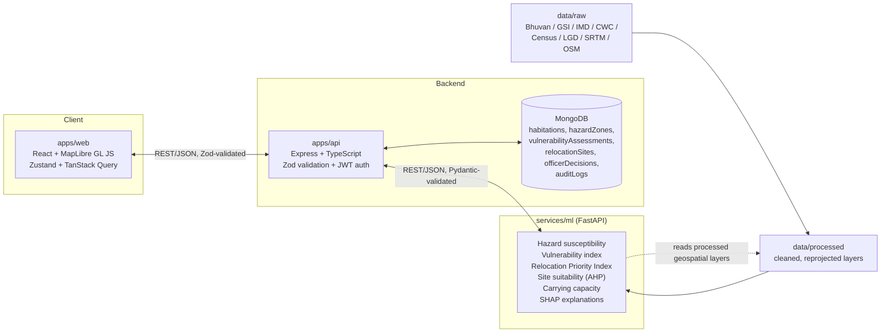

# Architecture

## System Overview

PunarVas is three deployable services sharing one MongoDB database and one
TypeScript type contract:

- **`apps/web`** — the officer-facing map and decision workbench.
- **`apps/api`** — the system of record: auth, CRUD, orchestration, and the
  audit trail. Talks to MongoDB directly and to `services/ml` over HTTP.
- **`services/ml`** — a stateless scoring service. Given inputs, it returns
  hazard/vulnerability/priority/suitability/capacity scores and their
  explanations. It does not own persistent state.

## Data Flow: Raw Data to Officer Decision

1. **Acquisition.** Raw datasets (satellite imagery, DEM, rainfall, census,
   habitation codes — see `docs/DATA_SOURCES.md`) are downloaded into
   `data/raw/`, untouched, with provenance recorded.
2. **Processing.** Scripts in `services/ml` clean, reproject, and merge
   `data/raw/` into analysis-ready layers in `data/processed/` (e.g. a
   single GeoDataFrame of habitations with hazard covariates attached).
3. **Scoring (`services/ml`).** FastAPI endpoints run the weighted-overlay
   - ML susceptibility model to classify hazard zones, then the
     vulnerability index, then the Relocation Priority Index, then site
     suitability and carrying-capacity models for candidate relocation
     sites. Every score returns alongside a SHAP-based explanation of which
     inputs drove it.
4. **Orchestration & persistence (`apps/api`).** The API calls
   `services/ml` for scores, persists the results as `status: "pending"`
   recommendation documents in MongoDB, and exposes them over a
   Zod-validated REST API. The API — never the ML service — owns
   authentication, authorization, and the audit trail.
5. **Officer decision workbench (`apps/web`).** An authenticated officer
   views ranked, mapped recommendations (hazard zone, vulnerability
   breakdown, RPI, candidate sites with capacity and binding constraint,
   and the SHAP explanation). The officer approves or overrides each
   recommendation; overriding requires a written justification.
6. **Audit trail.** Every decision (approve or override) is written by
   `apps/api` as an append-only document in the `auditLogs` collection,
   capturing who, when, what changed, and why. Nothing in this pipeline
   auto-executes a relocation — the officer decision is the terminal,
   human step, by design (see "Human-in-the-Loop" below).

## Human-in-the-Loop Principle

The ML service produces _recommendations_, never decisions. `apps/api`
enforces this structurally: a recommendation document cannot transition
out of `"pending"` status except through an authenticated officer action
that supplies a justification string, and that transition is what
triggers the audit log write. This is a deliberate design constraint, not
an implementation detail — see `docs/METHODOLOGY.md` and the roadmap in
`CLAUDE.md` (Step 11–12).

## Why Python Is a Separate Service

`services/ml` is intentionally a separate FastAPI process rather than
logic embedded in `apps/api`, for concrete technical reasons:

- **Ecosystem fit.** `geopandas`, `rasterio`, `scikit-learn`, `XGBoost`,
  and `SHAP` are Python-native. Their Node/JS equivalents are either
  immature, unmaintained, or missing entirely (e.g. there is no serious
  JS equivalent of `rasterio` for reading GeoTIFF/DEM rasters). Rewriting
  this tooling in TypeScript is not realistic for a hackathon timeline,
  and would still lag the Python ecosystem afterward.
- **Independent scaling and deployment.** Scoring workloads (raster
  processing, model inference) are CPU/memory-bound and bursty in a
  different way than the API's request/response traffic. Running them as
  a separate process lets each service be scaled, profiled, and deployed
  independently.
- **Clean boundary = testable contract.** A network boundary (REST +
  Pydantic validation on the way in, JSON schema on the way out) forces
  the scoring logic to have an explicit, versionable input/output
  contract, rather than becoming tangled with Express request handling.
- **Language-appropriate strengths.** TypeScript's strengths (end-to-end
  type safety with `packages/shared`, Zod validation, JWT/session
  handling) apply to `apps/web` and `apps/api`. Python's strengths
  (numerical/geospatial libraries, notebook-friendly iteration for model
  development) apply to `services/ml`. Keeping them separate lets each
  side use its language idiomatically instead of compromising both.

## Service Boundaries (What Each Owns)

| Concern                                                | Owner             |
| ------------------------------------------------------ | ----------------- |
| Authentication / JWT / sessions                        | `apps/api`        |
| Authorization / roles                                  | `apps/api`        |
| MongoDB persistence                                    | `apps/api`        |
| Audit trail                                            | `apps/api`        |
| REST API surface for the frontend                      | `apps/api`        |
| Hazard/vulnerability/RPI/suitability/capacity scoring  | `services/ml`     |
| Explainability (SHAP)                                  | `services/ml`     |
| Raster/vector geospatial processing                    | `services/ml`     |
| Map rendering, officer UI, client-side state           | `apps/web`        |
| Shared TS types/constants (contract between web & api) | `packages/shared` |
