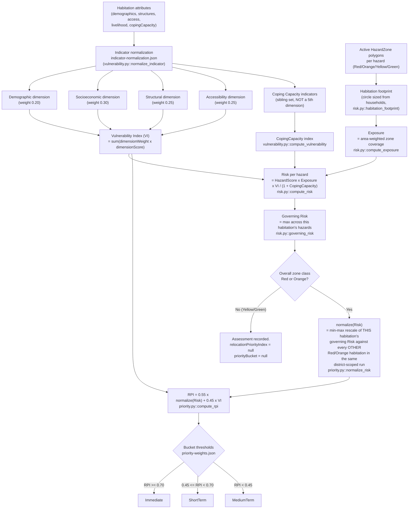

# Scoring Pipeline

How a habitation's raw attributes become a Relocation Priority Index (RPI)
and a priority bucket — every stage, every formula, and one fully worked
numeric example so a judge (or an officer) asking "how did you get this
number" gets an exact, reproducible answer.

This document is the implementation-level companion to
[`docs/METHODOLOGY.md`](./METHODOLOGY.md) (the model design and its
justification) — read METHODOLOGY first for _why_ the formulas are shaped
this way; read this document for exactly _how_ the code computes them,
file by file.

All figures below come from a real pipeline run against the seeded
Wayanad demo dataset (`SYNTHETIC_DEMO` — see CLAUDE.md's constraints: this
is a synthetic-but-plausible dataset, never real historical hazard/impact
data).

## 1. Pipeline stages



| Stage | Module | METHODOLOGY section |
| --- | --- | --- |
| Indicator normalization | `services/ml/app/engine/vulnerability.py::normalize_indicator` | §2.1 |
| Vulnerability Index (VI) | `vulnerability.py::compute_vulnerability` | §2 |
| Coping Capacity | `vulnerability.py::compute_vulnerability` | §2.2 |
| Habitation footprint + Exposure | `services/ml/app/engine/risk.py::habitation_footprint`, `compute_exposure` | §0 |
| Risk (per hazard) + Governing Risk | `risk.py::compute_risk`, `governing_risk` | §0 |
| normalize(Risk) | `services/ml/app/engine/priority.py::normalize_risk` | §3 (implementation note) |
| RPI + bucket | `priority.py::compute_rpi`, `bucket_for_rpi` | §3, §3.1 |
| Additive explanation | `priority.py::rpi_contributions` | §3 |
| Persistence (versioned) | `apps/api/src/lib/assessmentVersioning.ts` | — |
| Orchestration (grid → zones → assessments) | `apps/api/src/lib/jobs/pipelineJob.ts`, `assessmentStage.ts` | — |

Two implementation notes not obvious from the formulas alone:

- **Exposure is area-weighted, not point-in-polygon.** A habitation's
  built-up footprint is modeled as a circle (sized from
  `households x capacity-norms.json`'s per-household land norm, centered
  on the habitation's centroid, corrected for longitude foreshortening at
  that latitude — a circle in meters, not degrees) and intersected
  against each active hazard zone class. The area-weighted coverage is
  then scaled by a fixed per-class intensity weight (Red 1.0, Orange 0.7,
  Yellow 0.35, Green 0.05) and summed, so a habitation straddling a zone
  boundary gets a genuinely fractional exposure instead of an
  all-or-nothing 0/1.
- **`normalize(Risk)` is a within-run relative ranking, not an absolute
  score.** See §3's implementation note in `docs/METHODOLOGY.md` for why:
  raw `Risk` is multiplicative in VI (`Risk <= VI` always), so treating
  `normalize(Risk)` as a no-op made RPI structurally capped below every
  realistic VI value and no habitation could ever reach Immediate. It is
  instead min-max rescaled against the other Red/Orange habitations
  assessed in the same district-scoped pipeline run — so RPI ranks
  habitations against their own run/district, and is not a number
  comparable across two different districts or two different runs.

## 2. Worked example: Chooralmala (Wayanad)

Chooralmala is one of the Kerala pilot's two centrepiece habitations
(alongside Mundakkai). This is the exact arithmetic the pipeline produced
for it in the run with `modelVersion: "assessment-v1-1788499820396"`
(`computedAt: 2026-09-04T05:30:20.398Z`) — every number below is
reproducible from `GET /api/v1/habitations/{chooralmalaId}` and
`GET /api/v1/priorities?districtId={wayanadId}` against the seeded dev
dataset.

### 2.1 Raw habitation attributes

| Field | Value |
| --- | --- |
| `demographics.shareUnder5` | 0.07 |
| `demographics.shareOver60` | 0.13 |
| `demographics.womenHeadedHouseholdShare` | 0.11 |
| `demographics.disabledPersonsShare` | 0.03 |
| `demographics.bplShare` | 0.35 |
| `demographics.scStShare` | 0.46 |
| `demographics.literacyRate` | 0.69 |
| `livelihood.primaryLivelihoodDependenceShare` | 0.61 |
| `structures.kutchaHousingShare` | 0.33 |
| `structures.avgBuildingAgeYears` | 20 |
| `structures.predominantFoundationType` | `STONE_MASONRY` |
| `access.distanceToAllWeatherRoadKm` | 2.5 |
| `access.distanceToPhcKm` | 8.15 |
| `access.mobileNetworkCoverage` | 0.68 |
| `access.evacuationRouteCount` | 1 |
| `copingCapacity.sdrfResponseTimeMinutes` | 79.8 |
| `copingCapacity.shelterWithin2km` | `true` |
| `copingCapacity.communityTaskForcePresent` | `false` |
| `copingCapacity.earlyWarningCoverage` | 0.785 |

### 2.2 Indicator normalization

Every indicator's raw value → [0,1], per
`indicator-normalization.json`'s `method`/`min`/`max`/`direction` for that
indicator (`vulnerability.py::normalize_indicator`):

| Indicator | Method | Raw → clamped/scaled | Direction | Normalized |
| --- | --- | --- | --- | --- |
| `shareUnder5` | MINMAX [0,1] | 0.07 | DIRECT | **0.07** |
| `shareOver60` | MINMAX [0,1] | 0.13 | DIRECT | **0.13** |
| `womenHeadedHouseholdShare` | MINMAX [0,1] | 0.11 | DIRECT | **0.11** |
| `disabledPersonsShare` | MINMAX [0,1] | 0.03 | DIRECT | **0.03** |
| `bplShare` | MINMAX [0,1] | 0.35 | DIRECT | **0.35** |
| `scStShare` | MINMAX [0,1] | 0.46 | DIRECT | **0.46** |
| `literacyRateInverse` | MINMAX [0,1] | 0.69 | INVERSE (1 − x) | **0.31** |
| `primaryLivelihoodDependenceShare` | MINMAX [0,1] | 0.61 | DIRECT | **0.61** |
| `kutchaHousingShare` | MINMAX [0,1] | 0.33 | DIRECT | **0.33** |
| `buildingAgeIndex` | REFERENCE_RANGE [0,60] yrs | 20 → 20/60 | DIRECT | **0.333333** |
| `foundationTypeRisk` | MINMAX [0,1] | `STONE_MASONRY` → 0.30 (fixed lookup) | DIRECT | **0.30** |
| `distanceToAllWeatherRoad` | REFERENCE_RANGE [0,10] km | 2.5 → 2.5/10 | DIRECT | **0.25** |
| `distanceToPHC` | REFERENCE_RANGE [0,15] km | 8.15 → 8.15/15 | DIRECT | **0.543333** |
| `mobileNetworkCoverageInverse` | MINMAX [0,1] | 0.68 | INVERSE (1 − x) | **0.32** |
| `evacuationRouteRedundancyInverse` | REFERENCE_RANGE [0,4] routes | 1 → 1/4 = 0.25 | INVERSE (1 − x) | **0.75** |
| `sdrfResponseTimeInverse` | REFERENCE_RANGE [15,180] min | 79.8 → (79.8−15)/165 = 0.392727 | INVERSE (1 − x) | **0.607273** |
| `shelterWithin2kmPresence` | BOOLEAN | `true` | DIRECT | **1.0** |
| `communityTaskForcePresence` | BOOLEAN | `false` | DIRECT | **0.0** |
| `earlyWarningCoverage` | MINMAX [0,1] | 0.785 | DIRECT | **0.785** |

### 2.3 Vulnerability dimensions and VI

Each dimension score = Σ(indicator weight × normalized indicator),
weights from `vulnerability-weights.json`:

**Demographic** (dimension weight 0.20):

```
0.07×0.30 + 0.13×0.25 + 0.11×0.20 + 0.03×0.25
= 0.021 + 0.0325 + 0.022 + 0.0075 = 0.083000
```

**Socioeconomic** (dimension weight 0.30):

```
0.35×0.35 + 0.46×0.20 + 0.31×0.20 + 0.61×0.25
= 0.1225 + 0.092 + 0.062 + 0.1525 = 0.429000
```

**Structural** (dimension weight 0.25):

```
0.33×0.45 + 0.333333×0.25 + 0.30×0.30
= 0.1485 + 0.083333 + 0.09 = 0.321833
```

**Accessibility** (dimension weight 0.25):

```
0.25×0.30 + 0.543333×0.30 + 0.32×0.20 + 0.75×0.20
= 0.075 + 0.163 + 0.064 + 0.15 = 0.452000
```

**VI** = Σ(dimension weight × dimension score):

```
VI = 0.20×0.083000 + 0.30×0.429000 + 0.25×0.321833 + 0.25×0.452000
   = 0.016600 + 0.128700 + 0.080458 + 0.113000
   = 0.338758
```

### 2.4 Coping Capacity

CopingCapacity indicators are a **sibling set to the four VI dimensions**
— never a fifth dimension, and never subtracted from VI. They exist for
exactly one purpose: the Risk formula's divisor (§2.5). Weights from
`vulnerability-weights.json`'s `copingCapacity` block:

```
CopingCapacity = 0.25×0.607273 (sdrfResponseTimeInverse)
               + 0.30×1.0      (shelterWithin2kmPresence)
               + 0.20×0.0      (communityTaskForcePresence)
               + 0.25×0.785    (earlyWarningCoverage)
               = 0.151818 + 0.3 + 0 + 0.19625
               = 0.648068
```

### 2.5 Exposure and Risk per hazard

Chooralmala's habitation footprint (a circle sized from its 194
households) was intersected against Wayanad's three active hazard zones,
giving an area-weighted exposure per hazard (§1's note: Red zone coverage
counts fully, Orange at 0.7, per `risk.py`'s `ZONE_INTENSITY`):

| Hazard | HazardScore (blended) | Zone class | Exposure | Risk = HazardScore × Exposure × VI / (1 + CopingCapacity) |
| --- | --- | --- | --- | --- |
| cloudburst | 0.860284 | Red | 1.0 | **0.176830** |
| landslide | 0.730858 | Red | 1.0 | 0.150226 |
| flood | 0.621661 | Orange | 0.7 | 0.089448 |

Worked out for the governing hazard (cloudburst):

```
Risk_cloudburst = 0.860284 × 1.0 × 0.338758 / (1 + 0.648068)
                = 0.291428 / 1.648068
                = 0.176830
```

**Governing Risk** = max across hazards = **0.176830 (cloudburst)** —
this is Chooralmala's `compositeRiskScore` and `governingHazard`.
Overall zone class = **Red** (worst class across its three hazards).

### 2.6 normalize(Risk) — batch-relative rescaling

Chooralmala's zone class is Red, so it is RPI-eligible. Its governing
Risk (0.176830) is rescaled against the governing Risk of every other
Red/Orange habitation in the **same run, same district** (Wayanad; 21
Red/Orange habitations in this run):

```
min_risk (Kaniyambetta)  = 0.072406
max_risk (Kottathara)    = 0.267839

normalize(Risk) = (0.176830 − 0.072406) / (0.267839 − 0.072406)
                = 0.104425 / 0.195433
                = 0.534324
```

### 2.7 RPI and bucket

```
RPI = W_r × normalize(Risk) + W_v × VI
    = 0.55 × 0.534324 + 0.45 × 0.338758
    = 0.293878 + 0.152441
    = 0.446319
```

`0.45 ≤ 0.446319 < 0.70` → **bucket: MediumTerm**.

### 2.8 Explanation (exact additive decomposition)

`priority.py::rpi_contributions` re-expands RPI into every leaf term —
the risk term plus `W_v × dimensionWeight × indicatorWeight ×
normalized_indicator` for all sixteen VI indicators — and returns the
top 5 by `|contribution|`. This is exact linear algebra, not an
approximation: the terms literally sum to RPI (up to the omitted smaller
terms). The five actually returned for Chooralmala:

| Factor | Contribution | Derivation |
| --- | --- | --- |
| Hazard risk (relative to batch) | 0.293878 | `0.55 × 0.534324` |
| Dependence on a single primary livelihood | 0.020588 | `0.45 × 0.30 × 0.25 × 0.61` |
| Distance to the nearest PHC | 0.018338 | `0.45 × 0.25 × 0.30 × 0.543333` |
| Lack of alternate evacuation routes | 0.016875 | `0.45 × 0.25 × 0.20 × 0.75` |
| Share of kutcha (non-permanent) housing | 0.016706 | `0.45 × 0.25 × 0.45 × 0.33` |

**Why Chooralmala lands in MediumTerm, not Immediate**, is a separate,
already-diagnosed finding — not a bug in this arithmetic. See
`docs/METHODOLOGY.md` §3's implementation note and `priority.py`'s module
docstring: within this run's Wayanad batch, the habitations that
outrank Chooralmala are governed by **cloudburst**, whose synthetic
Red-zone hazard scores run higher than landslide's in this dataset (an
artifact of each hazard's Commit-1 label calibration being tuned
independently to its own AUC target), and those habitations also carry
higher VI. Chooralmala's own governing hazard is also cloudburst here —
its risk is real, just not the highest in its batch. This was diagnosed
and reported plainly rather than tuned away, per this project's standing
instruction not to force a particular answer.

## 3. Reproducing this example

Against the seeded dev dataset:

```
POST /api/v1/pipeline/run   { "districtId": "<wayanad district id>" }
GET  /api/v1/habitations/<chooralmala id>/assessment
GET  /api/v1/habitations/<chooralmala id>/explain
GET  /api/v1/priorities?districtId=<wayanad district id>&pageSize=100
```

The last call returns every Red/Orange Wayanad habitation's
`compositeRiskScore` for this run — `min`/`max` across that list is
exactly §2.6's `min_risk`/`max_risk`.
