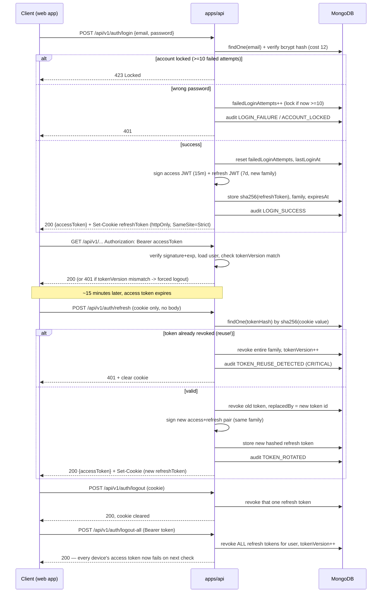

# Security

Authentication, authorization (RBAC), and the audit trail for `apps/api`.
This document is the security-design counterpart to `docs/METHODOLOGY.md`
(which covers the risk/vulnerability/suitability models) — read both
alongside `CLAUDE.md`'s "Auth Conventions" section, which states the
repo-wide rule this design exists to enforce: **every state-changing
route must be wrapped in `requirePermission` + `requireScope`.**

---

## 1. Authentication Flow



## 2. Tokens

|                     | Access token                                          | Refresh token                                                                                                |
| ------------------- | ----------------------------------------------------- | ------------------------------------------------------------------------------------------------------------ |
| Lifetime            | 15 minutes                                            | 7 days                                                                                                       |
| Secret              | `JWT_ACCESS_SECRET`                                   | `JWT_REFRESH_SECRET` (different key — a leaked access-signing key cannot mint refresh tokens, or vice versa) |
| Transport           | JSON response body, sent as `Authorization: Bearer`   | httpOnly, `SameSite=Strict`, `secure` in production, cookie scoped to `/api/v1/auth`                         |
| Storage server-side | Not stored (stateless; revocation via `tokenVersion`) | Stored **hashed** (sha256) in the `refreshTokens` collection — a DB read or leak never yields a usable token |
| Payload             | `{sub, role, scope, tokenVersion}`                    | `{sub, family, jti}`                                                                                         |

**Forced logout everywhere:** every access token carries the `tokenVersion`
it was issued under. `User.tokenVersion` is bumped by `logout-all`, a
password change, and reuse-detection. `authenticate` middleware rejects
any access token whose `tokenVersion` no longer matches the user's
current value — so a bump takes effect on the _next_ request with any
outstanding access token, without needing a token blocklist.

**Rotation:** every `/refresh` call revokes the presented refresh token
and issues a brand-new pair in the same `family`. A client should always
be holding at most one _currently valid_ refresh token per session.

**Reuse detection:** if a refresh token that is already marked
`revokedAt` is presented again, that can only mean either (a) it was
already used to rotate once and is being replayed — classic token theft
— or (b) the session already called `/logout`. Both cases are treated
identically and conservatively: the **entire token family** is revoked,
`tokenVersion` is bumped, and a `CRITICAL` audit entry
(`TOKEN_REUSE_DETECTED`) is written. Treating a post-logout retry the
same as theft is a deliberate, conservative choice — it is harmless
(the session was ending anyway) and keeps the reuse-detection logic in
one unconditional code path instead of trying to distinguish attacker
intent from a stale browser tab.

## 3. Password Handling

- Hashed with **bcrypt, cost factor 12** (`apps/api/src/lib/password.ts`).
- `User.passwordHash` has `select: false` in the Mongoose schema — it is
  never returned by a normal query; routes that need it call
  `.select("+passwordHash")` explicitly. `User.toSafeJSON()` is the only
  shape ever sent to a client.
- **Account lockout:** 10 consecutive failed logins locks the account for
  30 minutes (`User.lockedUntil`), independent of and in addition to the
  login rate limiter below. Only a `SUPER_ADMIN` can release a lock early
  (via `user:unlock` — see the permission matrix; the actual unlock route
  is out of scope for this step, deferred with the rest of user
  management).
- **Rate limiting** (`express-rate-limit`): `/login` allows 5 attempts
  per 15 minutes, keyed by **IP + email** together — not by email alone
  (so a busy shared office IP can't lock out a whole team) and not by IP
  alone (so it doesn't just throttle one attacker's traffic while missing
  a slow distributed attempt). This is why account lockout exists as a
  _second_, independent layer: an attacker rotating source IPs can dodge
  the per-IP+email rate limit (each IP only sees a few attempts) but
  cannot dodge the account-level failure counter, which is keyed purely
  on the account.

## 4. RBAC — Permission Matrix

Single source of truth:
`packages/shared/src/config/permissions.json`, loaded and validated by
`apps/api/src/lib/permissions.ts` (`hasPermission(role, permission)`).
Every `(role, permission)` pair is asserted against this exact table in
`apps/api/src/lib/permissions.test.ts` — that test file is what to show
a judge who asks "how do you stop the wrong person approving a
relocation."

**`FIELD_VOLUNTEER` gained `hazardEvent:read` and `hazardZone:read`**
(demo-rehearsal Part 1 fix): the map page and the habitation detail
panel's disaster-history section fetch `GET /hazard-events` and
`GET /zones`/`GET /grid` respectively, and this role held every other
permission those need (`habitation:read`, `district:read`) but not
these two — a genuine gap, not a deliberate restriction. A field
volunteer doing field work benefits most from knowing a habitation's
real disaster history and seeing hazard zones on the map — safety-
relevant information, not recommendation/decision detail — and the
volunteer's own printable report (Part 4B) explicitly lists disaster
history as in-scope for this role. `recommendation:read`,
`relocationSite:read`, `scenario:read`/`scenario:run`, `assessment:read`,
and `decision:read` remain deliberately withheld — a field volunteer
must never see recommendation, candidate-site, scenario, or decision
detail (Part 4B). The map page (`apps/web/src/routes/MapPage.tsx`) gates
its own recommendation/relocation-site/scenario queries behind
`hasPermission()` client-side so this role's map loads cleanly (no
console 403s) rather than silently attempting requests it can never
succeed at.

**`notification:read`** (demo-rehearsal Part 6) is granted to every role,
including `FIELD_VOLUNTEER` — it gates only a caller's own notifications
(`GET/PATCH /api/v1/notifications*`), which are never district-scoped:
the query filter is always `recipientId: req.auth.userId`, hardcoded from
the verified token rather than a request parameter, so there is no
`requireScope()` call on these routes (there is no row-level access
question to answer beyond "is this my own row"). In practice
`FIELD_VOLUNTEER` never receives a notification today — `notifyOnDecision`
(`apps/api/src/lib/notifications.ts`) deliberately omits this role from a
Decision's recipient list, since every notification message names the
habitation, action, and deciding officer, which is exactly the
recommendation/decision detail this role must never see (Part 4B's same
boundary). The permission is still granted broadly so a future
notification type this role legitimately should see does not need a
separate RBAC change to reach it.

| Permission               | SUPER_ADMIN | STATE_ADMIN | DISTRICT_OFFICER | ANALYST | FIELD_VOLUNTEER |
| ------------------------ | :---------: | :---------: | :--------------: | :-----: | :-------------: |
| `assessment:read`        |     ✅      |     ✅      |        ✅        |   ✅    |                 |
| `auditLog:read`          |     ✅      |     ✅      |                  |         |                 |
| `decision:read`          |     ✅      |     ✅      |        ✅        |   ✅    |                 |
| `district:read`          |     ✅      |     ✅      |        ✅        |   ✅    |       ✅        |
| `fieldReport:read`       |     ✅      |     ✅      |        ✅        |   ✅    |       ✅        |
| `fieldReport:submit`     |     ✅      |             |                  |         |       ✅        |
| `fieldReport:verify`     |     ✅      |     ✅      |        ✅        |         |                 |
| `habitation:read`        |     ✅      |     ✅      |        ✅        |   ✅    |       ✅        |
| `habitation:write`       |     ✅      |     ✅      |                  |         |                 |
| `hazardEvent:read`       |     ✅      |     ✅      |        ✅        |   ✅    |       ✅        |
| `hazardEvent:write`      |     ✅      |     ✅      |                  |         |                 |
| `hazardZone:read`        |     ✅      |     ✅      |        ✅        |   ✅    |       ✅        |
| `hazardZone:write`       |     ✅      |     ✅      |                  |         |                 |
| `notification:read`      |     ✅      |     ✅      |        ✅        |   ✅    |       ✅        |
| `pipeline:run`           |     ✅      |     ✅      |                  |   ✅    |                 |
| `recommendation:approve` |     ✅      |     ✅      |        ✅        |         |                 |
| `recommendation:approveEscalated` | ✅ |     ✅      |                  |         |                 |
| `recommendation:read`    |     ✅      |     ✅      |        ✅        |   ✅    |                 |
| `relocationSite:read`    |     ✅      |     ✅      |        ✅        |   ✅    |                 |
| `relocationSite:write`   |     ✅      |     ✅      |                  |         |                 |
| `scenario:read`          |     ✅      |     ✅      |        ✅        |   ✅    |                 |
| `scenario:run`           |     ✅      |     ✅      |        ✅        |   ✅    |                 |
| `user:manage`            |     ✅      |     ✅      |                  |         |                 |
| `user:read`              |     ✅      |     ✅      |        ✅        |         |                 |
| `user:unlock`            |     ✅      |             |                  |         |                 |

**Separation of duties — the load-bearing row is `recommendation:approve`.**
It gates `POST /api/v1/decisions` (creating a `Decision`: approve /
modify / reject / defer a `Recommendation`). It is granted to
`DISTRICT_OFFICER`, `STATE_ADMIN`, and `SUPER_ADMIN`.

**This project earlier held a stricter property here — worth stating
plainly rather than quietly dropping.** `STATE_ADMIN` was originally
withheld from `recommendation:approve` entirely, on the reasoning that
`STATE_ADMIN` also holds `habitation:write`, `hazardZone:write`,
`hazardEvent:write`, and `relocationSite:write` — every write permission
over the evidence a recommendation is built from — so a role that can
shape the inputs should not also routinely sign off on the output. A
narrower escalation-only exception (`recommendation:approveEscalated`,
§4.1) was added first, before this restriction was lifted entirely: a
`STATE_ADMIN` may now approve/modify/reject/defer **any** recommendation
in their own state, not only an escalated one. **This is a deliberate
product decision, made explicitly, not an oversight or a regression** —
recorded here, and in `permissions.json`'s own `separationOfDuties.note`,
precisely so a future reader does not find code that contradicts a
comment still claiming the old restriction.

**What this weakens:** there is no longer a technical barrier preventing
one `STATE_ADMIN` account from both altering the evidence a
recommendation is built from and approving that recommendation, within
their own state. A compromised or misused `STATE_ADMIN` account can do
both with no second role required to sign off. `DISTRICT_OFFICER`, by
contrast, still holds none of the four `*:write` permissions above — the
original "cannot edit what it approves" property still holds for that
role, unchanged.

**The mitigation is procedural and evidentiary, not access-control:**
every decision, from any role, still requires a >= 30-character
justification (`justificationSchema`, enforced both client- and
server-side) and is written to the append-only, hash-chained `AuditLog`
(§6) — nothing a `STATE_ADMIN` does here is silent or later deniable.
Every `STATE_ADMIN` decision — escalated or not — is additionally marked
`decisionLevel: "STATE"` (vs. `"DISTRICT"` for a `DISTRICT_OFFICER`/
`SUPER_ADMIN` decision) on the `Decision` document and in the audit
trail, rendered as a visible "STATE-LEVEL" badge in the UI, and audited
at `WARNING` severity instead of `INFO` — so state-level activity is
always visibly distinguishable from routine district-level activity to
whoever reviews the log afterward, even though nothing blocks it from
happening in the first place.

This is enforced structurally, not just by convention:
`packages/shared/src/config/loader.ts` asserts at import time that
`recommendation:approve` is granted to _exactly_ `permissions.json`'s
`separationOfDuties.approverRoles` list (now `["SUPER_ADMIN",
"DISTRICT_OFFICER", "STATE_ADMIN"]`) and no other role — editing the
JSON to hand approval rights to `ANALYST` or `FIELD_VOLUNTEER`, say,
fails the whole app's startup, not just a lint warning. What that
assertion can no longer claim is that `STATE_ADMIN` is excluded — it
isn't, deliberately, as above.

`requireScope()` (row-level, pre-query — §5) is unchanged and is what
still confines a `STATE_ADMIN` to their own state's recommendations: an
out-of-state attempt gets 404 before this route's own logic ever runs,
exactly as for every other resource.

### 4.1 The escalation path (routing/visibility, not a gate)

`recommendation:approveEscalated` and the `ESCALATE` `DecisionAction`
predate the change above and remain in place, now serving a narrower,
purely additive purpose: a `DISTRICT_OFFICER` (or `SUPER_ADMIN`, on the
district officer's behalf) can still explicitly flag a recommendation as
needing state-level attention.

- **`recommendation:approveEscalated`** is granted to `STATE_ADMIN` and
  `SUPER_ADMIN` — both of whom also hold `recommendation:approve`
  directly now, so this permission is no longer load-bearing for
  reaching `POST /api/v1/decisions`. It is kept for the `ESCALATE` action
  itself and because it has independent meaning: a future role could be
  granted it to act on escalated recommendations only, without full
  approval rights, without touching `recommendation:approve`'s own grant
  list.
- Escalating (`Recommendation.escalation`: `{status, escalatedBy,
  escalatedAt, reason}`) does not itself decide the recommendation —
  `status` stays `PENDING_REVIEW`. It requires the same >= 30-character
  justification as every other decision (`ESCALATE` is a
  `DecisionAction`, written as its own `Decision` document), and it
  triggers a notification to the state's `STATE_ADMIN`(s)
  (`notifications.ts`'s `notifyOnEscalation`) — its practical effect
  today is visibility and routing, not unlocking an approval right the
  state admin didn't already have.
- Escalating stays `DISTRICT_OFFICER`/`SUPER_ADMIN`-only, enforced inline
  in `decision.routes.ts` (not by the route's permission gate) — a
  `STATE_ADMIN` attempting `action: "ESCALATE"` still gets a 403; a
  `STATE_ADMIN` deciding an already-escalated recommendation is still
  marked `decisionLevel: "STATE"` with `WARNING` severity, same as any
  other `STATE_ADMIN` decision.
- `loader.ts` mirrors the `recommendation:approve` assertion above for
  `recommendation:approveEscalated` against
  `separationOfDuties.escalatedApproverRoles` — the same
  fails-app-startup guarantee against an accidental RBAC edit.

## 5. Enforcing RBAC on a Route

Every protected, state-changing route in this codebase follows the same
two-middleware shape:

```ts
router.post(
  "/some-resource",
  authenticate,
  requirePermission("habitation:write"),
  requireScope(), // attaches req.scopeFilter
  (req, res, next) => {
    // req.auth is populated; req.scopeFilter is a Mongo filter fragment
    // — merge it into every query BEFORE it runs.
    Habitation.find({ ...req.scopeFilter, ...otherFilters });
  },
);
```

- **`requirePermission(permission)`** — checks `req.auth.role` against
  the matrix above. This is the _can this role ever do this_ question.
- **`requireScope(options?)`** — computes a Mongo filter fragment from
  `req.auth` (`apps/api/src/lib/scope.ts`, `buildScopeFilter`) and
  attaches it to `req.scopeFilter`. This is the _which specific rows_
  question:
  - `SUPER_ADMIN` → `{}` (no restriction).
  - `STATE_ADMIN` → `{ districtId: { $in: [...districts in their state] } }`
    (resolved via a lookup against the `districts` collection, since
    resource documents carry `districtId`, not `state`, directly).
  - `ANALYST` with `scope.state` set and no `scope.districtId` (a
    state-level analyst — demo-rehearsal Part 5) gets that same state-wide
    `$in` lookup. An `ANALYST` with `scope.districtId` set (the more
    common, district-level shape) still gets the single-district rule
    below regardless of whether `scope.state` is also set.
  - `DISTRICT_OFFICER` / `FIELD_VOLUNTEER` / a district-level `ANALYST` →
    `{ districtId: <their one district> }`.
  - A role with no `state`/`districtId` configured never falls open to
    "everything" — it matches nothing (`{ _id: { $exists: false } }`).

  Critically, this filter is merged into the query **before it runs** —
  it is never applied as a permissions check on documents already
  fetched from the database. A `DISTRICT_OFFICER` for Wayanad genuinely
  cannot cause a Ganjam document to be read off disk, let alone see it.

## 6. Audit Trail

### 6.1 What gets audited

- **Automatically** (`apps/api/src/middleware/autoAudit.ts`): every
  non-GET request to `/api/v1/**` that responds 2xx, unless the route
  already wrote a more specific entry itself (it sets
  `res.locals.auditHandled = true` to suppress the generic one).
- **Explicitly**, with full domain context: `LOGIN_SUCCESS`,
  `LOGIN_FAILURE`, `LOGIN_BLOCKED_LOCKED`, `ACCOUNT_LOCKED`, `LOGOUT`,
  `LOGOUT_ALL`, `TOKEN_ROTATED`, `TOKEN_REUSE_DETECTED` (`CRITICAL`),
  `PASSWORD_CHANGE`.

Every entry carries `requestId` (a fresh UUID per request, echoed back
as the `X-Request-Id` response header —
`apps/api/src/middleware/requestId.ts`), `ipAddress`, `userAgent`,
`actorId`/`actorLabel`, `entityType`/`entityId`, `before`/`after`
snapshots where applicable, and a `severity` of `INFO` / `WARNING` /
`CRITICAL`. A route can override the default `INFO` on its own
`res.locals.auditEntity.severity` (`autoAudit.ts`) — used by
`POST /api/v1/decisions` to mark every `STATE_ADMIN` decision `WARNING`
(see §4) so state-level activity always stands out from routine
district-level activity in the log.

### 6.2 Append-only enforcement

`AuditLog` (`apps/api/src/models/AuditLog.ts`) blocks every Mongoose
mutation path except a plain insert: `save()` on an existing document,
`updateOne`, `updateMany`, `findOneAndUpdate`, `replaceOne`,
`findOneAndReplace`, `deleteOne`, `deleteMany`, `findOneAndDelete` all
throw. `Model.bulkWrite` is separately overridden (Mongoose's per-path
hooks do not intercept it) to reject the whole batch if _any_ operation
in it is not `insertOne`. All of this is proven by
`apps/api/src/models/AuditLog.test.ts`, one test per blocked path.

### 6.3 Tamper-evident hash chain

Every entry stores `seq` (a monotonic position in one global chain
across the whole collection), `prevHash`, and:

```
entryHash = sha256( canonicalJSON(entry-without-entryHash) + prevHash )
```

`canonicalJSON` sorts object keys recursively so the same logical
content always hashes identically. The very first entry uses the
sentinel `prevHash = "GENESIS"`. `apps/api/src/lib/audit.ts`'s `audit()`
function is the _only_ supported way to write an entry — it reads the
current chain tip, computes the next `seq`/`prevHash`/`entryHash`, and
inserts, with a small retry loop on a `seq` collision.

**`GET /api/v1/audit/verify-chain`** (`SUPER_ADMIN`/`STATE_ADMIN` only)
walks the whole chain in `seq` order, independently recomputing each
entry's hash from its own stored fields and checking `prevHash` linkage,
and reports the first broken link if any:

```json
{
  "valid": false,
  "entriesChecked": 42,
  "brokenAtSeq": 41,
  "reason": "entryHash does not match the recomputed hash — this entry's stored fields were altered after being written"
}
```

This is specifically designed to catch tampering that bypasses the
Mongoose guards entirely — e.g. someone with direct database access
editing a field via the native MongoDB driver.
`apps/api/src/lib/audit.test.ts` proves this: it writes a short chain,
edits a stored field directly through
`mongoose.connection.collections.auditLogs` (skipping every Mongoose
hook), and asserts `verifyAuditChain()` catches exactly that entry.

### 6.4 Reading the audit trail

`GET /api/v1/audit` — paginated (`page`, `pageSize`, max 100/page),
filterable by `actor`, `entityType`, `action`, `severity`, and a
`from`/`to` date range. `SUPER_ADMIN` and `STATE_ADMIN` only
(`auditLog:read`) — this listing has no per-district scope filter
(`AuditLog` is polymorphic across entity types, many of which, like
user management, have no district concept), so it is deliberately not
opened to `DISTRICT_OFFICER`.

For the officer decision workbench's audit trail view (Step 7 Commit 3),
`GET /api/v1/recommendations/:id/audit-trail` (`recommendation:read`,
already `DISTRICT_OFFICER`-scoped) exists instead: it resolves this one
recommendation's `Decision` documents (already scope-checked) to their
specific `AuditLog` entries, plus the same `verifyAuditChain()` result
`/audit/verify-chain` returns — a pass/fail-and-broken-link summary with
no entry content, safe to expose without the broader permission.

---

## 7. Known Limitations for a Hackathon Prototype

Honest gaps a production deployment would need to close:

- **No MFA.** Password-only authentication. A real deployment for
  government disaster-management officers should require at least TOTP
  second-factor for `DISTRICT_OFFICER` and above, given the weight of
  actions (`recommendation:approve`) those roles can take.
- **Secrets in `.env`, not a secrets manager.** `JWT_ACCESS_SECRET` /
  `JWT_REFRESH_SECRET` live in a local `.env` file (gitignored) for this
  prototype. Production should pull these from a managed secret store
  (AWS Secrets Manager, GCP Secret Manager, HashiCorp Vault, or
  equivalent) with rotation.
- **No WAF / DDoS layer.** `express-rate-limit`'s in-memory store
  protects individual routes from brute force but assumes a single
  Node process and does not protect against distributed
  volumetric attacks — a real deployment sits behind a WAF/CDN
  (Cloudflare, AWS WAF, etc.).
- **`trust proxy` assumes a trusted reverse proxy.** `app.ts` sets
  `app.set("trust proxy", 1)` so `req.ip` (used by the login rate
  limiter's key and every audit entry's `ipAddress`) reflects
  `X-Forwarded-For` from a fronting load balancer. If this app is ever
  deployed directly internet-facing instead, this **must** be removed or
  scoped to known proxy IPs — otherwise a client can spoof
  `X-Forwarded-For` to dodge rate limiting and forge audit log IPs.
- **Hash-chain `seq` allocation is best-effort under concurrency.**
  `audit()` reads the current chain tip and retries a bounded number of
  times on a `seq` collision. This is adequate for a single-process
  deployment (the expected shape here) but is not a strict distributed
  sequencing guarantee — a multi-instance production deployment would
  need a proper sequencer (e.g. a dedicated counter document with atomic
  `findOneAndUpdate($inc)`, or moving audit writes through a single
  queue consumer).
- **No DPDP Act 2023 compliance program.** This prototype handles
  synthetic demo data and does not implement India's Digital Personal
  Data Protection Act obligations a real deployment touching real
  citizens' data would need: a documented lawful basis and consent
  flow for habitation-level personal/demographic data (beyond the
  existing `consentStatus` field, which records consent for the
  _relocation conversation_, not for data processing itself), a data
  retention/erasure policy, a Data Protection Officer / grievance
  contact, and breach-notification procedures.
- **No account-unlock route yet.** The permission matrix defines
  `user:unlock` (SUPER_ADMIN only) and the lockout mechanism sets
  `User.lockedUntil`, but the actual `POST` endpoint to clear it early
  is deferred along with the rest of user-management CRUD (out of
  scope for this step — see `CLAUDE.md`'s Build Roadmap).
