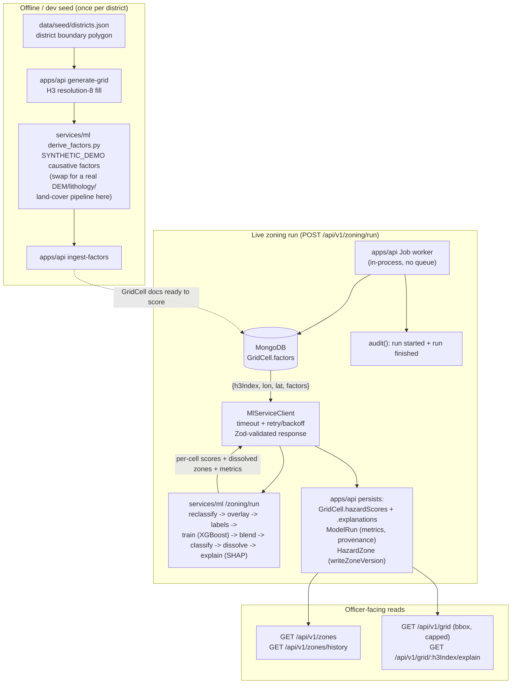

# Hazard Zoning Pipeline

Step 4's implementation of `docs/METHODOLOGY.md` §1: how a raw H3 grid
becomes versioned `HazardZone` polygons an officer can see on the map.
This is a description of what the code in this repo actually does, kept
in sync with it — if this document and the code disagree, the code wins;
open a PR to fix the doc.

## End to end



`services/ml` never touches MongoDB or the filesystem in the live path —
every cell's factor values and every real hazard-event point used for
label generation are supplied in the `POST /zoning/run` request body by
`apps/api`, which owns all persistence (`docs/ARCHITECTURE.md`).

## Stages

1. **Grid generation** (`apps/api/src/scripts/generateGrid.ts`, `npm run
   generate-grid`). Fills each district's seed boundary polygon with H3
   resolution-8 cells (`apps/api/src/lib/h3Grid.ts`), persists `GridCell`
   documents (geometry only), and exports a lightweight
   `{h3Index, lon, lat}` list per district to `data/processed/` for the
   next stage.

2. **Causative factors** (`services/ml/scripts/derive_factors.py`, one
   function per district). Currently SYNTHETIC_DEMO: smooth deterministic
   geographic trends (distance to an escarpment/coastline/river, elevation
   gradients) plus low-frequency spatially-coherent noise — verified
   non-white-noise by a printed neighbor-coherence diagnostic. **To swap in
   real data:** replace this script with one that samples a real DEM
   (SRTM/Bhuvan), lithology map (Bhukosh), land-cover raster (Sentinel-2),
   etc. at each cell's centroid — the output contract
   (`data/processed/<district>-factors.json`,
   `{h3Index: {hazardType: {factorName: value}}}`) is all any downstream
   stage depends on, so nothing else in the pipeline needs to change.
   `apps/api/src/scripts/ingestFactors.ts` (`npm run ingest-factors`) loads
   the result back into `GridCell.factors`.

3. **Reclassification + weighted overlay**
   (`services/ml/app/engine/reclassify.py`, `overlay.py`). Each raw factor
   value is mapped to a 1-5 susceptibility rating via
   `packages/shared/src/config/factor-reclassification.json`'s breakpoint
   tables, with the DIRECT/INVERSE flip applied uniformly from that
   config's `direction` field (never hardcoded per factor). `LSI = sum(W_i
   * R_i)` (hazard-weights.json), normalized to `[0, 1]` as the
   `overlayScore`. Unit-tested against a hand-computed example.

4. **Training labels** (`services/ml/app/engine/labels.py`). SYNTHETIC_DEMO:
   each hazard gets its own physically-motivated LATENT process built from
   the same raw causative factors as the model's features but combined
   nonlinearly, with different emphasis than the overlay's linear weighted
   sum — landslide's is an infinite-slope stability proxy (driving shear
   stress from gravity vs. resisting shear strength from soil cohesion,
   degraded by rainfall-driven pore pressure). The latent value becomes a
   probability via a logistic link calibrated to a rare-event base rate
   (~13% positive before boosting), boosted near a real recorded hazard
   event (`data/seed/hazard-events.json` → `apps/api`'s `HazardEvent`
   collection, passed to the ML service as `eventPoints`), sampled
   stochastically, then independently label-noised (~4.5%). Two failure
   modes are guarded against by regression tests
   (`test_engine_labels_blend_train.py`): an earlier version derived labels
   from a hard quantile cutoff on the model's own overlay-score input,
   making "training" a deterministic lookup table (AUC-ROC == 1.000 on
   every hazard); the fix that followed over-corrected with too much noise
   on too weak a signal, landing every hazard at/near chance (AUC-ROC
   0.50-0.64). **To swap in real data:** `labels.py::load_real_inventory(hazard)`
   is the seam — replace its `return None` with a loader for a real GSI
   landslide inventory or CWC flood-extent shapefile once one exists for
   Wayanad/Ganjam, and route its points into `generate_labels()`'s
   `event_points` (or replace the latent-process scheme entirely with real
   positive/negative labels — `generate_labels()`'s signature is the only
   contract callers depend on).

5. **ML susceptibility model** (`services/ml/app/engine/train.py`). One
   XGBoost binary classifier per hazard (pooled across every district that
   lists it as a primary hazard — flood spans both Wayanad and Ganjam),
   with `scale_pos_weight` set from the training split's actual class
   balance so the rare-event positive class isn't swamped. Split **by H3
   parent cell** (`spatial_block_split`, resolution 5, checkerboard on
   parent rank parity), never a random row-wise split: adjacent grid cells
   share nearly all of their causative-factor signal by construction
   (stage 2's smoothness), so a random split would put near-duplicate
   neighboring cells on both sides of train/test and inflate every
   reported metric through spatial autocorrelation leakage. Reports
   AUC-ROC, precision, recall, F1, expected calibration error, and a
   confusion matrix on the held-out spatial test split. Against the real
   Wayanad/Ganjam grid, metrics land at landslide 0.734, flood 0.847,
   coastalErosion 0.737, cloudburst 0.787 AUC-ROC
   (`services/ml/scripts/run_scoring_pipeline.py`) — realistic for
   genuinely-informative-but-noisy labels, neither the >0.95 a leaked or
   tautological setup would produce nor the ~0.5-0.64 an over-noised one
   does.

6. **Blend** (`services/ml/app/engine/blend.py`). `blendedScore = alpha *
   overlayScore + (1 - alpha) * mlScore`, `alpha` set **per hazard**
   (`packages/shared/src/config/blend-config.json`'s `hazards.<hazardType>.alpha`,
   not one global value) so a hazard whose model underperforms can be
   weighted back toward the overlay without affecting the others. Every
   hazard's alpha is 0.6 as of Step 5 — all four clear a 0.70 AUC-ROC
   floor, so the interpretable-overlay weighting reflects that training
   labels are still SYNTHETIC_DEMO, not that any model underperforms.
   Revisit per hazard once that hazard's labels come from stage 4's
   real-inventory seam.

7. **Zone classification + dissolve** (`services/ml/app/engine/zones.py`).
   `blendedScore` is classified per `zone-thresholds.json`'s per-hazard
   cutoffs, then contiguous same-class cells are dissolved
   (`shapely.ops.unary_union`) into one Polygon/MultiPolygon per (district,
   hazard, zoneClass) — cell boundaries are regenerated from each h3Index
   via `h3.cell_to_boundary`, never persisted separately. Both a
   full-resolution and a simplified (`shapely.simplify`, ~50m tolerance)
   geometry are produced; the officer map renders the simplified one, the
   full-resolution one is authoritative for audit/analysis.

8. **Explainability** (`services/ml/app/engine/explain.py`). A SHAP
   `TreeExplainer` is built once per trained model
   (`get_explainer`/`_explainer_cache`) and run once, batched, over every
   cell in the run (`top_contributions_batch`) — not rebuilt per cell.
   Top-5 signed factor contributions per cell are returned in
   `/zoning/run`'s response and persisted to `GridCell.explanations`,
   served at `GET /api/v1/grid/:h3Index/explain`.

9. **Persistence + versioning** (`apps/api/src/lib/zoneVersioning.ts`).
   `HazardZone` documents are never mutated. `writeZoneVersion()` closes
   every previously-active doc for a `(district, hazard)` and points a new
   doc's `supersedes` at the previously-active doc of the *same* zone
   class, if one existed — a class that drops out between runs (e.g. no
   cell reached Red this time) is simply closed with no successor, which
   is correct, not an orphan. Tested across three sequential runs for a
   clean chain with no orphans and no overlapping validity windows.

10. **Multi-hazard aggregation** (`services/ml/app/engine/zones.py::
    aggregate_multi_hazard`, METHODOLOGY §1.3). A habitation's overall zone
    class is the worst class across every hazard it's exposed to, escalating
    to Red if two or more hazards are independently Orange. Both rules are
    unit-tested.

## A limitation this pipeline surfaced, since fixed (Step 5)

Step 4's pipeline run showed that 16 of Wayanad's 40 seeded habitations —
including Chooralmala and Mundakkai themselves, the real 2024 landslide
site — fell **outside** Wayanad's own seed district boundary polygon
(`data/seed/districts.json`: a bounding rectangle starting at 11.55°N,
north of Meppadi taluk where those habitations actually sit), so they had
no H3 grid coverage and no hazard-zone assessment for any of Wayanad's
three hazards. Step 5 replaced the boundary with a hand-drawn irregular
polygon that actually contains every seeded habitation (see
`data/seed/README.md`'s "How the geometry was generated") and added a
permanent guard —
`apps/api/src/scripts/validateSeedGeometry.ts`, run automatically by
`npm run seed` — that fails the seed run loudly if this ever regresses.
Chooralmala and Mundakkai now score landslide `blendedScore` 0.744 and
0.777 respectively (both Red-zone, ≥ the 0.70 threshold) against the
current grid/model — see `docs/METHODOLOGY.md` §1.3 and
`services/ml/scripts/run_zoning_pipeline.py`'s output.

## Running it locally

```bash
# 1. Seed the two pilot districts + habitations (once)
npm run seed --workspace=@punarvas/api

# 2. Build the H3 grid + synthetic factors (once per district)
npm run generate-grid --workspace=@punarvas/api
cd services/ml && venv\Scripts\python scripts\derive_factors.py && cd ../..
npm run ingest-factors --workspace=@punarvas/api

# 3. Start both services
npm run dev:ml    # FastAPI on :8000
npm run dev:api   # Express on :4000

# 4. Trigger a run (needs a logged-in officer's access token)
curl -X POST http://localhost:4000/api/v1/zoning/run \
  -H "Authorization: Bearer <accessToken>" -H "Content-Type: application/json" \
  -d '{"districtId":"<wayanad-id>","hazardTypes":["landslide"]}'
```

Or, for a quick metrics/zone-count check without a live MongoDB or HTTP
round trip, the offline scripts run the same engine code directly against
`data/processed/`:

```bash
cd services/ml
venv\Scripts\python scripts\run_scoring_pipeline.py   # per-hazard training metrics
venv\Scripts\python scripts\run_zoning_pipeline.py     # zone counts + habitation split
```
