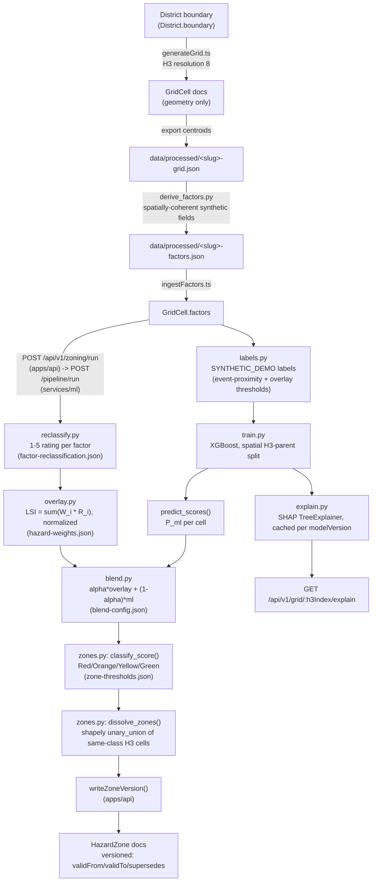

# Step 4 — Hazard Zoning Engine Implementation Plan

> **For agentic workers:** REQUIRED SUB-SKILL: Use superpowers:subagent-driven-development (recommended) or superpowers:executing-plans to implement this plan task-by-task. Steps use checkbox (`- [ ]`) syntax for tracking.

**Goal:** Build the H3-grid-based hazard zoning engine (weighted overlay + XGBoost susceptibility + SHAP), versioned zone storage, and the API surface to trigger/serve it — per the Step 4 spec in the user's message and `docs/METHODOLOGY.md` §1.

**Architecture:** `apps/api` owns MongoDB persistence and the job queue (per `docs/ARCHITECTURE.md` — services/ml is stateless). `apps/api/src/scripts/generateGrid.ts` creates `GridCell` docs (geometry only) and also exports lightweight `{h3Index, lon, lat}` files to `data/processed/` so `services/ml/scripts/derive_factors.py` (a Python offline batch script) can compute spatially-coherent synthetic factors without touching Mongo directly, writing `data/processed/<district>-factors.json`. `apps/api/src/scripts/ingestFactors.ts` loads that file back into `GridCell.factors`. For live zoning runs, `apps/api`'s job worker reads `GridCell` factor data from Mongo and POSTs `{h3Index, factors}` per cell to a FastAPI endpoint in `services/ml`; the ML service reclassifies, computes the weighted overlay, runs the (per-hazard, cached) XGBoost model, blends, classifies, and dissolves same-class H3 cells (regenerating cell boundaries from the h3Index itself via `h3-py`, so geometry never needs to cross the wire) into zone polygons with `shapely.unary_union`, returning per-cell scores + zone GeoJSON + metrics. `apps/api` persists `GridCell.hazardScores`, creates versioned `HazardZone` docs, creates a `ModelRun` doc, and writes audit entries.

**Tech Stack:** h3-py / h3-js for the hex grid, XGBoost + SHAP (already in `services/ml/requirements.txt`) for susceptibility scoring, shapely for dissolve, Zod/Pydantic at every boundary per `CLAUDE.md`.

**Spec:** the Step 4 spec is the user's message in this conversation (Parts A–G); `docs/METHODOLOGY.md` §1 is the numeric/formula source of truth this plan implements.

## Global Constraints

- TypeScript strict mode, no `any`, named exports only, Zod validation at every `apps/api` boundary, Pydantic at every `services/ml` boundary — per `CLAUDE.md`.
- Every new weight/threshold config goes in `packages/shared/src/config/*.json` with a Zod schema + loader assertion (TS) and a matching Python loader function in `services/ml/app/config_loader.py` — same file, both languages, never hand-duplicated values.
- Every state-changing `apps/api` route: `authenticate` → `requirePermission('resource:action')` → `requireScope()`, in that order.
- Every officer/system action that changes state gets an audit entry via `apps/api/src/lib/audit.ts`'s `audit()`.
- `HazardZone` docs are never mutated — new run inserts new docs, sets `validTo` + `supersedes` on the superseded doc.
- All synthesized data carries `dataProvenance: "SYNTHETIC_DEMO"`.
- MongoDB collections: plural lowerCamelCase, every doc has `createdAt`/`updatedAt`.
- Do not build vulnerability scoring, site suitability, or UI (out of scope for Step 4).

## File Structure

**New shared config (packages/shared/src/config/):**
- `factor-reclassification.json` — per-hazard, per-factor 1–5 breakpoint tables + `direction` (DIRECT/INVERSE)
- `blend-config.json` — `alpha` (overlay/ML blend weight)
- `schemas.ts` — add `factorReclassificationSchema`, `blendConfigSchema`
- `loader.ts` — add `loadFactorReclassification()`, `loadBlendConfig()`, export `factorReclassification`, `blendConfig`

**New shared types/schemas:**
- `constants.ts` — add `JOB_STATUSES`, `JOB_TYPES`, `FACTOR_DIRECTIONS`
- `schemas/common.ts` — add `jobStatusSchema`, `shapContributionSchema` (reuse `explanationEntrySchema` pattern)
- `schemas/gridCell.ts`, `schemas/modelRun.ts`, `schemas/job.ts` (new) — mirror the Mongoose models below
- `schemas/index.ts` — export the three new schema modules

**New Mongoose models (apps/api/src/models/):**
- `GridCell.ts` — h3Index, resolution, districtId, centroid, boundary, factors (per-hazard raw values), hazardScores (per-hazard overlay/ml/blended/zoneClass), modelVersion, computedAt, dataProvenance
- `ModelRun.ts` — modelVersion, hazardType, algorithm, trainedAt, featureList, hyperparameters, metrics, trainingSampleCount, labelSource, notes
- `Job.ts` — type, status, progressPercent, params, result, error, createdBy, startedAt, finishedAt

**New apps/api scripts:**
- `src/scripts/generateGrid.ts` — H3 res-8 grid fill for both districts, persists `GridCell` docs, exports centroid lists to `data/processed/`
- `src/scripts/ingestFactors.ts` — reads `data/processed/<district>-factors.json`, bulk-updates `GridCell.factors`

**New apps/api lib:**
- `src/lib/mlServiceClient.ts` — typed HTTP client to services/ml (timeout, retry/backoff, Zod-validated response)
- `src/lib/hazardAggregation.ts` — multi-hazard worst-class + 2-Orange-escalates-to-Red rule (METHODOLOGY §1.3)
- `src/lib/zoneVersioning.ts` — `writeZoneVersion()`, `getActiveZones(at?)`
- `src/lib/jobs/zoningJob.ts` — in-process job runner

**New apps/api routes:**
- `src/routes/zoning.routes.ts` — the 6 endpoints from Part F2, wired into `src/routes/index.ts`

**New services/ml modules (services/ml/app/engine/):**
- `reclassify.py`, `overlay.py`, `labels.py`, `train.py`, `explain.py`, `blend.py`, `zones.py`
- `services/ml/app/routes/zoning.py` — FastAPI router exposing the engine over HTTP, mounted in `main.py`
- `services/ml/scripts/derive_factors.py` — synthetic spatial factor generator

**Docs:**
- `docs/METHODOLOGY.md` §1.2 rewrite
- `docs/ZONING_PIPELINE.md` (new)
- `CLAUDE.md` roadmap + folder layout updates

---

### Task 1: Add h3-py and h3-js dependencies

**Files:**
- Modify: `services/ml/requirements.txt`
- Modify: `apps/api/package.json`

**Interfaces:**
- Produces: `h3` importable in `services/ml` (Python, v4 API: `h3.latlng_to_cell`, `h3.cell_to_boundary`, `h3.cell_to_latlng`, `h3.polygon_to_cells`, `h3.LatLngPoly`); `h3-js` importable in `apps/api` (Node, v4 API: `polygonToCells`, `cellToBoundary`, `cellToLatLng`, `getResolution`).

- [ ] **Step 1: Add h3 to services/ml**

Add this line to `services/ml/requirements.txt` (after `pandas==2.2.3`, before `pytest==8.3.3`):

```
h3==4.1.2
```

- [ ] **Step 2: Install and verify**

Run: `cd services/ml && venv\Scripts\pip install -r requirements.txt` (Windows) then `venv\Scripts\python -c "import h3; print(h3.versions())"`.
Expected: prints version info, no import error.

- [ ] **Step 3: Add h3-js to apps/api**

Run: `cd apps/api && npm install h3-js@^4.1.0`
This adds `"h3-js": "^4.1.0"` under `dependencies` in `apps/api/package.json` and updates the root `package-lock.json`.

- [ ] **Step 4: Verify**

Run: `cd apps/api && node -e "const h3=require('h3-js'); console.log(h3.cellToLatLng(h3.latLngToCell(11.7, 76.1, 8)))"` (or an equivalent `.mjs`/ts-node one-liner given this is an ESM package — use `node --input-type=module -e "import * as h3 from 'h3-js'; console.log(h3.cellToLatLng(h3.latLngToCell(11.7,76.1,8)))"`).
Expected: prints a `[lat, lng]` pair close to `[11.7, 76.1]`.

- [ ] **Step 5: Commit**

```bash
git add services/ml/requirements.txt apps/api/package.json package-lock.json
git commit -m "chore: add h3-py and h3-js for the H3 grid foundation

Co-Authored-By: Claude Sonnet 5 <noreply@anthropic.com>
Claude-Session: https://claude.ai/code/session_01Nxix1Pe4bu8FYr3zL3Fb1c"
```

---

### Task 2: `blend-config.json` config + Zod schema + TS/Python loaders + tests

**Files:**
- Create: `packages/shared/src/config/blend-config.json`
- Modify: `packages/shared/src/config/schemas.ts`
- Modify: `packages/shared/src/config/loader.ts`
- Modify: `services/ml/app/config_loader.py`
- Modify: `services/ml/tests/test_config_loader.py`
- Create: `apps/api/src/config/blendConfig.test.ts`

**Interfaces:**
- Produces: `blendConfig: BlendConfig` (TS), `BLEND_CONFIG` (Python). Shape: `{ modelVersion: string, alpha: number (0-1), note: string }`.

- [ ] **Step 1: Write the config JSON**

Create `packages/shared/src/config/blend-config.json`:

```json
{
  "modelVersion": "blend-config-v1",
  "alpha": 0.6,
  "note": "blendedScore = alpha * overlayScore + (1 - alpha) * mlScore. Weighted toward the interpretable weighted-overlay (0.6) because the ML training labels are SYNTHETIC_DEMO for this prototype (services/ml/app/engine/labels.py) — shift alpha toward the ML score once real GSI landslide inventory / CWC flood extent labels are available. See docs/METHODOLOGY.md §1.2."
}
```

- [ ] **Step 2: Add the Zod schema**

In `packages/shared/src/config/schemas.ts`:

```typescript
export const blendConfigSchema = z.object({
  modelVersion: z.string().min(1),
  alpha: z.number().min(0).max(1),
  note: z.string(),
});
export type BlendConfig = z.infer<typeof blendConfigSchema>;
```

- [ ] **Step 3: Wire the TS loader**

In `packages/shared/src/config/loader.ts`, add the import and:

```typescript
function loadBlendConfig(): BlendConfig {
  return parseConfig(blendConfigSchema, blendConfigJson, "blend-config.json");
}

export const blendConfig: BlendConfig = loadBlendConfig();
```

- [ ] **Step 4: Run TS typecheck**

Run: `cd packages/shared && npm run typecheck`
Expected: no errors.

- [ ] **Step 5: Add the Python loader**

In `services/ml/app/config_loader.py`:

```python
def load_blend_config() -> dict[str, Any]:
    config = _load_json("blend-config.json")
    alpha = config["alpha"]
    if not (0.0 <= alpha <= 1.0):
        raise ValueError(f"[ml/config] blend-config.json alpha ({alpha}) must be in [0, 1]")
    return config


BLEND_CONFIG = load_blend_config()
```

- [ ] **Step 6: Write Python config test**

Add to `services/ml/tests/test_config_loader.py`:

```python
from app.config_loader import BLEND_CONFIG


def test_blend_config_alpha_in_range():
    assert 0.0 <= BLEND_CONFIG["alpha"] <= 1.0
```

- [ ] **Step 7: Run Python tests**

Run: `cd services/ml && venv\Scripts\python -m pytest tests/test_config_loader.py -v`
Expected: all pass.

- [ ] **Step 8: Write TS test**

Create `apps/api/src/config/blendConfig.test.ts`:

```typescript
import { describe, it, expect } from "vitest";
import { blendConfig } from "@prahari/shared";

describe("blend-config.json (Step 4 Part D5)", () => {
  it("alpha is in [0, 1] and defaults to 0.6 favoring the interpretable overlay", () => {
    expect(blendConfig.alpha).toBeGreaterThanOrEqual(0);
    expect(blendConfig.alpha).toBeLessThanOrEqual(1);
    expect(blendConfig.alpha).toBe(0.6);
  });
});
```

- [ ] **Step 9: Run apps/api tests**

Run: `cd apps/api && npx vitest run src/config/blendConfig.test.ts`
Expected: passes.

- [ ] **Step 10: Commit**

```bash
git add packages/shared/src/config/blend-config.json packages/shared/src/config/schemas.ts packages/shared/src/config/loader.ts services/ml/app/config_loader.py services/ml/tests/test_config_loader.py apps/api/src/config/blendConfig.test.ts
git commit -m "feat: blend-config for overlay/ML score blending (alpha=0.6)

Co-Authored-By: Claude Sonnet 5 <noreply@anthropic.com>
Claude-Session: https://claude.ai/code/session_01Nxix1Pe4bu8FYr3zL3Fb1c"
```

---

### Task 3: Shared constants, common schemas, and Zod schemas for GridCell/ModelRun/Job

**Files:**
- Modify: `packages/shared/src/constants.ts`
- Modify: `packages/shared/src/schemas/common.ts`
- Create: `packages/shared/src/schemas/gridCell.ts`
- Create: `packages/shared/src/schemas/modelRun.ts`
- Create: `packages/shared/src/schemas/job.ts`
- Modify: `packages/shared/src/schemas/index.ts`

**Interfaces:**
- Consumes: `hazardTypeSchema`, `zoneClassSchema`, `objectIdSchema`, `geoPointSchema`, `geoPolygonalSchema`, `dataProvenanceSchema`, `timestampsSchema` from `./common`.
- Produces: `gridCellSchema`/`GridCell`, `hazardScoreEntrySchema`/`HazardScoreEntry`, `modelRunSchema`/`ModelRun`, `modelMetricsSchema`/`ModelMetrics`, `jobSchema`/`Job`, `jobStatusSchema`, `JOB_STATUSES`, `JOB_TYPES` — all re-exported from `@prahari/shared` via `schemas/index.ts` and the top-level `src/index.ts` (already does `export * from "./schemas"`).

- [ ] **Step 1: Add JOB_STATUSES and JOB_TYPES constants**

In `packages/shared/src/constants.ts`, add after `AUDIT_SEVERITIES`:

```typescript
export const JOB_STATUSES = ["PENDING", "RUNNING", "SUCCEEDED", "FAILED"] as const;

export const JOB_TYPES = ["ZONING_RUN"] as const;
```

- [ ] **Step 2: Add jobStatusSchema to common.ts**

In `packages/shared/src/schemas/common.ts`, add to the imports from `"../constants"`: `JOB_STATUSES, JOB_TYPES,` and add near the other enum schemas:

```typescript
export const jobStatusSchema = z.enum(JOB_STATUSES);
export const jobTypeSchema = z.enum(JOB_TYPES);
```

- [ ] **Step 3: Write gridCell.ts**

Create `packages/shared/src/schemas/gridCell.ts`:

```typescript
import { z } from "zod";
import {
  objectIdSchema,
  geoPointSchema,
  geoPolygonalSchema,
  hazardTypeSchema,
  zoneClassSchema,
  dataProvenanceSchema,
  timestampsSchema,
} from "./common";

export const hazardScoreEntrySchema = z.object({
  overlayScore: z.number().min(0).max(1),
  mlScore: z.number().min(0).max(1),
  blendedScore: z.number().min(0).max(1),
  zoneClass: zoneClassSchema,
});
export type HazardScoreEntry = z.infer<typeof hazardScoreEntrySchema>;

/** hazardType -> factorName -> raw value. Keyed per-hazard (not flattened) because the same factor name can mean different things across hazards (e.g. landCover is a forest-cover index for landslide, an imperviousness index for flood). */
export const gridCellFactorsSchema = z.record(hazardTypeSchema, z.record(z.string(), z.number()));
export type GridCellFactors = z.infer<typeof gridCellFactorsSchema>;

export const gridCellHazardScoresSchema = z.record(hazardTypeSchema, hazardScoreEntrySchema);

export const gridCellSchema = z
  .object({
    _id: objectIdSchema,
    h3Index: z.string().min(1),
    resolution: z.number().int().min(0).max(15),
    districtId: objectIdSchema,
    centroid: geoPointSchema,
    boundary: geoPolygonalSchema,
    factors: gridCellFactorsSchema,
    hazardScores: gridCellHazardScoresSchema,
    modelVersion: z.string().min(1),
    computedAt: z.date(),
    dataProvenance: dataProvenanceSchema,
  })
  .merge(timestampsSchema);
export type GridCell = z.infer<typeof gridCellSchema>;
```

- [ ] **Step 4: Write modelRun.ts**

Create `packages/shared/src/schemas/modelRun.ts`:

```typescript
import { z } from "zod";
import { objectIdSchema, hazardTypeSchema, timestampsSchema } from "./common";

export const modelMetricsSchema = z.object({
  aucRoc: z.number().min(0).max(1),
  precision: z.number().min(0).max(1),
  recall: z.number().min(0).max(1),
  f1: z.number().min(0).max(1),
  calibrationError: z.number().min(0),
});
export type ModelMetrics = z.infer<typeof modelMetricsSchema>;

export const modelRunSchema = z
  .object({
    _id: objectIdSchema,
    modelVersion: z.string().min(1),
    hazardType: hazardTypeSchema,
    algorithm: z.string().min(1),
    trainedAt: z.date(),
    featureList: z.array(z.string().min(1)).min(1),
    hyperparameters: z.record(z.string(), z.unknown()),
    metrics: modelMetricsSchema,
    trainingSampleCount: z.number().int().min(1),
    labelSource: z.string().min(1),
    notes: z.string().optional(),
  })
  .merge(timestampsSchema);
export type ModelRun = z.infer<typeof modelRunSchema>;
```

- [ ] **Step 5: Write job.ts**

Create `packages/shared/src/schemas/job.ts`:

```typescript
import { z } from "zod";
import { objectIdSchema, jobStatusSchema, jobTypeSchema, timestampsSchema } from "./common";

export const jobSchema = z
  .object({
    _id: objectIdSchema,
    type: jobTypeSchema,
    districtId: objectIdSchema,
    status: jobStatusSchema,
    progressPercent: z.number().min(0).max(100),
    params: z.record(z.string(), z.unknown()),
    result: z.record(z.string(), z.unknown()).nullable(),
    error: z.string().nullable(),
    createdBy: objectIdSchema,
    startedAt: z.date().nullable(),
    finishedAt: z.date().nullable(),
  })
  .merge(timestampsSchema);
export type Job = z.infer<typeof jobSchema>;
```

- [ ] **Step 6: Export from schemas/index.ts**

Add to `packages/shared/src/schemas/index.ts`: `export * from "./gridCell"; export * from "./modelRun"; export * from "./job";`

- [ ] **Step 7: Typecheck**

Run: `cd packages/shared && npm run typecheck`
Expected: no errors.

- [ ] **Step 8: Commit**

```bash
git add packages/shared/src/constants.ts packages/shared/src/schemas/common.ts packages/shared/src/schemas/gridCell.ts packages/shared/src/schemas/modelRun.ts packages/shared/src/schemas/job.ts packages/shared/src/schemas/index.ts
git commit -m "feat: shared Zod schemas for GridCell, ModelRun, and Job

Co-Authored-By: Claude Sonnet 5 <noreply@anthropic.com>
Claude-Session: https://claude.ai/code/session_01Nxix1Pe4bu8FYr3zL3Fb1c"
```

---

### Task 4: `GridCell` Mongoose model

**Files:**
- Create: `apps/api/src/models/GridCell.ts`
- Create: `apps/api/src/models/GridCell.test.ts`
- Modify: `apps/api/src/models/index.ts`

**Interfaces:**
- Consumes: `HAZARD_TYPES`, `ZONE_CLASSES`, `DATA_PROVENANCE_VALUES` from `@prahari/shared`; `geoPointSchema`, `geoPolygonalSchema` from `./geoSchemas`.
- Produces: `GridCell` model (Mongoose), collection `gridCells`, exported `GridCellDoc`, `HazardScoreEntry` types. Later tasks (8, 9, 15–18, 21) read/write `GridCell.factors`, `GridCell.hazardScores`, `GridCell.h3Index`.

- [ ] **Step 1: Write the model**

Create `apps/api/src/models/GridCell.ts`:

```typescript
import { Schema, model, type Document, type Types } from "mongoose";
import { ZONE_CLASSES, DATA_PROVENANCE_VALUES } from "@prahari/shared";
import type { ZoneClass, DataProvenance, GeoPoint, GeoPolygonal } from "@prahari/shared";
import { geoPointSchema, geoPolygonalSchema } from "./geoSchemas";

export interface HazardScoreEntry {
  overlayScore: number;
  mlScore: number;
  blendedScore: number;
  zoneClass: ZoneClass;
}

/**
 * `factors` is keyed hazardType -> factorName -> raw value, NOT flattened,
 * because the same factor name can mean different physical quantities for
 * different hazards (e.g. landCover is a forest-cover index for landslide
 * but an imperviousness index for flood) — see
 * packages/shared/src/config/hazard-weights.json.
 */
export interface GridCellDoc extends Document {
  h3Index: string;
  resolution: number;
  districtId: Types.ObjectId;
  centroid: GeoPoint;
  boundary: GeoPolygonal;
  factors: Record<string, Record<string, number>>;
  hazardScores: Map<string, HazardScoreEntry>;
  modelVersion: string;
  computedAt: Date;
  dataProvenance: DataProvenance;
  createdAt: Date;
  updatedAt: Date;
}

const hazardScoreEntrySchema = new Schema<HazardScoreEntry>(
  {
    overlayScore: { type: Number, required: true, min: 0, max: 1 },
    mlScore: { type: Number, required: true, min: 0, max: 1 },
    blendedScore: { type: Number, required: true, min: 0, max: 1 },
    zoneClass: { type: String, enum: ZONE_CLASSES, required: true },
  },
  { _id: false },
);

const gridCellSchema = new Schema<GridCellDoc>(
  {
    h3Index: { type: String, required: true, unique: true },
    resolution: { type: Number, required: true },
    districtId: { type: Schema.Types.ObjectId, ref: "District", required: true },
    centroid: { type: geoPointSchema, required: true },
    boundary: { type: geoPolygonalSchema, required: true },
    factors: { type: Schema.Types.Mixed, required: true, default: () => ({}) },
    hazardScores: {
      type: Map,
      of: hazardScoreEntrySchema,
      required: true,
      default: () => new Map(),
    },
    modelVersion: { type: String, required: true },
    computedAt: { type: Date, required: true },
    dataProvenance: { type: String, enum: DATA_PROVENANCE_VALUES, required: true },
  },
  { timestamps: true },
);

gridCellSchema.index({ centroid: "2dsphere" });
gridCellSchema.index({ boundary: "2dsphere" });
gridCellSchema.index({ districtId: 1 });

export const GridCell = model<GridCellDoc>("GridCell", gridCellSchema, "gridCells");
```

- [ ] **Step 2: Write the failing test**

Create `apps/api/src/models/GridCell.test.ts`:

```typescript
import { describe, it, expect } from "vitest";
import { GridCell } from "./GridCell";
import { District } from "./District";

async function seedDistrict(): Promise<string> {
  const district = await District.create({
    lgdCode: "GRIDCELL-TEST-001",
    name: "Test District",
    state: "Testland",
    boundary: {
      type: "Polygon",
      coordinates: [[[76.0, 11.6], [76.1, 11.6], [76.1, 11.7], [76.0, 11.7], [76.0, 11.6]]],
    },
    population: 1000,
    areaSqKm: 10,
    primaryHazards: ["landslide"],
    dmAuthorityContact: { name: "Test", designation: "Tester", phone: "0000000000" },
  });
  return district._id.toString();
}

describe("GridCell model", () => {
  it("persists a cell with per-hazard factors and hazardScores", async () => {
    const districtId = await seedDistrict();
    const doc = await GridCell.create({
      h3Index: "88283082a3fffff",
      resolution: 8,
      districtId,
      centroid: { type: "Point", coordinates: [76.05, 11.65] },
      boundary: {
        type: "Polygon",
        coordinates: [[[76.04, 11.64], [76.06, 11.64], [76.06, 11.66], [76.04, 11.66], [76.04, 11.64]]],
      },
      factors: { landslide: { slope: 22.5, lithology: 0.4 } },
      hazardScores: new Map([
        ["landslide", { overlayScore: 0.6, mlScore: 0.55, blendedScore: 0.58, zoneClass: "Orange" }],
      ]),
      modelVersion: "test-v1",
      computedAt: new Date(),
      dataProvenance: "SYNTHETIC_DEMO",
    });

    const found = await GridCell.findOne({ h3Index: "88283082a3fffff" }).lean();
    expect(found?.factors.landslide.slope).toBe(22.5);
    expect(found?.hazardScores.get("landslide")?.zoneClass).toBe("Orange");
    expect(doc.dataProvenance).toBe("SYNTHETIC_DEMO");
  });

  it("rejects a duplicate h3Index", async () => {
    const districtId = await seedDistrict();
    const base = {
      resolution: 8,
      districtId,
      centroid: { type: "Point" as const, coordinates: [76.05, 11.65] as [number, number] },
      boundary: {
        type: "Polygon" as const,
        coordinates: [[[76.04, 11.64], [76.06, 11.64], [76.06, 11.66], [76.04, 11.66], [76.04, 11.64]]],
      },
      factors: {},
      hazardScores: new Map(),
      modelVersion: "test-v1",
      computedAt: new Date(),
      dataProvenance: "SYNTHETIC_DEMO" as const,
    };
    await GridCell.create({ ...base, h3Index: "88283082a5fffff" });
    await expect(GridCell.create({ ...base, h3Index: "88283082a5fffff" })).rejects.toThrow();
  });
});
```

- [ ] **Step 3: Run and verify it passes**

Run: `cd apps/api && npx vitest run src/models/GridCell.test.ts`
Expected: 2 tests pass (the model exists and is correct on first write since there's no red/green cycle needed for a schema-only model — this test IS the verification).

- [ ] **Step 4: Export from models/index.ts**

Add `export * from "./GridCell";` to `apps/api/src/models/index.ts` (check the file first — it may re-export named or just be a barrel; match its existing style).

- [ ] **Step 5: Commit**

```bash
git add apps/api/src/models/GridCell.ts apps/api/src/models/GridCell.test.ts apps/api/src/models/index.ts
git commit -m "feat: GridCell model for the H3 hazard-zoning grid

Co-Authored-By: Claude Sonnet 5 <noreply@anthropic.com>
Claude-Session: https://claude.ai/code/session_01Nxix1Pe4bu8FYr3zL3Fb1c"
```

---

### Task 5: `ModelRun` Mongoose model

**Files:**
- Create: `apps/api/src/models/ModelRun.ts`
- Create: `apps/api/src/models/ModelRun.test.ts`
- Modify: `apps/api/src/models/index.ts`

**Interfaces:**
- Produces: `ModelRun` model, collection `modelRuns`. Consumed by Task 21 (zoning job persists one `ModelRun` per hazard per run) and referenced by `GridCell.modelVersion` / `HazardZone.modelVersion` (string match, not a foreign key — matches the existing `HazardZone.modelVersion: string` field already in the Step 2 model).

- [ ] **Step 1: Write the model**

Create `apps/api/src/models/ModelRun.ts`:

```typescript
import { Schema, model, type Document } from "mongoose";
import { HAZARD_TYPES } from "@prahari/shared";
import type { HazardType } from "@prahari/shared";

export interface ModelMetrics {
  aucRoc: number;
  precision: number;
  recall: number;
  f1: number;
  calibrationError: number;
}

export interface ModelRunDoc extends Document {
  modelVersion: string;
  hazardType: HazardType;
  algorithm: string;
  trainedAt: Date;
  featureList: string[];
  hyperparameters: Record<string, unknown>;
  metrics: ModelMetrics;
  trainingSampleCount: number;
  labelSource: string;
  notes?: string;
  createdAt: Date;
  updatedAt: Date;
}

const modelMetricsSchema = new Schema<ModelMetrics>(
  {
    aucRoc: { type: Number, required: true, min: 0, max: 1 },
    precision: { type: Number, required: true, min: 0, max: 1 },
    recall: { type: Number, required: true, min: 0, max: 1 },
    f1: { type: Number, required: true, min: 0, max: 1 },
    calibrationError: { type: Number, required: true, min: 0 },
  },
  { _id: false },
);

const modelRunSchema = new Schema<ModelRunDoc>(
  {
    modelVersion: { type: String, required: true, unique: true },
    hazardType: { type: String, enum: HAZARD_TYPES, required: true },
    algorithm: { type: String, required: true },
    trainedAt: { type: Date, required: true },
    featureList: { type: [String], required: true },
    hyperparameters: { type: Schema.Types.Mixed, required: true, default: () => ({}) },
    metrics: { type: modelMetricsSchema, required: true },
    trainingSampleCount: { type: Number, required: true, min: 1 },
    labelSource: { type: String, required: true },
    notes: { type: String },
  },
  { timestamps: true },
);

modelRunSchema.index({ hazardType: 1, trainedAt: -1 });

export const ModelRun = model<ModelRunDoc>("ModelRun", modelRunSchema, "modelRuns");
```

- [ ] **Step 2: Write and run the test**

Create `apps/api/src/models/ModelRun.test.ts`:

```typescript
import { describe, it, expect } from "vitest";
import { ModelRun } from "./ModelRun";

describe("ModelRun model", () => {
  it("persists provenance for a trained susceptibility model", async () => {
    const doc = await ModelRun.create({
      modelVersion: "landslide-xgb-2026-09-03T00:00:00Z",
      hazardType: "landslide",
      algorithm: "xgboost-binary-classifier",
      trainedAt: new Date(),
      featureList: ["slope", "lithology", "landCover"],
      hyperparameters: { maxDepth: 4, nEstimators: 200, learningRate: 0.1 },
      metrics: { aucRoc: 0.81, precision: 0.7, recall: 0.65, f1: 0.67, calibrationError: 0.05 },
      trainingSampleCount: 600,
      labelSource: "SYNTHETIC_DEMO",
      notes: "Spatial block split, 3 real hazard events used only as positive anchors",
    });
    expect(doc.labelSource).toBe("SYNTHETIC_DEMO");
    expect(doc.metrics.aucRoc).toBe(0.81);
  });

  it("rejects a duplicate modelVersion", async () => {
    const base = {
      hazardType: "flood" as const,
      algorithm: "xgboost-binary-classifier",
      trainedAt: new Date(),
      featureList: ["elevation"],
      hyperparameters: {},
      metrics: { aucRoc: 0.7, precision: 0.6, recall: 0.6, f1: 0.6, calibrationError: 0.1 },
      trainingSampleCount: 100,
      labelSource: "SYNTHETIC_DEMO",
    };
    await ModelRun.create({ ...base, modelVersion: "flood-dup-test" });
    await expect(ModelRun.create({ ...base, modelVersion: "flood-dup-test" })).rejects.toThrow();
  });
});
```

Run: `cd apps/api && npx vitest run src/models/ModelRun.test.ts`
Expected: 2 tests pass.

- [ ] **Step 3: Export and commit**

Add `export * from "./ModelRun";` to `apps/api/src/models/index.ts`.

```bash
git add apps/api/src/models/ModelRun.ts apps/api/src/models/ModelRun.test.ts apps/api/src/models/index.ts
git commit -m "feat: ModelRun model for susceptibility-model provenance

Co-Authored-By: Claude Sonnet 5 <noreply@anthropic.com>
Claude-Session: https://claude.ai/code/session_01Nxix1Pe4bu8FYr3zL3Fb1c"
```

---

### Task 6: `Job` Mongoose model

**Files:**
- Create: `apps/api/src/models/Job.ts`
- Create: `apps/api/src/models/Job.test.ts`
- Modify: `apps/api/src/models/index.ts`

**Interfaces:**
- Produces: `Job` model, collection `jobs`. Consumed by Task 20 (job worker) and Task 21 (`POST /zoning/run` creates a `Job`, `GET /zoning/runs/:id` reads one).

- [ ] **Step 1: Write the model**

Create `apps/api/src/models/Job.ts`:

```typescript
import { Schema, model, type Document, type Types } from "mongoose";
import { JOB_STATUSES, JOB_TYPES } from "@prahari/shared";
import type { JobStatus, JobType } from "@prahari/shared";

export interface JobDoc extends Document {
  type: JobType;
  /**
   * A real, correctly-typed ObjectId field — not just the districtId
   * that also lives inside `params` for the worker to read — so
   * `requireScope()`'s default `districtField: "districtId"` behavior
   * (which compares against `Types.ObjectId` values, including a
   * STATE_ADMIN's `$in: [ObjectId, ...]`) works unmodified. Comparing
   * scope against a Mixed/string-typed `params.districtId` path instead
   * would silently fail to match STATE_ADMIN's ObjectId-array scope
   * filter (BSON string vs ObjectId are never equal), which is exactly
   * the kind of scoping bug CLAUDE.md's Auth Conventions warn about.
   */
  districtId: Types.ObjectId;
  status: JobStatus;
  progressPercent: number;
  params: Record<string, unknown>;
  result: Record<string, unknown> | null;
  error: string | null;
  createdBy: Types.ObjectId;
  startedAt: Date | null;
  finishedAt: Date | null;
  createdAt: Date;
  updatedAt: Date;
}

const jobSchema = new Schema<JobDoc>(
  {
    type: { type: String, enum: JOB_TYPES, required: true },
    districtId: { type: Schema.Types.ObjectId, ref: "District", required: true },
    status: { type: String, enum: JOB_STATUSES, required: true, default: "PENDING" },
    progressPercent: { type: Number, required: true, min: 0, max: 100, default: 0 },
    params: { type: Schema.Types.Mixed, required: true, default: () => ({}) },
    result: { type: Schema.Types.Mixed, default: null },
    error: { type: String, default: null },
    createdBy: { type: Schema.Types.ObjectId, ref: "User", required: true },
    startedAt: { type: Date, default: null },
    finishedAt: { type: Date, default: null },
  },
  { timestamps: true },
);

jobSchema.index({ districtId: 1, type: 1, createdAt: -1 });

export const Job = model<JobDoc>("Job", jobSchema, "jobs");
```

`JobStatus`/`JobType` also need adding to `packages/shared/src/types.ts`, which hand-writes each literal union (mirroring, not deriving from, the `constants.ts` array — this is the file's existing convention, e.g. `export type HazardType = "landslide" | "flood" | "coastalErosion" | "cloudburst";`). Add, after `export type AuditSeverity = ...`:

```typescript
export type JobStatus = "PENDING" | "RUNNING" | "SUCCEEDED" | "FAILED";
export type JobType = "ZONING_RUN";
```

- [ ] **Step 2: Write and run the test**

Create `apps/api/src/models/Job.test.ts`:

```typescript
import { describe, it, expect } from "vitest";
import { Job } from "./Job";
import { User } from "./User";
import { hashPassword } from "../lib/password";

describe("Job model", () => {
  it("defaults to PENDING with 0 progress", async () => {
    const user = await User.create({
      name: "Analyst",
      email: "job-model-test@prahari.gov.in",
      passwordHash: await hashPassword("SomePassw0rd!23"),
      role: "ANALYST",
      scope: {},
      isActive: true,
    });
    const job = await Job.create({
      type: "ZONING_RUN",
      districtId: user._id, // any valid ObjectId for this unit test — no District doc needed
      params: { districtId: user._id.toString(), hazardTypes: ["landslide"] },
      createdBy: user._id,
    });
    expect(job.status).toBe("PENDING");
    expect(job.progressPercent).toBe(0);
    expect(job.startedAt).toBeNull();
  });
});
```

Run: `cd apps/api && npx vitest run src/models/Job.test.ts`
Expected: 1 test passes.

- [ ] **Step 3: Export and commit**

Add `export * from "./Job";` to `apps/api/src/models/index.ts`.

```bash
git add apps/api/src/models/Job.ts apps/api/src/models/Job.test.ts apps/api/src/models/index.ts packages/shared/src/types.ts
git commit -m "feat: Job model for the in-process zoning job queue

Co-Authored-By: Claude Sonnet 5 <noreply@anthropic.com>
Claude-Session: https://claude.ai/code/session_01Nxix1Pe4bu8FYr3zL3Fb1c"
```

---

### Task 7: `factor-reclassification.json` config + Zod schema + TS/Python loaders + tests

**Files:**
- Create: `packages/shared/src/config/factor-reclassification.json`
- Modify: `packages/shared/src/config/schemas.ts`
- Modify: `packages/shared/src/config/loader.ts`
- Modify: `services/ml/app/config_loader.py`
- Modify: `services/ml/tests/test_config_loader.py`
- Create: `apps/api/src/config/reclassification.test.ts`

**Interfaces:**
- Consumes: `hazardWeights` (from `packages/shared/src/config/loader.ts`, already loaded) to cross-validate factor-key parity.
- Produces: `factorReclassification: FactorReclassificationConfig` (TS, exported from `packages/shared`), `FACTOR_RECLASSIFICATION` (Python dict, exported from `services/ml/app/config_loader.py`). Shape: `{ modelVersion: string, hazards: Record<HazardType, Record<string, { direction: "DIRECT" | "INVERSE", unit: string, breakpoints: Array<{ max: number | null, rating: 1|2|3|4|5 }> }>> }`.

- [ ] **Step 1: Write the config JSON**

Create `packages/shared/src/config/factor-reclassification.json`:

```json
{
  "modelVersion": "factor-reclassification-v1",
  "note": "Reclassifies each raw causative-factor value to a 1-5 susceptibility rating (METHODOLOGY §1.1). breakpoints are ascending ranges of the RAW value, each mapped to a table rating that itself ascends with the raw value (max: null = +infinity, covers the top bucket). For a DIRECT factor the table rating IS the susceptibility rating. For an INVERSE factor (raw value ascending means SAFER — e.g. distance from a hazard driver, or a protective buffer), the susceptibility rating is 6 minus the table rating, applied uniformly by services/ml/app/engine/reclassify.py — never hardcoded per factor.",
  "hazards": {
    "landslide": {
      "slope": { "direction": "DIRECT", "unit": "degrees", "breakpoints": [{ "max": 10, "rating": 1 }, { "max": 20, "rating": 2 }, { "max": 30, "rating": 3 }, { "max": 40, "rating": 4 }, { "max": null, "rating": 5 }] },
      "lithology": { "direction": "DIRECT", "unit": "erodibilityIndex0to1", "breakpoints": [{ "max": 0.2, "rating": 1 }, { "max": 0.4, "rating": 2 }, { "max": 0.6, "rating": 3 }, { "max": 0.8, "rating": 4 }, { "max": null, "rating": 5 }] },
      "landCover": { "direction": "INVERSE", "unit": "forestCoverIndex0to1", "breakpoints": [{ "max": 0.2, "rating": 1 }, { "max": 0.4, "rating": 2 }, { "max": 0.6, "rating": 3 }, { "max": 0.8, "rating": 4 }, { "max": null, "rating": 5 }] },
      "antecedentRainfallIndex": { "direction": "DIRECT", "unit": "index0to1", "breakpoints": [{ "max": 0.2, "rating": 1 }, { "max": 0.4, "rating": 2 }, { "max": 0.6, "rating": 3 }, { "max": 0.8, "rating": 4 }, { "max": null, "rating": 5 }] },
      "soilDepth": { "direction": "DIRECT", "unit": "meters", "breakpoints": [{ "max": 0.5, "rating": 1 }, { "max": 1.5, "rating": 2 }, { "max": 3, "rating": 3 }, { "max": 5, "rating": 4 }, { "max": null, "rating": 5 }] },
      "distanceToDrainage": { "direction": "INVERSE", "unit": "km", "breakpoints": [{ "max": 0.1, "rating": 1 }, { "max": 0.3, "rating": 2 }, { "max": 0.6, "rating": 3 }, { "max": 1.0, "rating": 4 }, { "max": null, "rating": 5 }] },
      "distanceToRoadCut": { "direction": "INVERSE", "unit": "km", "breakpoints": [{ "max": 0.05, "rating": 1 }, { "max": 0.15, "rating": 2 }, { "max": 0.3, "rating": 3 }, { "max": 0.5, "rating": 4 }, { "max": null, "rating": 5 }] },
      "historicalIncidentDensity": { "direction": "DIRECT", "unit": "index0to1", "breakpoints": [{ "max": 0.2, "rating": 1 }, { "max": 0.4, "rating": 2 }, { "max": 0.6, "rating": 3 }, { "max": 0.8, "rating": 4 }, { "max": null, "rating": 5 }] },
      "curvature": { "direction": "DIRECT", "unit": "concavityIndex0to1", "breakpoints": [{ "max": 0.2, "rating": 1 }, { "max": 0.4, "rating": 2 }, { "max": 0.6, "rating": 3 }, { "max": 0.8, "rating": 4 }, { "max": null, "rating": 5 }] },
      "aspect": { "direction": "DIRECT", "unit": "swExposureIndex0to1", "breakpoints": [{ "max": 0.2, "rating": 1 }, { "max": 0.4, "rating": 2 }, { "max": 0.6, "rating": 3 }, { "max": 0.8, "rating": 4 }, { "max": null, "rating": 5 }] }
    },
    "flood": {
      "elevation": { "direction": "INVERSE", "unit": "meters", "breakpoints": [{ "max": 5, "rating": 1 }, { "max": 20, "rating": 2 }, { "max": 50, "rating": 3 }, { "max": 100, "rating": 4 }, { "max": null, "rating": 5 }] },
      "rainfallIntensity": { "direction": "DIRECT", "unit": "index0to1", "breakpoints": [{ "max": 0.2, "rating": 1 }, { "max": 0.4, "rating": 2 }, { "max": 0.6, "rating": 3 }, { "max": 0.8, "rating": 4 }, { "max": null, "rating": 5 }] },
      "distanceToRiver": { "direction": "INVERSE", "unit": "km", "breakpoints": [{ "max": 0.2, "rating": 1 }, { "max": 0.5, "rating": 2 }, { "max": 1.0, "rating": 3 }, { "max": 2.0, "rating": 4 }, { "max": null, "rating": 5 }] },
      "twi": { "direction": "DIRECT", "unit": "topographicWetnessIndex", "breakpoints": [{ "max": 4, "rating": 1 }, { "max": 8, "rating": 2 }, { "max": 12, "rating": 3 }, { "max": 16, "rating": 4 }, { "max": null, "rating": 5 }] },
      "drainageDensity": { "direction": "DIRECT", "unit": "index0to1", "breakpoints": [{ "max": 0.2, "rating": 1 }, { "max": 0.4, "rating": 2 }, { "max": 0.6, "rating": 3 }, { "max": 0.8, "rating": 4 }, { "max": null, "rating": 5 }] },
      "landCover": { "direction": "DIRECT", "unit": "imperviousnessIndex0to1", "breakpoints": [{ "max": 0.2, "rating": 1 }, { "max": 0.4, "rating": 2 }, { "max": 0.6, "rating": 3 }, { "max": 0.8, "rating": 4 }, { "max": null, "rating": 5 }] },
      "soilInfiltration": { "direction": "INVERSE", "unit": "mmPerHour", "breakpoints": [{ "max": 5, "rating": 1 }, { "max": 15, "rating": 2 }, { "max": 30, "rating": 3 }, { "max": 50, "rating": 4 }, { "max": null, "rating": 5 }] },
      "historicalInundation": { "direction": "DIRECT", "unit": "index0to1", "breakpoints": [{ "max": 0.2, "rating": 1 }, { "max": 0.4, "rating": 2 }, { "max": 0.6, "rating": 3 }, { "max": 0.8, "rating": 4 }, { "max": null, "rating": 5 }] }
    },
    "coastalErosion": {
      "shorelineChangeRate": { "direction": "DIRECT", "unit": "metersPerYear", "breakpoints": [{ "max": 0.5, "rating": 1 }, { "max": 1.0, "rating": 2 }, { "max": 2.0, "rating": 3 }, { "max": 3.5, "rating": 4 }, { "max": null, "rating": 5 }] },
      "elevation": { "direction": "INVERSE", "unit": "meters", "breakpoints": [{ "max": 2, "rating": 1 }, { "max": 5, "rating": 2 }, { "max": 10, "rating": 3 }, { "max": 20, "rating": 4 }, { "max": null, "rating": 5 }] },
      "waveEnergy": { "direction": "DIRECT", "unit": "index0to1", "breakpoints": [{ "max": 0.2, "rating": 1 }, { "max": 0.4, "rating": 2 }, { "max": 0.6, "rating": 3 }, { "max": 0.8, "rating": 4 }, { "max": null, "rating": 5 }] },
      "geomorphology": { "direction": "DIRECT", "unit": "erodibilityIndex0to1", "breakpoints": [{ "max": 0.2, "rating": 1 }, { "max": 0.4, "rating": 2 }, { "max": 0.6, "rating": 3 }, { "max": 0.8, "rating": 4 }, { "max": null, "rating": 5 }] },
      "tidalRange": { "direction": "INVERSE", "unit": "meters", "breakpoints": [{ "max": 1, "rating": 1 }, { "max": 2, "rating": 2 }, { "max": 4, "rating": 3 }, { "max": 6, "rating": 4 }, { "max": null, "rating": 5 }] },
      "mangroveDuneBufferPresence": { "direction": "INVERSE", "unit": "bufferQualityIndex0to1", "breakpoints": [{ "max": 0.2, "rating": 1 }, { "max": 0.4, "rating": 2 }, { "max": 0.6, "rating": 3 }, { "max": 0.8, "rating": 4 }, { "max": null, "rating": 5 }] }
    },
    "cloudburst": {
      "orographicIndex": { "direction": "DIRECT", "unit": "index0to1", "breakpoints": [{ "max": 0.2, "rating": 1 }, { "max": 0.4, "rating": 2 }, { "max": 0.6, "rating": 3 }, { "max": 0.8, "rating": 4 }, { "max": null, "rating": 5 }] },
      "historicalCloudburstDensity": { "direction": "DIRECT", "unit": "index0to1", "breakpoints": [{ "max": 0.2, "rating": 1 }, { "max": 0.4, "rating": 2 }, { "max": 0.6, "rating": 3 }, { "max": 0.8, "rating": 4 }, { "max": null, "rating": 5 }] },
      "slope": { "direction": "DIRECT", "unit": "degrees", "breakpoints": [{ "max": 10, "rating": 1 }, { "max": 20, "rating": 2 }, { "max": 30, "rating": 3 }, { "max": 40, "rating": 4 }, { "max": null, "rating": 5 }] },
      "elevation": { "direction": "DIRECT", "unit": "meters", "breakpoints": [{ "max": 400, "rating": 1 }, { "max": 800, "rating": 2 }, { "max": 1200, "rating": 3 }, { "max": 1800, "rating": 4 }, { "max": null, "rating": 5 }] },
      "drainageCapacity": { "direction": "INVERSE", "unit": "index0to1", "breakpoints": [{ "max": 0.2, "rating": 1 }, { "max": 0.4, "rating": 2 }, { "max": 0.6, "rating": 3 }, { "max": 0.8, "rating": 4 }, { "max": null, "rating": 5 }] }
    }
  }
}
```

- [ ] **Step 2: Add the Zod schema**

In `packages/shared/src/config/schemas.ts`, add (near the other config schemas — check the file's existing pattern first: it exports one schema + type per config file, all consumed by `loader.ts`):

```typescript
const factorDirectionSchema = z.enum(["DIRECT", "INVERSE"]);

const factorBreakpointSchema = z.object({
  max: z.number().nullable(),
  rating: z.union([z.literal(1), z.literal(2), z.literal(3), z.literal(4), z.literal(5)]),
});

const factorReclassificationEntrySchema = z.object({
  direction: factorDirectionSchema,
  unit: z.string().min(1),
  breakpoints: z.array(factorBreakpointSchema).length(5),
});

export const factorReclassificationSchema = z.object({
  modelVersion: z.string().min(1),
  note: z.string(),
  hazards: z.record(z.string(), z.record(z.string(), factorReclassificationEntrySchema)),
});
export type FactorReclassificationConfig = z.infer<typeof factorReclassificationSchema>;
```

- [ ] **Step 3: Wire the TS loader with cross-validation against hazard-weights.json**

In `packages/shared/src/config/loader.ts`, add the import (`import factorReclassificationJson from "./factor-reclassification.json";` and the schema/type imports), then add after `loadHazardWeights`:

```typescript
function loadFactorReclassification(): FactorReclassificationConfig {
  const config = parseConfig(
    factorReclassificationSchema,
    factorReclassificationJson,
    "factor-reclassification.json",
  );
  for (const [hazard, hazardConfig] of Object.entries(hazardWeights.hazards)) {
    const reclassHazard = config.hazards[hazard];
    if (!reclassHazard) {
      throw new Error(`[shared/config] factor-reclassification.json is missing hazard "${hazard}" present in hazard-weights.json`);
    }
    const weightFactors = Object.keys(hazardConfig.factors).sort();
    const reclassFactors = Object.keys(reclassHazard).sort();
    if (weightFactors.join(",") !== reclassFactors.join(",")) {
      throw new Error(
        `[shared/config] factor-reclassification.json hazards.${hazard} factor keys [${reclassFactors.join(", ")}] do not match hazard-weights.json hazards.${hazard}.factors keys [${weightFactors.join(", ")}]`,
      );
    }
    for (const [factorName, entry] of Object.entries(reclassHazard)) {
      const maxValues = entry.breakpoints.map((b) => b.max);
      for (let i = 0; i < maxValues.length - 1; i += 1) {
        const current = maxValues[i];
        const next = maxValues[i + 1];
        if (current === null) {
          throw new Error(`[shared/config] factor-reclassification.json hazards.${hazard}.${factorName}: only the last breakpoint may have max: null`);
        }
        if (next !== null && next <= current) {
          throw new Error(`[shared/config] factor-reclassification.json hazards.${hazard}.${factorName}: breakpoints must have strictly ascending max values`);
        }
      }
      if (maxValues[maxValues.length - 1] !== null) {
        throw new Error(`[shared/config] factor-reclassification.json hazards.${hazard}.${factorName}: the last breakpoint must have max: null`);
      }
      const ratings = entry.breakpoints.map((b) => b.rating);
      if (ratings.join(",") !== "1,2,3,4,5") {
        throw new Error(`[shared/config] factor-reclassification.json hazards.${hazard}.${factorName}: breakpoint ratings must be exactly [1,2,3,4,5] in order`);
      }
    }
  }
  return config;
}
```

Then add `export const factorReclassification: FactorReclassificationConfig = loadFactorReclassification();` at the bottom, **after** the existing `export const hazardWeights = ...` line (ordering matters — `loadFactorReclassification` reads the already-initialized `hazardWeights` binding).

- [ ] **Step 4: Run TS typecheck**

Run: `cd packages/shared && npm run typecheck`
Expected: no errors.

- [ ] **Step 5: Add the Python loader**

In `services/ml/app/config_loader.py`, add after `load_hazard_weights`:

```python
def load_factor_reclassification() -> dict[str, Any]:
    config = _load_json("factor-reclassification.json")
    for hazard, hazard_factors in HAZARD_WEIGHTS["hazards"].items():
        reclass_hazard = config["hazards"].get(hazard)
        if reclass_hazard is None:
            raise ValueError(
                f"[ml/config] factor-reclassification.json is missing hazard \"{hazard}\""
            )
        weight_keys = sorted(hazard_factors["factors"].keys())
        reclass_keys = sorted(reclass_hazard.keys())
        if weight_keys != reclass_keys:
            raise ValueError(
                f"[ml/config] factor-reclassification.json hazards.{hazard} factor keys "
                f"{reclass_keys} do not match hazard-weights.json keys {weight_keys}"
            )
        for factor_name, entry in reclass_hazard.items():
            max_values = [bp["max"] for bp in entry["breakpoints"]]
            for i in range(len(max_values) - 1):
                current, nxt = max_values[i], max_values[i + 1]
                if current is None:
                    raise ValueError(
                        f"[ml/config] factor-reclassification.json hazards.{hazard}.{factor_name}: "
                        "only the last breakpoint may have max: null"
                    )
                if nxt is not None and nxt <= current:
                    raise ValueError(
                        f"[ml/config] factor-reclassification.json hazards.{hazard}.{factor_name}: "
                        "breakpoints must have strictly ascending max values"
                    )
            if max_values[-1] is not None:
                raise ValueError(
                    f"[ml/config] factor-reclassification.json hazards.{hazard}.{factor_name}: "
                    "the last breakpoint must have max: null"
                )
            ratings = [bp["rating"] for bp in entry["breakpoints"]]
            if ratings != [1, 2, 3, 4, 5]:
                raise ValueError(
                    f"[ml/config] factor-reclassification.json hazards.{hazard}.{factor_name}: "
                    "breakpoint ratings must be exactly [1,2,3,4,5] in order"
                )
    return config


FACTOR_RECLASSIFICATION = load_factor_reclassification()
```

(This must be added after the `HAZARD_WEIGHTS = load_hazard_weights()` line since it depends on that binding.)

- [ ] **Step 6: Write Python config test**

Add to `services/ml/tests/test_config_loader.py`:

```python
from app.config_loader import FACTOR_RECLASSIFICATION, HAZARD_WEIGHTS


def test_factor_reclassification_covers_every_hazard_weight_factor():
    for hazard, hazard_config in HAZARD_WEIGHTS["hazards"].items():
        reclass_hazard = FACTOR_RECLASSIFICATION["hazards"][hazard]
        assert sorted(reclass_hazard.keys()) == sorted(hazard_config["factors"].keys())


def test_factor_reclassification_directions_are_declared():
    for hazard_config in FACTOR_RECLASSIFICATION["hazards"].values():
        for factor in hazard_config.values():
            assert factor["direction"] in ("DIRECT", "INVERSE")
            assert [bp["rating"] for bp in factor["breakpoints"]] == [1, 2, 3, 4, 5]
            assert factor["breakpoints"][-1]["max"] is None
```

- [ ] **Step 7: Run Python tests**

Run: `cd services/ml && venv\Scripts\python -m pytest tests/test_config_loader.py -v`
Expected: all pass, including the two new tests.

- [ ] **Step 8: Write TS parity test in apps/api**

Create `apps/api/src/config/reclassification.test.ts`:

```typescript
import { describe, it, expect } from "vitest";
import { factorReclassification, hazardWeights } from "@prahari/shared";

describe("factor-reclassification.json (Step 4 Part C1)", () => {
  it("declares a reclassification entry for every hazard-weights factor", () => {
    for (const [hazard, hazardConfig] of Object.entries(hazardWeights.hazards)) {
      const reclassHazard = factorReclassification.hazards[hazard];
      expect(reclassHazard, `missing hazard ${hazard}`).toBeDefined();
      expect(Object.keys(reclassHazard ?? {}).sort()).toEqual(
        Object.keys(hazardConfig.factors).sort(),
      );
    }
  });

  it("marks known protective/distance factors as INVERSE", () => {
    expect(factorReclassification.hazards.coastalErosion?.mangroveDuneBufferPresence?.direction).toBe(
      "INVERSE",
    );
    expect(factorReclassification.hazards.cloudburst?.drainageCapacity?.direction).toBe("INVERSE");
  });
});
```

- [ ] **Step 9: Run apps/api tests**

Run: `cd apps/api && npx vitest run src/config/reclassification.test.ts`
Expected: both tests pass.

- [ ] **Step 10: Commit**

```bash
git add packages/shared/src/config/factor-reclassification.json packages/shared/src/config/schemas.ts packages/shared/src/config/loader.ts services/ml/app/config_loader.py services/ml/tests/test_config_loader.py apps/api/src/config/reclassification.test.ts
git commit -m "feat: factor-reclassification config with declared DIRECT/INVERSE handling

Co-Authored-By: Claude Sonnet 5 <noreply@anthropic.com>
Claude-Session: https://claude.ai/code/session_01Nxix1Pe4bu8FYr3zL3Fb1c"
```

---

### Task 8: H3 grid geometry helpers + `generateGrid.ts` script

**Files:**
- Create: `apps/api/src/lib/h3Grid.ts`
- Create: `apps/api/src/lib/h3Grid.test.ts`
- Create: `apps/api/src/scripts/generateGrid.ts`
- Modify: `apps/api/package.json` (add `generate-grid` script)

**Interfaces:**
- Consumes: `District` model (`boundary: GeoPolygonal`), `GridCell` model, `h3-js`.
- Produces: `cellsForBoundary(boundary: GeoPolygonal, resolution: number): Set<string>`, `cellGeometry(h3Index: string): { centroid: GeoPoint; boundary: GeoPolygon }`, `slugify(name: string): string` — all exported from `apps/api/src/lib/h3Grid.ts`, consumed by `generateGrid.ts` (this task) and `services/ml/scripts/derive_factors.py` reads the JSON this script exports, not these functions directly (cross-language).

- [ ] **Step 1: Write the failing test**

Create `apps/api/src/lib/h3Grid.test.ts`:

```typescript
import { describe, it, expect } from "vitest";
import * as h3 from "h3-js";
import { cellsForBoundary, cellGeometry, slugify } from "./h3Grid";
import type { GeoPolygonal } from "@prahari/shared";

const SMALL_SQUARE: GeoPolygonal = {
  type: "Polygon",
  coordinates: [[[76.0, 11.6], [76.05, 11.6], [76.05, 11.65], [76.0, 11.65], [76.0, 11.6]]],
};

describe("h3Grid helpers (Step 4 Part B3)", () => {
  it("fills a polygon with valid resolution-8 H3 cells", () => {
    const cells = cellsForBoundary(SMALL_SQUARE, 8);
    expect(cells.size).toBeGreaterThan(0);
    for (const cell of cells) {
      expect(h3.isValidCell(cell)).toBe(true);
      expect(h3.getResolution(cell)).toBe(8);
    }
  });

  it("computes a closed-ring boundary and a centroid inside it for a cell", () => {
    const cells = cellsForBoundary(SMALL_SQUARE, 8);
    const [firstCell] = Array.from(cells);
    const geometry = cellGeometry(firstCell as string);
    expect(geometry.centroid.type).toBe("Point");
    const ring = geometry.boundary.coordinates[0] as [number, number][];
    expect(ring[0]).toEqual(ring[ring.length - 1]);
    expect(ring.length).toBeGreaterThanOrEqual(6);
  });

  it("handles a MultiPolygon boundary by unioning cells from every polygon", () => {
    const multi: GeoPolygonal = {
      type: "MultiPolygon",
      coordinates: [SMALL_SQUARE.coordinates as never, [[[76.2, 11.6], [76.25, 11.6], [76.25, 11.65], [76.2, 11.65], [76.2, 11.6]]]],
    };
    const singleCells = cellsForBoundary(SMALL_SQUARE, 8);
    const multiCells = cellsForBoundary(multi, 8);
    expect(multiCells.size).toBeGreaterThan(singleCells.size);
  });

  it("slugifies a district name for use as a filename", () => {
    expect(slugify("Wayanad")).toBe("wayanad");
    expect(slugify("St. Thomas Mount")).toBe("st-thomas-mount");
  });
});
```

- [ ] **Step 2: Run and confirm it fails**

Run: `cd apps/api && npx vitest run src/lib/h3Grid.test.ts`
Expected: FAIL — `Cannot find module './h3Grid'`.

- [ ] **Step 3: Implement h3Grid.ts**

Create `apps/api/src/lib/h3Grid.ts`:

```typescript
import * as h3 from "h3-js";
import type { GeoPolygonal, GeoPoint, GeoPolygon } from "@prahari/shared";

/** Every ring in GeoPolygonal.coordinates, grouped per polygon (so each group can be passed to h3.polygonToCells individually, since it takes one polygon's [outerRing, ...holeRings] at a time). */
function polygonsOf(boundary: GeoPolygonal): number[][][][] {
  return boundary.type === "Polygon" ? [boundary.coordinates] : boundary.coordinates;
}

/** Fills `boundary` with H3 cells at `resolution`. GeoJSON ring coordinates are [lng, lat]; h3.polygonToCells(..., isGeoJson=true) accepts that order directly. */
export function cellsForBoundary(boundary: GeoPolygonal, resolution: number): Set<string> {
  const cells = new Set<string>();
  for (const rings of polygonsOf(boundary)) {
    for (const cell of h3.polygonToCells(rings, resolution, true)) {
      cells.add(cell);
    }
  }
  return cells;
}

/** Regenerates a cell's centroid (GeoJSON Point) and boundary (GeoJSON Polygon, closed ring) purely from its h3Index — no stored geometry is ever the source of truth. */
export function cellGeometry(h3Index: string): { centroid: GeoPoint; boundary: GeoPolygon } {
  const [lat, lng] = h3.cellToLatLng(h3Index);
  const ring = h3.cellToBoundary(h3Index, true) as [number, number][];
  return {
    centroid: { type: "Point", coordinates: [lng, lat] },
    boundary: { type: "Polygon", coordinates: [ring] },
  };
}

export function slugify(name: string): string {
  return name
    .toLowerCase()
    .trim()
    .replace(/[^a-z0-9]+/g, "-")
    .replace(/^-+|-+$/g, "");
}
```

- [ ] **Step 4: Run and confirm it passes**

Run: `cd apps/api && npx vitest run src/lib/h3Grid.test.ts`
Expected: all 4 tests pass.

- [ ] **Step 5: Write generateGrid.ts**

Create `apps/api/src/scripts/generateGrid.ts`:

```typescript
/**
 * Fills both pilot districts' boundaries with H3 resolution-8 cells and
 * upserts a GridCell doc per cell (geometry only — factors are populated
 * later by `npm run ingest-factors`, after
 * services/ml/scripts/derive_factors.py has run against the
 * data/processed/<district>-grid.json this script exports).
 *
 * Idempotent: re-running only inserts cells that don't already exist
 * (upsert on h3Index, $setOnInsert) so it never clobbers factors or
 * hazardScores a later step has already computed.
 *
 * Usage (from repo root): npm run generate-grid --workspace=@prahari/api
 */
import "dotenv/config";
import { writeFileSync, mkdirSync } from "node:fs";
import { join } from "node:path";
import type { AnyBulkWriteOperation } from "mongoose";
import { connectDb, disconnectDb } from "../lib/db";
import { env } from "../lib/env";
import { cellsForBoundary, cellGeometry, slugify } from "../lib/h3Grid";
import { District, GridCell, type GridCellDoc } from "../models";

const RESOLUTION = 8;
const PROCESSED_DIR = join(__dirname, "..", "..", "..", "..", "data", "processed");

interface GridExportRow {
  h3Index: string;
  lon: number;
  lat: number;
}

async function generateGridForDistrict(district: {
  _id: unknown;
  name: string;
  boundary: Parameters<typeof cellsForBoundary>[0];
}): Promise<number> {
  const cellIds = cellsForBoundary(district.boundary, RESOLUTION);
  const exportRows: GridExportRow[] = [];

  const ops: AnyBulkWriteOperation<GridCellDoc>[] = Array.from(cellIds).map((h3Index) => {
    const { centroid, boundary } = cellGeometry(h3Index);
    exportRows.push({ h3Index, lon: centroid.coordinates[0], lat: centroid.coordinates[1] });
    return {
      updateOne: {
        filter: { h3Index },
        update: {
          $setOnInsert: {
            h3Index,
            resolution: RESOLUTION,
            districtId: district._id,
            centroid,
            boundary,
            factors: {},
            hazardScores: new Map(),
            modelVersion: "unscored",
            computedAt: new Date(),
            dataProvenance: "SYNTHETIC_DEMO",
          },
        },
        upsert: true,
      },
    };
  });

  if (ops.length > 0) {
    await GridCell.bulkWrite(ops, { ordered: false });
  }

  mkdirSync(PROCESSED_DIR, { recursive: true });
  writeFileSync(
    join(PROCESSED_DIR, `${slugify(district.name)}-grid.json`),
    JSON.stringify(exportRows, null, 2),
  );

  return cellIds.size;
}

async function main(): Promise<void> {
  await connectDb(env.MONGODB_URI);
  console.log(`[generateGrid] Connected to ${env.MONGODB_URI}`);

  const districts = await District.find().lean();
  const report: Array<{ district: string; cells: number }> = [];
  for (const district of districts) {
    const count = await generateGridForDistrict(district);
    report.push({ district: district.name, cells: count });
  }

  console.log("[generateGrid] Cells generated per district:");
  console.table(report);
  console.log(`[generateGrid] Total cells: ${report.reduce((sum, row) => sum + row.cells, 0)}`);
  console.log(`[generateGrid] Centroid exports written to ${PROCESSED_DIR}`);

  await disconnectDb();
}

main().catch((error: unknown) => {
  console.error("[generateGrid] Failed:", error);
  process.exitCode = 1;
});
```

- [ ] **Step 6: Add the npm script**

In `apps/api/package.json`, add to `"scripts"` (after `"seed:reset"`):

```json
"generate-grid": "ts-node --transpile-only src/scripts/generateGrid.ts"
```

- [ ] **Step 7: Run against seeded data and report counts**

Run (from repo root, MongoDB running and seeded — `npm run seed` first if not already):
```
npm run generate-grid --workspace=@prahari/api
```
Expected: prints a table with `Wayanad` and `Ganjam` rows and nonzero cell counts (Wayanad's ~3344 sq km bounding box at H3 res 8, ~0.737 sq km/cell, is expected to land somewhere in the 3,500–5,500 range; Ganjam's ~9,879 sq km bbox in the 11,000–16,000 range — report whatever the run actually prints, this is just a sanity band, not an assertion). Confirms `data/processed/wayanad-grid.json` and `data/processed/ganjam-grid.json` now exist.

- [ ] **Step 8: Typecheck**

Run: `cd apps/api && npm run typecheck`
Expected: no errors.

- [ ] **Step 9: Commit**

```bash
git add apps/api/src/lib/h3Grid.ts apps/api/src/lib/h3Grid.test.ts apps/api/src/scripts/generateGrid.ts apps/api/package.json
git commit -m "feat: H3 resolution-8 grid generation for the pilot districts

Co-Authored-By: Claude Sonnet 5 <noreply@anthropic.com>
Claude-Session: https://claude.ai/code/session_01Nxix1Pe4bu8FYr3zL3Fb1c"
```

Note: `data/processed/*.json` is gitignored per `data/README.md` (derived/regenerable) — do not force-add it.

---

### Task 9: Spatial noise helpers + `derive_factors.py` + `ingestFactors.ts`

**Files:**
- Create: `services/ml/app/engine/__init__.py`
- Create: `services/ml/app/engine/spatial.py`
- Create: `services/ml/tests/test_spatial.py`
- Create: `services/ml/scripts/__init__.py`
- Create: `services/ml/scripts/derive_factors.py`
- Create: `services/ml/tests/test_derive_factors.py`
- Create: `apps/api/src/scripts/ingestFactors.ts`
- Modify: `apps/api/package.json` (add `ingest-factors` script)

**Interfaces:**
- Consumes: `data/processed/<slug>-grid.json` (written by Task 8's `generateGrid.ts`), `packages/shared/src/config/hazard-weights.json` (via `HAZARD_WEIGHTS`) for the factor-key list per hazard.
- Produces: `smooth_field(lon, lat, bbox, seed, octaves=(4,8,16)) -> float` and `distance_km(lon1, lat1, lon2, lat2) -> float` (`services/ml/app/engine/spatial.py`, importable by Task 10/11/16); `data/processed/<slug>-factors.json` shaped `{ [h3Index]: { [hazardType]: { [factorName]: number } } }`, consumed by this task's `ingestFactors.ts`, which writes it into `GridCell.factors`.

- [ ] **Step 1: Write spatial.py**

Create `services/ml/app/engine/__init__.py` (empty file — makes `engine` a package).

Create `services/ml/app/engine/spatial.py`:

```python
"""Deterministic smooth spatial fields for synthetic factor generation.

No new dependency: builds a coarse random grid per (seed, octave) with
numpy's Generator and bilinear-interpolates it, then averages a few
octaves at different grid resolutions — a lightweight value-noise
substitute for Perlin/simplex noise. Adjacent points always interpolate
smoothly (no white noise), which is the property Step 4 Part B4 requires.
"""

from __future__ import annotations

import math

import numpy as np

Bbox = tuple[float, float, float, float]  # (min_lon, min_lat, max_lon, max_lat)


def _value_noise_grid(seed: int, grid_size: int) -> np.ndarray:
    rng = np.random.default_rng(seed)
    return rng.random((grid_size, grid_size))


def _bilinear_sample(grid: np.ndarray, u: float, v: float) -> float:
    gh, gw = grid.shape
    x = min(max(u, 0.0), 1.0) * (gw - 1)
    y = min(max(v, 0.0), 1.0) * (gh - 1)
    x0, y0 = int(math.floor(x)), int(math.floor(y))
    x1, y1 = min(x0 + 1, gw - 1), min(y0 + 1, gh - 1)
    fx, fy = x - x0, y - y0
    top = grid[y0, x0] * (1 - fx) + grid[y0, x1] * fx
    bottom = grid[y1, x0] * (1 - fx) + grid[y1, x1] * fx
    return float(top * (1 - fy) + bottom * fy)


def smooth_field(
    lon: float,
    lat: float,
    bbox: Bbox,
    seed: int,
    octaves: tuple[int, ...] = (4, 8, 16),
) -> float:
    """Returns a deterministic, spatially smooth value in [0, 1] for (lon, lat)."""
    min_lon, min_lat, max_lon, max_lat = bbox
    u = (lon - min_lon) / (max_lon - min_lon)
    v = (lat - min_lat) / (max_lat - min_lat)
    total = 0.0
    weight_sum = 0.0
    for i, grid_size in enumerate(octaves):
        grid = _value_noise_grid(seed * 1000 + i, grid_size)
        weight = 1.0 / (2**i)
        total += _bilinear_sample(grid, u, v) * weight
        weight_sum += weight
    return total / weight_sum


def distance_km(lon1: float, lat1: float, lon2: float, lat2: float) -> float:
    """Equirectangular approximation — accurate enough at pilot-district scale (tens of km)."""
    lat_rad = math.radians((lat1 + lat2) / 2)
    dx = (lon2 - lon1) * 111.32 * math.cos(lat_rad)
    dy = (lat2 - lat1) * 110.57
    return math.hypot(dx, dy)


def gaussian_decay(distance: float, sigma_km: float) -> float:
    """1.0 at distance=0, decaying smoothly to ~0 by ~3*sigma_km."""
    return math.exp(-((distance / sigma_km) ** 2))
```

- [ ] **Step 2: Write and run spatial.py tests**

Create `services/ml/tests/test_spatial.py`:

```python
from app.engine.spatial import distance_km, gaussian_decay, smooth_field

BBOX = (75.85, 11.55, 76.55, 11.95)


def test_smooth_field_is_in_unit_range():
    for lon, lat in [(75.9, 11.6), (76.5, 11.9), (76.2, 11.75)]:
        value = smooth_field(lon, lat, BBOX, seed=1)
        assert 0.0 <= value <= 1.0


def test_smooth_field_is_deterministic():
    a = smooth_field(76.1, 11.7, BBOX, seed=5)
    b = smooth_field(76.1, 11.7, BBOX, seed=5)
    assert a == b


def test_smooth_field_is_spatially_coherent_not_white_noise():
    """Two points 0.001 deg (~100m) apart must differ far less than two
    points at opposite corners of the bbox — proves the field is smooth,
    not independently-random per query point."""
    near_a = smooth_field(76.1, 11.7, BBOX, seed=3)
    near_b = smooth_field(76.101, 11.701, BBOX, seed=3)
    far_a = smooth_field(75.86, 11.56, BBOX, seed=3)
    far_b = smooth_field(76.54, 11.94, BBOX, seed=3)
    assert abs(near_a - near_b) < abs(far_a - far_b)
    assert abs(near_a - near_b) < 0.05


def test_distance_km_is_zero_at_same_point():
    assert distance_km(76.0, 11.7, 76.0, 11.7) == 0.0


def test_distance_km_matches_known_scale():
    # 1 degree latitude is ~110.57 km
    assert 109 < distance_km(76.0, 11.0, 76.0, 12.0) < 112


def test_gaussian_decay_peaks_at_zero_and_fades():
    assert gaussian_decay(0, 10) == 1.0
    assert gaussian_decay(30, 10) < 0.01
```

Run: `cd services/ml && venv\Scripts\python -m pytest tests/test_spatial.py -v`
Expected: all 6 pass.

- [ ] **Step 3: Write derive_factors.py**

Create `services/ml/scripts/__init__.py` (empty file).

Create `services/ml/scripts/derive_factors.py`:

```python
"""Synthesizes spatially-coherent per-cell factor values for the pilot
districts (Step 4 Part B4). Reads the centroid list `generateGrid.ts`
exported to data/processed/<slug>-grid.json and writes
data/processed/<slug>-factors.json, keyed h3Index -> hazardType ->
factorName -> raw value, covering every factor in
packages/shared/src/config/hazard-weights.json for every hazard the
district is actually exposed to (District.primaryHazards).

This is a one-off offline batch script — like the data/raw -> data/processed
pipeline described in docs/ARCHITECTURE.md — not part of the live,
stateless services/ml FastAPI request path. It never touches MongoDB;
apps/api/src/scripts/ingestFactors.ts loads its output into GridCell docs.

Every value here is SYNTHETIC_DEMO: anchored to the real, documented
approximate location of known features (the 2024 Chooralmala/Mundakkai
landslide, the Ganjam coastline) via gaussian decay from a hand-picked
anchor point, not measured. Replace this script's output with real
DEM/rainfall/soil layers once data/raw/ has them (see docs/DATA_SOURCES.md).

Usage (from services/ml, with venv active): python scripts/derive_factors.py
"""

from __future__ import annotations

import json
from pathlib import Path
from typing import Any

from app.engine.spatial import Bbox, distance_km, gaussian_decay, smooth_field

PROCESSED_DIR = Path(__file__).resolve().parents[2] / "data" / "processed"

WAYANAD_BBOX: Bbox = (75.85, 11.55, 76.55, 11.95)
# Approximate anchor for the 2024 Chooralmala/Mundakkai landslide, clamped
# to fall inside the demo district bounding box (the real point sits just
# south of it) — the escarpment high-susceptibility zone this script
# generates is centered here, not on GPS-surveyed terrain.
WAYANAD_ESCARPMENT_ANCHOR = (76.15, 11.57)

GANJAM_BBOX: Bbox = (84.5, 18.95, 85.35, 19.95)
# Coast approximated as the district bounding box's eastern edge (real
# Ganjam's coastline is not a straight meridian) — adequate for a demo
# distance-decay field; replace with a real coastline vector when OSM/CRZ
# data is integrated (see docs/DATA_SOURCES.md).
GANJAM_COAST_LON = 85.35
# Latitude bands with a synthetic mangrove/dune buffer (near Chilika's
# southern mouth and the Rushikulya river mouth).
GANJAM_MANGROVE_LAT_ANCHORS = (19.7, 19.36)
# Rushikulya river corridor, modeled as an east-west band at this latitude.
GANJAM_RIVER_LAT_ANCHOR = 19.36

DISTRICT_HAZARDS: dict[str, list[str]] = {
    "wayanad": ["landslide", "flood", "cloudburst"],
    "ganjam": ["coastalErosion", "flood"],
}


def _clamp(value: float, lo: float, hi: float) -> float:
    return max(lo, min(hi, value))


def _wayanad_shared(lon: float, lat: float) -> dict[str, float]:
    dist = distance_km(lon, lat, *WAYANAD_ESCARPMENT_ANCHOR)
    elevation = 700 + 1400 * gaussian_decay(dist, 12) + (smooth_field(lon, lat, WAYANAD_BBOX, seed=1) * 200 - 100)
    elevation = _clamp(elevation, 650, 2200)
    elev_norm = (elevation - 650) / (2200 - 650)
    slope = _clamp(5 + 35 * gaussian_decay(dist, 15) * (1 + 0.3 * smooth_field(lon, lat, WAYANAD_BBOX, seed=2)), 0, 70)
    orographic_rainfall = _clamp(0.7 * elev_norm + 0.3 * smooth_field(lon, lat, WAYANAD_BBOX, seed=5), 0, 1)
    return {"elevation": elevation, "elev_norm": elev_norm, "slope": slope, "dist_to_anchor": dist, "orographic_rainfall": orographic_rainfall}


def wayanad_factors(lon: float, lat: float) -> dict[str, dict[str, float]]:
    shared = _wayanad_shared(lon, lat)
    elevation, elev_norm, slope, dist, rainfall = (
        shared["elevation"], shared["elev_norm"], shared["slope"], shared["dist_to_anchor"], shared["orographic_rainfall"],
    )
    landslide = {
        "slope": slope,
        "lithology": smooth_field(lon, lat, WAYANAD_BBOX, seed=3),
        "landCover": _clamp(0.2 + 0.6 * smooth_field(lon, lat, WAYANAD_BBOX, seed=4), 0, 1),
        "antecedentRainfallIndex": rainfall,
        "soilDepth": _clamp(0.3 + 4.5 * smooth_field(lon, lat, WAYANAD_BBOX, seed=6), 0.1, 5),
        "distanceToDrainage": _clamp(0.05 + 1.15 * smooth_field(lon, lat, WAYANAD_BBOX, seed=7), 0.02, 1.5),
        "distanceToRoadCut": _clamp(0.02 + 0.6 * smooth_field(lon, lat, WAYANAD_BBOX, seed=8), 0.01, 0.8),
        "historicalIncidentDensity": _clamp(0.9 * gaussian_decay(dist, 10) + 0.1 * smooth_field(lon, lat, WAYANAD_BBOX, seed=9), 0, 1),
        "curvature": smooth_field(lon, lat, WAYANAD_BBOX, seed=10),
        "aspect": smooth_field(lon, lat, WAYANAD_BBOX, seed=11),
    }
    flood = {
        "elevation": elevation,
        "rainfallIntensity": rainfall,
        "distanceToRiver": _clamp(0.05 + 2.45 * smooth_field(lon, lat, WAYANAD_BBOX, seed=13), 0.02, 3),
        "twi": _clamp(20 * (1 - elev_norm) * 0.7 + 6 * smooth_field(lon, lat, WAYANAD_BBOX, seed=14), 0, 20),
        "drainageDensity": smooth_field(lon, lat, WAYANAD_BBOX, seed=15),
        "landCover": _clamp(0.5 * smooth_field(lon, lat, WAYANAD_BBOX, seed=16), 0, 1),
        "soilInfiltration": _clamp(5 + 45 * smooth_field(lon, lat, WAYANAD_BBOX, seed=17), 1, 60),
        "historicalInundation": _clamp(0.6 * smooth_field(lon, lat, WAYANAD_BBOX, seed=18), 0, 1),
    }
    cloudburst = {
        "orographicIndex": _clamp(0.6 * elev_norm + 0.4 * (slope / 70), 0, 1),
        "historicalCloudburstDensity": _clamp(0.7 * gaussian_decay(dist, 14) + 0.3 * smooth_field(lon, lat, WAYANAD_BBOX, seed=19), 0, 1),
        "slope": slope,
        "elevation": elevation,
        "drainageCapacity": smooth_field(lon, lat, WAYANAD_BBOX, seed=20),
    }
    return {"landslide": landslide, "flood": flood, "cloudburst": cloudburst}


def _ganjam_shared(lon: float, lat: float) -> dict[str, float]:
    inland_km = max(0.0, (GANJAM_COAST_LON - lon) * 111.32)
    elevation = _clamp(5 + 180 * (1 - gaussian_decay(inland_km, 60)) + (smooth_field(lon, lat, GANJAM_BBOX, seed=1) * 40 - 20), 0, 320)
    elev_norm = elevation / 320
    return {"elevation": elevation, "elev_norm": elev_norm, "inland_km": inland_km}


def ganjam_factors(lon: float, lat: float) -> dict[str, dict[str, float]]:
    shared = _ganjam_shared(lon, lat)
    elevation, elev_norm, inland_km = shared["elevation"], shared["elev_norm"], shared["inland_km"]

    mangrove_lat_boost = max(gaussian_decay(abs(lat - a) * 110.57, 5) for a in GANJAM_MANGROVE_LAT_ANCHORS)
    coastal_erosion = {
        "shorelineChangeRate": _clamp(3.5 * gaussian_decay(inland_km, 3) * (0.6 + 0.4 * smooth_field(lon, lat, GANJAM_BBOX, seed=2)), 0, 4),
        "elevation": elevation,
        "waveEnergy": _clamp(gaussian_decay(inland_km, 5) * (0.7 + 0.3 * smooth_field(lon, lat, GANJAM_BBOX, seed=3)), 0, 1),
        "geomorphology": smooth_field(lon, lat, GANJAM_BBOX, seed=4),
        "tidalRange": _clamp(1.0 + 1.5 * smooth_field(lon, lat, GANJAM_BBOX, seed=5), 0.5, 2.5),
        "mangroveDuneBufferPresence": _clamp(mangrove_lat_boost * gaussian_decay(inland_km, 2) * (0.5 + 0.5 * smooth_field(lon, lat, GANJAM_BBOX, seed=6)), 0, 1),
    }
    river_dist_km = abs(lat - GANJAM_RIVER_LAT_ANCHOR) * 110.57
    flood = {
        "elevation": elevation,
        "rainfallIntensity": _clamp(0.3 + 0.6 * smooth_field(lon, lat, GANJAM_BBOX, seed=7), 0, 1),
        "distanceToRiver": _clamp(river_dist_km * (0.5 + 0.5 * smooth_field(lon, lat, GANJAM_BBOX, seed=8)), 0.05, 15),
        "twi": _clamp(20 * (1 - elev_norm) * 0.6 + 6 * smooth_field(lon, lat, GANJAM_BBOX, seed=9), 0, 20),
        "drainageDensity": smooth_field(lon, lat, GANJAM_BBOX, seed=10),
        "landCover": _clamp(0.6 * smooth_field(lon, lat, GANJAM_BBOX, seed=11), 0, 1),
        "soilInfiltration": _clamp(10 + 50 * smooth_field(lon, lat, GANJAM_BBOX, seed=12), 1, 60),
        "historicalInundation": _clamp(0.5 * gaussian_decay(river_dist_km, 8) + 0.3 * gaussian_decay(inland_km, 10), 0, 1),
    }
    return {"coastalErosion": coastal_erosion, "flood": flood}


FACTOR_FUNCTIONS = {"wayanad": wayanad_factors, "ganjam": ganjam_factors}


def derive_district_factors(slug: str) -> dict[str, dict[str, dict[str, float]]]:
    grid_path = PROCESSED_DIR / f"{slug}-grid.json"
    if not grid_path.exists():
        raise FileNotFoundError(
            f"[derive_factors] {grid_path} not found — run "
            "`npm run generate-grid --workspace=@prahari/api` first"
        )
    cells: list[dict[str, Any]] = json.loads(grid_path.read_text(encoding="utf-8"))
    factor_fn = FACTOR_FUNCTIONS[slug]
    allowed_hazards = set(DISTRICT_HAZARDS[slug])

    result: dict[str, dict[str, dict[str, float]]] = {}
    for cell in cells:
        all_hazards = factor_fn(cell["lon"], cell["lat"])
        result[cell["h3Index"]] = {h: v for h, v in all_hazards.items() if h in allowed_hazards}
    return result


def main() -> None:
    for slug in DISTRICT_HAZARDS:
        factors = derive_district_factors(slug)
        out_path = PROCESSED_DIR / f"{slug}-factors.json"
        out_path.write_text(json.dumps(factors, indent=2), encoding="utf-8")
        print(f"[derive_factors] {slug}: wrote factors for {len(factors)} cells to {out_path}")


if __name__ == "__main__":
    main()
```

- [ ] **Step 4: Write derive_factors.py tests**

Create `services/ml/tests/test_derive_factors.py`:

```python
from scripts.derive_factors import (
    DISTRICT_HAZARDS,
    WAYANAD_ESCARPMENT_ANCHOR,
    ganjam_factors,
    wayanad_factors,
)


def test_wayanad_factors_cover_every_hazard_and_factor_key():
    from app.config_loader import HAZARD_WEIGHTS

    factors = wayanad_factors(76.1, 11.7)
    assert set(factors.keys()) == set(DISTRICT_HAZARDS["wayanad"])
    for hazard in DISTRICT_HAZARDS["wayanad"]:
        expected_keys = set(HAZARD_WEIGHTS["hazards"][hazard]["factors"].keys())
        assert set(factors[hazard].keys()) == expected_keys


def test_ganjam_factors_cover_every_hazard_and_factor_key():
    from app.config_loader import HAZARD_WEIGHTS

    factors = ganjam_factors(85.0, 19.3)
    assert set(factors.keys()) == set(DISTRICT_HAZARDS["ganjam"])
    for hazard in DISTRICT_HAZARDS["ganjam"]:
        expected_keys = set(HAZARD_WEIGHTS["hazards"][hazard]["factors"].keys())
        assert set(factors[hazard].keys()) == expected_keys


def test_wayanad_elevation_and_slope_peak_near_the_escarpment_anchor():
    anchor_lon, anchor_lat = WAYANAD_ESCARPMENT_ANCHOR
    near = wayanad_factors(anchor_lon, anchor_lat)
    far = wayanad_factors(75.87, 11.93)  # opposite corner of the bbox
    assert near["landslide"]["slope"] > far["landslide"]["slope"]
    assert near["cloudburst"]["elevation"] > far["cloudburst"]["elevation"]


def test_ganjam_shoreline_change_rate_and_wave_energy_decay_inland():
    coastal = ganjam_factors(85.34, 19.3)
    inland = ganjam_factors(84.55, 19.3)
    assert coastal["coastalErosion"]["shorelineChangeRate"] > inland["coastalErosion"]["shorelineChangeRate"]
    assert coastal["coastalErosion"]["waveEnergy"] > inland["coastalErosion"]["waveEnergy"]
    assert coastal["coastalErosion"]["elevation"] < inland["coastalErosion"]["elevation"]


def test_all_synthesized_values_are_finite_and_non_negative_where_expected():
    for lon, lat in [(76.0, 11.6), (76.4, 11.9), (85.0, 19.5)]:
        for factors in (wayanad_factors(lon, lat), ganjam_factors(lon, lat)):
            for hazard_factors in factors.values():
                for value in hazard_factors.values():
                    assert value == value  # not NaN
                    assert value >= 0
```

Run: `cd services/ml && venv\Scripts\python -m pytest tests/test_derive_factors.py -v`
Expected: all 5 pass.

- [ ] **Step 5: Run against the real grid export and report**

Prerequisite: Task 8's `npm run generate-grid --workspace=@prahari/api` has already been run (so `data/processed/wayanad-grid.json` and `data/processed/ganjam-grid.json` exist).

Run: `cd services/ml && venv\Scripts\python scripts/derive_factors.py`
Expected: prints `wayanad: wrote factors for N cells` and `ganjam: wrote factors for M cells`, matching the cell counts Task 8 reported. Confirms `data/processed/wayanad-factors.json` and `data/processed/ganjam-factors.json` now exist.

- [ ] **Step 6: Write ingestFactors.ts**

Create `apps/api/src/scripts/ingestFactors.ts`:

```typescript
/**
 * Loads data/processed/<slug>-factors.json (written by
 * services/ml/scripts/derive_factors.py) into GridCell.factors. This is
 * the only place a Python-generated file crosses into MongoDB — apps/api
 * remains the sole owner of MongoDB persistence (docs/ARCHITECTURE.md);
 * services/ml itself never connects to the database.
 *
 * Usage (from repo root): npm run ingest-factors --workspace=@prahari/api
 */
import "dotenv/config";
import { readFileSync, existsSync } from "node:fs";
import { join } from "node:path";
import type { AnyBulkWriteOperation } from "mongoose";
import { connectDb, disconnectDb } from "../lib/db";
import { env } from "../lib/env";
import { GridCell, type GridCellDoc } from "../models";

const PROCESSED_DIR = join(__dirname, "..", "..", "..", "..", "data", "processed");
const DISTRICT_SLUGS = ["wayanad", "ganjam"];

type FactorsFile = Record<string, Record<string, Record<string, number>>>;

async function ingestDistrict(slug: string): Promise<number> {
  const path = join(PROCESSED_DIR, `${slug}-factors.json`);
  if (!existsSync(path)) {
    throw new Error(`[ingestFactors] ${path} not found — run derive_factors.py first`);
  }
  const factorsByH3: FactorsFile = JSON.parse(readFileSync(path, "utf-8"));

  const ops: AnyBulkWriteOperation<GridCellDoc>[] = Object.entries(factorsByH3).map(
    ([h3Index, factors]) => ({
      updateOne: {
        filter: { h3Index },
        update: { $set: { factors, dataProvenance: "SYNTHETIC_DEMO" } },
      },
    }),
  );

  if (ops.length === 0) return 0;
  const result = await GridCell.bulkWrite(ops, { ordered: false });
  return result.matchedCount;
}

async function main(): Promise<void> {
  await connectDb(env.MONGODB_URI);
  const report: Array<{ district: string; cellsUpdated: number }> = [];
  for (const slug of DISTRICT_SLUGS) {
    const cellsUpdated = await ingestDistrict(slug);
    report.push({ district: slug, cellsUpdated });
  }
  console.log("[ingestFactors] Cells updated per district:");
  console.table(report);
  await disconnectDb();
}

main().catch((error: unknown) => {
  console.error("[ingestFactors] Failed:", error);
  process.exitCode = 1;
});
```

- [ ] **Step 7: Add the npm script and run it**

In `apps/api/package.json`, add to `"scripts"`: `"ingest-factors": "ts-node --transpile-only src/scripts/ingestFactors.ts"`.

Run: `npm run ingest-factors --workspace=@prahari/api`
Expected: prints a table with `wayanad`/`ganjam` rows and `cellsUpdated` matching the cell counts from Task 8's `generate-grid` run.

- [ ] **Step 8: Typecheck and lint**

Run: `cd apps/api && npm run typecheck && npm run lint`
Expected: no errors.

- [ ] **Step 9: Commit**

```bash
git add services/ml/app/engine/__init__.py services/ml/app/engine/spatial.py services/ml/tests/test_spatial.py services/ml/scripts/__init__.py services/ml/scripts/derive_factors.py services/ml/tests/test_derive_factors.py apps/api/src/scripts/ingestFactors.ts apps/api/package.json
git commit -m "feat: spatially-coherent synthetic factor generation + Mongo ingestion

Co-Authored-By: Claude Sonnet 5 <noreply@anthropic.com>
Claude-Session: https://claude.ai/code/session_01Nxix1Pe4bu8FYr3zL3Fb1c"
```

---

### Task 10: `reclassify.py` — 1–5 susceptibility reclassification

**Files:**
- Create: `services/ml/app/engine/reclassify.py`
- Create: `services/ml/tests/test_reclassify.py`

**Interfaces:**
- Consumes: `FACTOR_RECLASSIFICATION` (from `app.config_loader`, Task 7).
- Produces: `reclassify_factor(hazard_type: str, factor_name: str, raw_value: float) -> int` and `reclassify_cell(hazard_type: str, raw_factors: dict[str, float]) -> dict[str, int]`, consumed by Task 11 (`overlay.py`).

- [ ] **Step 1: Write the failing tests**

Create `services/ml/tests/test_reclassify.py`:

```python
from app.engine.reclassify import reclassify_cell, reclassify_factor


def test_direct_factor_low_raw_value_gives_rating_1():
    assert reclassify_factor("landslide", "slope", 5) == 1


def test_direct_factor_mid_raw_value_gives_rating_3():
    assert reclassify_factor("landslide", "slope", 25) == 3


def test_direct_factor_above_last_finite_breakpoint_gives_rating_5():
    assert reclassify_factor("landslide", "slope", 100) == 5


def test_inverse_distance_factor_close_gives_high_susceptibility_rating():
    # distanceToDrainage is INVERSE: raw=0.05km (very close) -> table
    # rating 1 -> inverted to 5 (most susceptible).
    assert reclassify_factor("landslide", "distanceToDrainage", 0.05) == 5


def test_inverse_distance_factor_far_gives_low_susceptibility_rating():
    assert reclassify_factor("landslide", "distanceToDrainage", 2.0) == 1


def test_inverse_protective_factor_mangrove_absent_gives_high_susceptibility():
    assert reclassify_factor("coastalErosion", "mangroveDuneBufferPresence", 0.1) == 5


def test_inverse_protective_factor_mangrove_present_gives_low_susceptibility():
    assert reclassify_factor("coastalErosion", "mangroveDuneBufferPresence", 0.9) == 1


def test_breakpoint_boundary_is_inclusive_of_max():
    # slope breakpoints: max=10 -> rating 1. A value exactly at the
    # boundary falls in the LOWER bucket (inclusive of max).
    assert reclassify_factor("landslide", "slope", 10) == 1
    assert reclassify_factor("landslide", "slope", 10.0001) == 2


def test_reclassify_cell_reclassifies_every_factor():
    raw = {"slope": 5, "lithology": 0.1, "landCover": 0.1, "antecedentRainfallIndex": 0.1,
           "soilDepth": 0.1, "distanceToDrainage": 2.0, "distanceToRoadCut": 1.0,
           "historicalIncidentDensity": 0.1, "curvature": 0.1, "aspect": 0.1}
    ratings = reclassify_cell("landslide", raw)
    assert set(ratings.keys()) == set(raw.keys())
    assert ratings["slope"] == 1
    assert ratings["distanceToDrainage"] == 1  # INVERSE, far -> low rating
```

- [ ] **Step 2: Run and confirm failure**

Run: `cd services/ml && venv\Scripts\python -m pytest tests/test_reclassify.py -v`
Expected: FAIL — `ModuleNotFoundError: No module named 'app.engine.reclassify'`.

- [ ] **Step 3: Implement reclassify.py**

Create `services/ml/app/engine/reclassify.py`:

```python
"""Reclassifies a raw causative-factor value to a 1-5 susceptibility
rating (METHODOLOGY §1.1), using the breakpoint tables in
packages/shared/src/config/factor-reclassification.json.

Every breakpoint table is ascending-raw-value -> ascending-table-rating.
For a DIRECT factor the table rating IS the susceptibility rating. For an
INVERSE factor (raw value ascending means SAFER — a distance from a
hazard driver, or a protective buffer) the susceptibility rating is
6 minus the table rating — applied HERE, uniformly, for every INVERSE
factor, so no factor-specific branch exists anywhere in this module
(Step 4 Part C1's requirement that inversion be declared, not hardcoded).
"""

from __future__ import annotations

from app.config_loader import FACTOR_RECLASSIFICATION


def _table_rating(raw_value: float, breakpoints: list[dict[str, float | int | None]]) -> int:
    for breakpoint in breakpoints:
        max_value = breakpoint["max"]
        if max_value is None or raw_value <= max_value:
            return int(breakpoint["rating"])
    raise AssertionError("unreachable: the last breakpoint always has max=None")


def reclassify_factor(hazard_type: str, factor_name: str, raw_value: float) -> int:
    entry = FACTOR_RECLASSIFICATION["hazards"][hazard_type][factor_name]
    table_rating = _table_rating(raw_value, entry["breakpoints"])
    if entry["direction"] == "INVERSE":
        return 6 - table_rating
    return table_rating


def reclassify_cell(hazard_type: str, raw_factors: dict[str, float]) -> dict[str, int]:
    return {name: reclassify_factor(hazard_type, name, value) for name, value in raw_factors.items()}
```

- [ ] **Step 4: Run and confirm it passes**

Run: `cd services/ml && venv\Scripts\python -m pytest tests/test_reclassify.py -v`
Expected: all 9 pass.

- [ ] **Step 5: Commit**

```bash
git add services/ml/app/engine/reclassify.py services/ml/tests/test_reclassify.py
git commit -m "feat: 1-5 factor reclassification with generic DIRECT/INVERSE handling

Co-Authored-By: Claude Sonnet 5 <noreply@anthropic.com>
Claude-Session: https://claude.ai/code/session_01Nxix1Pe4bu8FYr3zL3Fb1c"
```

---

### Task 11: `overlay.py` — weighted-overlay LSI computation

**Files:**
- Create: `services/ml/app/engine/overlay.py`
- Create: `services/ml/tests/test_overlay.py`

**Interfaces:**
- Consumes: `HAZARD_WEIGHTS` (`app.config_loader`), `reclassify_cell` (Task 10).
- Produces: `overlay_score(hazard_type: str, raw_factors: dict[str, float]) -> float` (0–1), consumed by Task 15 (`blend.py`) and Task 17 (the FastAPI zoning route).

- [ ] **Step 1: Write the failing test**

Create `services/ml/tests/test_overlay.py`:

```python
import pytest

from app.engine.overlay import overlay_score

LANDSLIDE_ALL_RATING_1 = {
    "slope": 5, "lithology": 0.1, "landCover": 0.9,  # landCover is INVERSE: 0.9 -> table5 -> inverted 1
    "antecedentRainfallIndex": 0.1, "soilDepth": 0.1, "distanceToDrainage": 2.0,
    "distanceToRoadCut": 1.0, "historicalIncidentDensity": 0.1, "curvature": 0.1, "aspect": 0.1,
}

LANDSLIDE_ALL_RATING_5 = {
    "slope": 100, "lithology": 0.9, "landCover": 0.1,  # landCover INVERSE: 0.1 -> table1 -> inverted 5
    "antecedentRainfallIndex": 0.9, "soilDepth": 10, "distanceToDrainage": 0.01,
    "distanceToRoadCut": 0.01, "historicalIncidentDensity": 0.9, "curvature": 0.9, "aspect": 0.9,
}

# Hand-computed: LSI = sum(W_i * R_i) using
# packages/shared/src/config/hazard-weights.json landslide weights
# (slope .20, lithology .16, landCover .13, antecedentRainfallIndex .13,
# soilDepth .10, distanceToDrainage .09, distanceToRoadCut .08,
# historicalIncidentDensity .06, curvature .03, aspect .02) against the
# ratings each raw value in MIXED_RATINGS reclassifies to:
# slope=100->5(*.20=1.00), lithology=0.1->1(*.16=0.16),
# landCover=0.1(INVERSE)->5(*.13=0.65), antecedentRainfallIndex=0.1->1(*.13=0.13),
# soilDepth=0.1->1(*.10=0.10), distanceToDrainage=2.0(INVERSE)->1(*.09=0.09),
# distanceToRoadCut=1.0(INVERSE)->1(*.08=0.08), historicalIncidentDensity=0.1->1(*.06=0.06),
# curvature=0.1->1(*.03=0.03), aspect=0.1->1(*.02=0.02)
# LSI = 1.00+0.16+0.65+0.13+0.10+0.09+0.08+0.06+0.03+0.02 = 2.32
# normalized = (2.32 - 1) / (5 - 1) = 0.33
MIXED_RATINGS = {
    "slope": 100, "lithology": 0.1, "landCover": 0.1, "antecedentRainfallIndex": 0.1,
    "soilDepth": 0.1, "distanceToDrainage": 2.0, "distanceToRoadCut": 1.0,
    "historicalIncidentDensity": 0.1, "curvature": 0.1, "aspect": 0.1,
}


def test_all_ratings_1_normalizes_to_0():
    assert overlay_score("landslide", LANDSLIDE_ALL_RATING_1) == pytest.approx(0.0, abs=1e-9)


def test_all_ratings_5_normalizes_to_1():
    assert overlay_score("landslide", LANDSLIDE_ALL_RATING_5) == pytest.approx(1.0, abs=1e-9)


def test_hand_computed_mixed_ratings():
    assert overlay_score("landslide", MIXED_RATINGS) == pytest.approx(0.33, abs=0.005)


def test_output_is_always_in_0_1_range():
    for score in (
        overlay_score("landslide", LANDSLIDE_ALL_RATING_1),
        overlay_score("landslide", LANDSLIDE_ALL_RATING_5),
        overlay_score("landslide", MIXED_RATINGS),
    ):
        assert 0.0 <= score <= 1.0
```

- [ ] **Step 2: Run and confirm failure**

Run: `cd services/ml && venv\Scripts\python -m pytest tests/test_overlay.py -v`
Expected: FAIL — `ModuleNotFoundError`.

- [ ] **Step 3: Implement overlay.py**

Create `services/ml/app/engine/overlay.py`:

```python
"""Weighted-overlay Landslide/hazard Susceptibility Index (METHODOLOGY §1.1):
LSI = sum(W_i * R_i) for causative factors i, normalized from its natural
[1, 5] range (weights sum to 1, ratings are 1-5) to [0, 1].
"""

from __future__ import annotations

from app.config_loader import HAZARD_WEIGHTS
from app.engine.reclassify import reclassify_cell

MIN_RATING = 1
MAX_RATING = 5


def overlay_score(hazard_type: str, raw_factors: dict[str, float]) -> float:
    ratings = reclassify_cell(hazard_type, raw_factors)
    weights = HAZARD_WEIGHTS["hazards"][hazard_type]["factors"]
    lsi = sum(weights[name] * ratings[name] for name in weights)
    normalized = (lsi - MIN_RATING) / (MAX_RATING - MIN_RATING)
    assert 0.0 <= normalized <= 1.0, (
        f"overlay_score for {hazard_type} produced {normalized}, outside [0,1] "
        "— this should be mathematically impossible if weights sum to 1 and "
        "every rating is in [1,5]; check hazard-weights.json / reclassify.py"
    )
    return normalized
```

- [ ] **Step 4: Run and confirm it passes**

Run: `cd services/ml && venv\Scripts\python -m pytest tests/test_overlay.py -v`
Expected: all 4 pass.

- [ ] **Step 5: Commit**

```bash
git add services/ml/app/engine/overlay.py services/ml/tests/test_overlay.py
git commit -m "feat: weighted-overlay LSI computation

Co-Authored-By: Claude Sonnet 5 <noreply@anthropic.com>
Claude-Session: https://claude.ai/code/session_01Nxix1Pe4bu8FYr3zL3Fb1c"
```

---

### Task 12: `labels.py` — honest synthetic training labels + real-inventory loader interface

**Files:**
- Create: `services/ml/app/engine/labels.py`
- Create: `services/ml/tests/test_labels.py`

**Interfaces:**
- Consumes: `overlay_score` (Task 11).
- Produces: `LabeledSample` dataclass (`h3_index`, `hazard_type`, `label`, `label_source`, `features`), `generate_labels(hazard_type, cells, hazard_events, alpha_source=None) -> list[LabeledSample]`, `REAL_LABEL_PATHS: dict[str, str | None]`, `load_real_labels(hazard_type, source_path) -> list[LabeledSample] | None` — consumed by Task 13 (`train.py`) and Task 17 (the FastAPI route, which supplies `cells`/`hazard_events` from data POSTed by `apps/api`).

- [ ] **Step 1: Write the failing tests**

Create `services/ml/tests/test_labels.py`:

```python
from app.engine.labels import REAL_LABEL_PATHS, generate_labels, load_real_labels

CELLS = [
    {"h3Index": "cell-safe-1", "lon": 76.5, "lat": 11.9, "factors": {"slope": 3, "lithology": 0.05, "landCover": 0.9, "antecedentRainfallIndex": 0.05, "soilDepth": 0.2, "distanceToDrainage": 2.0, "distanceToRoadCut": 1.0, "historicalIncidentDensity": 0.02, "curvature": 0.05, "aspect": 0.05}},
    {"h3Index": "cell-steep-near-event", "lon": 76.151, "lat": 11.571, "factors": {"slope": 45, "lithology": 0.9, "landCover": 0.1, "antecedentRainfallIndex": 0.9, "soilDepth": 4, "distanceToDrainage": 0.02, "distanceToRoadCut": 0.02, "historicalIncidentDensity": 0.9, "curvature": 0.9, "aspect": 0.9}},
    {"h3Index": "cell-ambiguous", "lon": 76.3, "lat": 11.75, "factors": {"slope": 22, "lithology": 0.5, "landCover": 0.5, "antecedentRainfallIndex": 0.5, "soilDepth": 2, "distanceToDrainage": 0.4, "distanceToRoadCut": 0.2, "historicalIncidentDensity": 0.4, "curvature": 0.5, "aspect": 0.5}},
]

HAZARD_EVENTS = [{"lon": 76.15, "lat": 11.57}]  # Chooralmala/Mundakkai anchor


def test_generates_positive_label_for_cell_near_a_recorded_event():
    labels = generate_labels("landslide", CELLS, HAZARD_EVENTS)
    by_id = {label.h3_index: label for label in labels}
    assert by_id["cell-steep-near-event"].label == 1
    assert by_id["cell-steep-near-event"].label_source == "SYNTHETIC_DEMO"


def test_generates_negative_label_for_clearly_safe_terrain():
    labels = generate_labels("landslide", CELLS, HAZARD_EVENTS)
    by_id = {label.h3_index: label for label in labels}
    assert by_id["cell-safe-1"].label == 0


def test_excludes_ambiguous_cells_not_near_an_event_and_not_clearly_safe_or_susceptible():
    labels = generate_labels("landslide", CELLS, HAZARD_EVENTS)
    labeled_ids = {label.h3_index for label in labels}
    assert "cell-ambiguous" not in labeled_ids


def test_every_label_carries_raw_features_for_training():
    labels = generate_labels("landslide", CELLS, HAZARD_EVENTS)
    for label in labels:
        assert label.features  # non-empty
        assert label.hazard_type == "landslide"


def test_real_label_loader_returns_none_when_no_path_configured():
    assert REAL_LABEL_PATHS["landslide"] is None
    assert load_real_labels("landslide", None) is None


def test_real_label_loader_raises_not_implemented_when_a_path_is_given():
    import pytest

    with pytest.raises(NotImplementedError):
        load_real_labels("landslide", "data/processed/gsi-landslide-inventory.json")
```

- [ ] **Step 2: Run and confirm failure**

Run: `cd services/ml && venv\Scripts\python -m pytest tests/test_labels.py -v`
Expected: FAIL — `ModuleNotFoundError`.

- [ ] **Step 3: Implement labels.py**

Create `services/ml/app/engine/labels.py`:

```python
"""Generates training labels for the per-hazard XGBoost susceptibility
models (Step 4 Part D1).

HONESTY NOTE: PRAHARI has three real recorded hazard events for the two
pilot districts (data/seed/hazard-events.json) — not a training set by any
reasonable standard. Every label this module produces is synthetic:
positive samples come from (a) cells near a recorded event and (b) cells
the weighted overlay already rates clearly susceptible on terrain grounds
alone; negative samples come from cells the overlay rates clearly safe.
Cells in between are excluded rather than guessed at. Every LabeledSample
carries label_source="SYNTHETIC_DEMO" so this is traceable end-to-end
into ModelRun.labelSource and never conflated with a real inventory.

REAL-DATA SWAP-IN: once a GSI landslide inventory or CWC flood-extent
shapefile is available (processed and H3-joined into data/processed/,
see docs/DATA_SOURCES.md), set the corresponding REAL_LABEL_PATHS entry
and implement its parser in load_real_labels() — generate_labels() then
prefers it automatically, with no other code change.
"""

from __future__ import annotations

from dataclasses import dataclass

from app.engine.overlay import overlay_score
from app.engine.spatial import distance_km

LOW_SUSCEPTIBILITY_THRESHOLD = 0.2  # overlay_score at/below this -> "clearly safe terrain"
HIGH_SUSCEPTIBILITY_THRESHOLD = 0.6  # overlay_score at/above this -> "terrain-plausible high susceptibility"
EVENT_PROXIMITY_KM = 3.0  # a cell within this distance of a recorded event is a positive anchor


@dataclass
class LabeledSample:
    h3_index: str
    hazard_type: str
    label: int  # 1 = susceptible, 0 = not susceptible
    label_source: str
    features: dict[str, float]


# TODO: once a real, H3-joined hazard inventory file exists for a hazard,
# set its path here (see docs/DATA_SOURCES.md for the source datasets —
# GSI landslide inventory, CWC flood extent) and implement the matching
# branch in load_real_labels(). Left None means "use synthetic labels".
REAL_LABEL_PATHS: dict[str, str | None] = {
    "landslide": None,
    "flood": None,
    "coastalErosion": None,
    "cloudburst": None,
}


def load_real_labels(hazard_type: str, source_path: str | None) -> list[LabeledSample] | None:
    if source_path is None:
        return None
    raise NotImplementedError(
        f"Real hazard inventory label loading for {hazard_type} is not implemented yet. "
        f"Drop a processed, H3-joined inventory file at {source_path} and implement its "
        "parser here once real GSI/CWC data is available (see docs/DATA_SOURCES.md)."
    )


def _is_near_any_event(lon: float, lat: float, hazard_events: list[dict[str, float]]) -> bool:
    return any(distance_km(lon, lat, event["lon"], event["lat"]) <= EVENT_PROXIMITY_KM for event in hazard_events)


def generate_labels(
    hazard_type: str,
    cells: list[dict],
    hazard_events: list[dict[str, float]],
) -> list[LabeledSample]:
    real = load_real_labels(hazard_type, REAL_LABEL_PATHS[hazard_type])
    if real is not None:
        return real

    samples: list[LabeledSample] = []
    for cell in cells:
        factors = cell["factors"]
        score = overlay_score(hazard_type, factors)
        near_event = _is_near_any_event(cell["lon"], cell["lat"], hazard_events)

        if near_event or score >= HIGH_SUSCEPTIBILITY_THRESHOLD:
            label = 1
        elif score <= LOW_SUSCEPTIBILITY_THRESHOLD:
            label = 0
        else:
            continue  # ambiguous — excluded rather than guessed at

        samples.append(
            LabeledSample(
                h3_index=cell["h3Index"],
                hazard_type=hazard_type,
                label=label,
                label_source="SYNTHETIC_DEMO",
                features=dict(factors),
            )
        )
    return samples
```

- [ ] **Step 4: Run and confirm it passes**

Run: `cd services/ml && venv\Scripts\python -m pytest tests/test_labels.py -v`
Expected: all 6 pass.

- [ ] **Step 5: Commit**

```bash
git add services/ml/app/engine/labels.py services/ml/tests/test_labels.py
git commit -m "feat: honest synthetic-demo training labels with a real-inventory loader interface

Co-Authored-By: Claude Sonnet 5 <noreply@anthropic.com>
Claude-Session: https://claude.ai/code/session_01Nxix1Pe4bu8FYr3zL3Fb1c"
```

---

### Task 13: `train.py` — XGBoost training with a spatial (block) split

**Files:**
- Create: `services/ml/tests/fixtures.py`
- Create: `services/ml/app/engine/train.py`
- Create: `services/ml/tests/test_train.py`

**Interfaces:**
- Consumes: `LabeledSample` (Task 12).
- Produces: `TrainResult` dataclass (`model`, `model_version`, `feature_list`, `hyperparameters`, `metrics`, `training_sample_count`, `label_source`), `train_hazard_model(hazard_type, samples) -> TrainResult`, `predict_scores(model, feature_list, cells_features) -> list[float]`, module-level `MODELS_DIR`, `PARENT_RESOLUTION` — consumed by Task 14 (`explain.py`) and Task 17 (the FastAPI route, which persists `TrainResult`'s fields into a `ModelRun` doc via `apps/api`).

- [ ] **Step 1: Write a shared test fixture**

Create `services/ml/tests/fixtures.py`:

```python
"""Shared synthetic training-sample fixture for test_train.py and test_explain.py."""

import h3

from app.engine.labels import LabeledSample


def make_landslide_samples() -> list[LabeledSample]:
    """A 20x20 grid of cells over a small Wayanad-sized bbox, with a
    label deterministically driven by a synthetic decision boundary on
    `slope` — learnable by a real classifier, so metrics tests below are
    checking real model behavior, not a degenerate always-0.5 model."""
    samples: list[LabeledSample] = []
    for i in range(20):
        for j in range(20):
            lat = 11.6 + 0.01 * i
            lon = 76.0 + 0.01 * j
            h3_index = h3.latlng_to_cell(lat, lon, 8)
            slope = (i / 19) * 60  # 0..60 degrees, varies with latitude only
            elevation = 700 + (j / 19) * 1500  # 700..2200m, varies with longitude only
            label = 1 if slope > 30 else 0
            samples.append(
                LabeledSample(
                    h3_index=h3_index,
                    hazard_type="landslide",
                    label=label,
                    label_source="SYNTHETIC_DEMO",
                    features={"slope": slope, "elevation": elevation},
                )
            )
    return samples
```

- [ ] **Step 2: Write the failing tests**

Create `services/ml/tests/test_train.py`:

```python
import h3
import pytest

from tests.fixtures import make_landslide_samples


def test_train_hazard_model_reports_metrics_and_persists_a_model_file(tmp_path, monkeypatch):
    from app.engine import train as train_module

    monkeypatch.setattr(train_module, "MODELS_DIR", tmp_path)
    samples = make_landslide_samples()

    result = train_module.train_hazard_model("landslide", samples)

    assert 0.0 <= result.metrics["aucRoc"] <= 1.0
    assert result.metrics["aucRoc"] > 0.6  # should learn the synthetic slope boundary
    assert 0.0 <= result.metrics["precision"] <= 1.0
    assert 0.0 <= result.metrics["recall"] <= 1.0
    assert 0.0 <= result.metrics["f1"] <= 1.0
    assert result.metrics["calibrationError"] >= 0.0
    assert result.training_sample_count == len(samples)
    assert result.label_source == "SYNTHETIC_DEMO"
    assert result.feature_list == ["elevation", "slope"]
    saved_files = list(tmp_path.glob("*.json"))
    assert len(saved_files) == 1
    assert result.model_version in saved_files[0].name


def test_spatial_split_keeps_every_cell_in_exactly_one_side(tmp_path, monkeypatch):
    from app.engine import train as train_module

    monkeypatch.setattr(train_module, "MODELS_DIR", tmp_path)
    samples = make_landslide_samples()

    train_idx, test_idx = train_module._spatial_split(samples)

    assert set(train_idx) | set(test_idx) == set(range(len(samples)))
    assert set(train_idx) & set(test_idx) == set()
    assert len(test_idx) > 0
    assert len(train_idx) > 0


def test_spatial_split_keeps_every_h3_parent_cell_together():
    from app.engine import train as train_module

    samples = make_landslide_samples()
    train_idx, test_idx = train_module._spatial_split(samples)
    test_set = set(test_idx)

    parent_side: dict[str, bool] = {}
    for i, sample in enumerate(samples):
        parent = h3.cell_to_parent(sample.h3_index, train_module.PARENT_RESOLUTION)
        is_test = i in test_set
        if parent in parent_side:
            assert parent_side[parent] == is_test, "a single H3 parent cell was split across train and test"
        else:
            parent_side[parent] = is_test


def test_train_hazard_model_requires_a_minimum_sample_count():
    from app.engine.train import train_hazard_model

    with pytest.raises(ValueError):
        train_hazard_model("landslide", [])
```

- [ ] **Step 3: Run and confirm failure**

Run: `cd services/ml && venv\Scripts\python -m pytest tests/test_train.py -v`
Expected: FAIL — `ModuleNotFoundError`.

- [ ] **Step 4: Implement train.py**

Create `services/ml/app/engine/train.py`:

```python
"""Trains an XGBoost binary susceptibility classifier per hazard type
(Step 4 Part D2), using a SPATIAL train/test split rather than a random
one: resolution-8 cells are grouped by their resolution-5 H3 PARENT cell,
and every sample under the same parent is kept on the same side of the
split. A random per-cell split would place spatially-adjacent cells
(whose factor values are strongly spatially autocorrelated — the whole
point of Part B4's smooth noise fields) on both sides, letting the model
partly memorize local terrain instead of generalizing, which inflates
reported metrics. The checkerboard assignment uses a CRC32 hash (not
Python's built-in hash(), which is randomized per-process by
PYTHONHASHSEED) so the split is reproducible across runs.
"""

from __future__ import annotations

import zlib
from dataclasses import dataclass
from datetime import datetime, timezone
from pathlib import Path

import h3
import numpy as np
import xgboost as xgb
from sklearn.metrics import (
    brier_score_loss,
    f1_score,
    precision_score,
    recall_score,
    roc_auc_score,
)

from app.engine.labels import LabeledSample

MODELS_DIR = Path(__file__).resolve().parents[2] / "models"
PARENT_RESOLUTION = 5
MIN_TRAINING_SAMPLES = 20
TEST_FRACTION_DENOMINATOR = 5  # ~1/5 of PARENT cells go to test


@dataclass
class TrainResult:
    model: xgb.XGBClassifier
    model_version: str
    feature_list: list[str]
    hyperparameters: dict[str, float | int | str]
    metrics: dict[str, float]
    training_sample_count: int
    label_source: str


def _spatial_split(samples: list[LabeledSample]) -> tuple[list[int], list[int]]:
    train_idx: list[int] = []
    test_idx: list[int] = []
    for i, sample in enumerate(samples):
        parent = h3.cell_to_parent(sample.h3_index, PARENT_RESOLUTION)
        is_test = (zlib.crc32(parent.encode("utf-8")) % TEST_FRACTION_DENOMINATOR) == 0
        (test_idx if is_test else train_idx).append(i)
    return train_idx, test_idx


def train_hazard_model(hazard_type: str, samples: list[LabeledSample]) -> TrainResult:
    if len(samples) < MIN_TRAINING_SAMPLES:
        raise ValueError(
            f"train_hazard_model({hazard_type}): need at least {MIN_TRAINING_SAMPLES} "
            f"labeled samples, got {len(samples)}"
        )

    feature_list = sorted(samples[0].features.keys())
    features = np.array([[sample.features[name] for name in feature_list] for sample in samples])
    labels = np.array([sample.label for sample in samples])

    train_idx, test_idx = _spatial_split(samples)
    if len(train_idx) == 0 or len(test_idx) == 0:
        raise ValueError(
            f"train_hazard_model({hazard_type}): spatial split produced an empty "
            "train or test set — increase the sample count or its geographic spread"
        )

    hyperparameters: dict[str, float | int | str] = {
        "max_depth": 4,
        "n_estimators": 200,
        "learning_rate": 0.1,
        "eval_metric": "logloss",
    }
    model = xgb.XGBClassifier(**hyperparameters, random_state=42)
    model.fit(features[train_idx], labels[train_idx])

    y_test = labels[test_idx]
    y_pred_proba = model.predict_proba(features[test_idx])[:, 1]
    y_pred = (y_pred_proba >= 0.5).astype(int)

    metrics = {
        "aucRoc": float(roc_auc_score(y_test, y_pred_proba)) if len(set(y_test)) > 1 else 0.5,
        "precision": float(precision_score(y_test, y_pred, zero_division=0)),
        "recall": float(recall_score(y_test, y_pred, zero_division=0)),
        "f1": float(f1_score(y_test, y_pred, zero_division=0)),
        "calibrationError": float(brier_score_loss(y_test, y_pred_proba)),
    }

    model_version = f"{hazard_type}-xgb-{datetime.now(timezone.utc).strftime('%Y%m%dT%H%M%SZ')}"
    MODELS_DIR.mkdir(parents=True, exist_ok=True)
    model.save_model(str(MODELS_DIR / f"{model_version}.json"))

    label_sources = {sample.label_source for sample in samples}
    label_source = "SYNTHETIC_DEMO" if label_sources == {"SYNTHETIC_DEMO"} else "|".join(sorted(label_sources))

    return TrainResult(
        model=model,
        model_version=model_version,
        feature_list=feature_list,
        hyperparameters=hyperparameters,
        metrics=metrics,
        training_sample_count=len(samples),
        label_source=label_source,
    )


def predict_scores(
    model: xgb.XGBClassifier, feature_list: list[str], cells_features: list[dict[str, float]]
) -> list[float]:
    features = np.array([[cell[name] for name in feature_list] for cell in cells_features])
    return model.predict_proba(features)[:, 1].tolist()
```

- [ ] **Step 5: Run and confirm it passes**

Run: `cd services/ml && venv\Scripts\python -m pytest tests/test_train.py -v`
Expected: all 4 pass.

- [ ] **Step 6: Commit**

```bash
git add services/ml/tests/fixtures.py services/ml/app/engine/train.py services/ml/tests/test_train.py
git commit -m "feat: XGBoost training with a spatial block train/test split

Co-Authored-By: Claude Sonnet 5 <noreply@anthropic.com>
Claude-Session: https://claude.ai/code/session_01Nxix1Pe4bu8FYr3zL3Fb1c"
```

---

### Task 14: `explain.py` — cached SHAP explanations

**Files:**
- Create: `services/ml/app/engine/explain.py`
- Create: `services/ml/tests/test_explain.py`

**Interfaces:**
- Consumes: `TrainResult` (Task 13), `xgb.XGBClassifier`.
- Produces: `get_explainer(model_version, model) -> shap.TreeExplainer` (cached), `explain_cell(model_version, model, feature_list, features, top_n=5) -> list[{factor, contribution, direction}]`, `clear_explainer_cache()` — consumed by Task 17 (the FastAPI route's `GET /grid/{h3Index}/explain` handler). The returned dict shape matches `packages/shared`'s existing `explanationEntrySchema` (`{factor, contribution, direction}`, `direction` in `EXPLANATION_DIRECTIONS`), so `apps/api` can pass it straight through Zod validation with no reshaping.

- [ ] **Step 1: Write the failing tests**

Create `services/ml/tests/test_explain.py`:

```python
from tests.fixtures import make_landslide_samples


def test_get_explainer_is_cached_across_calls(tmp_path, monkeypatch):
    from app.engine import explain as explain_module
    from app.engine import train as train_module

    monkeypatch.setattr(train_module, "MODELS_DIR", tmp_path)
    explain_module.clear_explainer_cache()
    result = train_module.train_hazard_model("landslide", make_landslide_samples())

    explainer_a = explain_module.get_explainer(result.model_version, result.model)
    explainer_b = explain_module.get_explainer(result.model_version, result.model)

    assert explainer_a is explainer_b


def test_explain_cell_returns_at_most_5_signed_contributions_sorted_by_magnitude(tmp_path, monkeypatch):
    from app.engine import explain as explain_module
    from app.engine import train as train_module

    monkeypatch.setattr(train_module, "MODELS_DIR", tmp_path)
    explain_module.clear_explainer_cache()
    result = train_module.train_hazard_model("landslide", make_landslide_samples())

    top = explain_module.explain_cell(
        result.model_version, result.model, result.feature_list, {"slope": 55, "elevation": 2100}
    )

    assert len(top) == min(5, len(result.feature_list))
    for entry in top:
        assert entry["direction"] in ("INCREASES_RISK", "DECREASES_RISK")
        assert isinstance(entry["contribution"], float)
        assert entry["factor"] in result.feature_list
    magnitudes = [abs(entry["contribution"]) for entry in top]
    assert magnitudes == sorted(magnitudes, reverse=True)


def test_explain_cell_direction_matches_contribution_sign(tmp_path, monkeypatch):
    from app.engine import explain as explain_module
    from app.engine import train as train_module

    monkeypatch.setattr(train_module, "MODELS_DIR", tmp_path)
    explain_module.clear_explainer_cache()
    result = train_module.train_hazard_model("landslide", make_landslide_samples())

    top = explain_module.explain_cell(
        result.model_version, result.model, result.feature_list, {"slope": 55, "elevation": 2100}
    )
    for entry in top:
        if entry["contribution"] > 0:
            assert entry["direction"] == "INCREASES_RISK"
        elif entry["contribution"] < 0:
            assert entry["direction"] == "DECREASES_RISK"
```

- [ ] **Step 2: Run and confirm failure**

Run: `cd services/ml && venv\Scripts\python -m pytest tests/test_explain.py -v`
Expected: FAIL — `ModuleNotFoundError`.

- [ ] **Step 3: Implement explain.py**

Create `services/ml/app/engine/explain.py`:

```python
"""SHAP explainability for the per-hazard XGBoost susceptibility models
(Step 4 Part D4). Building a shap.TreeExplainer walks the whole boosted
tree ensemble, which is too slow to redo on every
GET /grid/{h3Index}/explain request — this module caches one explainer
per modelVersion in a module-level dict, built once and reused for the
life of the process (or until a new model version retires it).
"""

from __future__ import annotations

import numpy as np
import shap
import xgboost as xgb

_EXPLAINER_CACHE: dict[str, shap.TreeExplainer] = {}


def get_explainer(model_version: str, model: xgb.XGBClassifier) -> shap.TreeExplainer:
    if model_version not in _EXPLAINER_CACHE:
        _EXPLAINER_CACHE[model_version] = shap.TreeExplainer(model)
    return _EXPLAINER_CACHE[model_version]


def explain_cell(
    model_version: str,
    model: xgb.XGBClassifier,
    feature_list: list[str],
    features: dict[str, float],
    top_n: int = 5,
) -> list[dict[str, float | str]]:
    explainer = get_explainer(model_version, model)
    x = np.array([[features[name] for name in feature_list]])
    raw_shap_values = explainer.shap_values(x)

    values = np.asarray(raw_shap_values)
    if values.ndim == 3:
        # Some SHAP/XGBoost version combinations return one array per
        # class (1, n_features, n_classes) even for a binary classifier —
        # take the positive ("susceptible") class.
        values = values[:, :, 1]

    contributions = list(zip(feature_list, values[0].tolist()))
    contributions.sort(key=lambda pair: abs(pair[1]), reverse=True)
    top = contributions[:top_n]

    return [
        {
            "factor": name,
            "contribution": float(value),
            "direction": "INCREASES_RISK" if value > 0 else "DECREASES_RISK",
        }
        for name, value in top
    ]


def clear_explainer_cache() -> None:
    """Test-only: forces the next get_explainer() call to rebuild, so
    tests don't leak a cached explainer from one model into another."""
    _EXPLAINER_CACHE.clear()
```

- [ ] **Step 4: Run and confirm it passes**

Run: `cd services/ml && venv\Scripts\python -m pytest tests/test_explain.py -v`
Expected: all 3 pass.

- [ ] **Step 5: Commit**

```bash
git add services/ml/app/engine/explain.py services/ml/tests/test_explain.py
git commit -m "feat: cached SHAP explanations, top-5 signed factor contributions

Co-Authored-By: Claude Sonnet 5 <noreply@anthropic.com>
Claude-Session: https://claude.ai/code/session_01Nxix1Pe4bu8FYr3zL3Fb1c"
```

---

### Task 15: `blend.py` — overlay/ML score blending

**Files:**
- Create: `services/ml/app/engine/blend.py`
- Create: `services/ml/tests/test_blend.py`

**Interfaces:**
- Consumes: `BLEND_CONFIG` (`app.config_loader`, Task 2).
- Produces: `blended_score(overlay_score: float, ml_score: float) -> float`, consumed by Task 17 (the FastAPI route, per cell per hazard) and Task 16 (`zones.py`, which classifies the blended score).

- [ ] **Step 1: Write the failing tests**

Create `services/ml/tests/test_blend.py`:

```python
import pytest

from app.engine.blend import blended_score


def test_hand_computed_blend_at_default_alpha():
    # alpha=0.6 (packages/shared/src/config/blend-config.json):
    # 0.6*0.8 + 0.4*0.4 = 0.48 + 0.16 = 0.64
    assert blended_score(0.8, 0.4) == pytest.approx(0.64, abs=1e-9)


def test_blend_of_two_zeros_is_zero():
    assert blended_score(0.0, 0.0) == pytest.approx(0.0, abs=1e-9)


def test_blend_of_two_ones_is_one():
    assert blended_score(1.0, 1.0) == pytest.approx(1.0, abs=1e-9)


def test_output_always_in_0_1_range():
    for overlay, ml in [(0.0, 1.0), (1.0, 0.0), (0.5, 0.5), (0.3, 0.9)]:
        result = blended_score(overlay, ml)
        assert 0.0 <= result <= 1.0
```

- [ ] **Step 2: Run and confirm failure**

Run: `cd services/ml && venv\Scripts\python -m pytest tests/test_blend.py -v`
Expected: FAIL — `ModuleNotFoundError`.

- [ ] **Step 3: Implement blend.py**

Create `services/ml/app/engine/blend.py`:

```python
"""Blends the weighted-overlay score with the ML susceptibility score
(METHODOLOGY §1.2): blendedScore = alpha * overlayScore + (1 - alpha) * mlScore.
alpha (default 0.6, from packages/shared/src/config/blend-config.json)
favors the interpretable overlay because the ML training labels are
SYNTHETIC_DEMO for this prototype (see app/engine/labels.py) — shift it
toward the ML score once real hazard inventory labels are available.
"""

from __future__ import annotations

from app.config_loader import BLEND_CONFIG


def blended_score(overlay_score: float, ml_score: float) -> float:
    alpha = BLEND_CONFIG["alpha"]
    blended = alpha * overlay_score + (1 - alpha) * ml_score
    assert 0.0 <= blended <= 1.0, f"blended_score produced {blended}, outside [0,1]"
    return blended
```

- [ ] **Step 4: Run and confirm it passes**

Run: `cd services/ml && venv\Scripts\python -m pytest tests/test_blend.py -v`
Expected: all 4 pass.

- [ ] **Step 5: Commit**

```bash
git add services/ml/app/engine/blend.py services/ml/tests/test_blend.py
git commit -m "feat: overlay/ML score blending (blendedScore = alpha*overlay + (1-alpha)*ml)

Co-Authored-By: Claude Sonnet 5 <noreply@anthropic.com>
Claude-Session: https://claude.ai/code/session_01Nxix1Pe4bu8FYr3zL3Fb1c"
```

---

### Task 16: `zones.py` — zone classification + H3-to-polygon dissolve

**Files:**
- Modify: `services/ml/requirements.txt` (pin `shapely` explicitly — already a transitive `geopandas` dependency, pinning avoids relying on that)
- Create: `services/ml/app/engine/zones.py`
- Create: `services/ml/tests/test_zones.py`

**Interfaces:**
- Consumes: `ZONE_THRESHOLDS` (`app.config_loader`), `h3.cell_to_boundary`.
- Produces: `classify_score(hazard_type: str, blended_score: float) -> str`, `dissolve_zones(hazard_type: str, cell_scores: dict[str, float]) -> list[{zoneClass, cellCount, geometry, geometrySimplified}]` — consumed by Task 17 (the FastAPI route returns this list; `apps/api` turns each entry into a `HazardZone` doc via Task 19's `writeZoneVersion`).

- [ ] **Step 1: Pin shapely**

Add to `services/ml/requirements.txt` (after `geopandas==1.0.1`): `shapely==2.0.6`. Run `cd services/ml && venv\Scripts\pip install -r requirements.txt`.

- [ ] **Step 2: Write the failing tests**

Create `services/ml/tests/test_zones.py`:

```python
import h3

from app.engine.zones import classify_score, dissolve_zones


def test_classify_score_landslide_thresholds_are_min_inclusive():
    # landslide thresholds (packages/shared/src/config/zone-thresholds.json): red>=0.70, orange>=0.50, yellow>=0.25
    assert classify_score("landslide", 0.75) == "Red"
    assert classify_score("landslide", 0.70) == "Red"
    assert classify_score("landslide", 0.69) == "Orange"
    assert classify_score("landslide", 0.50) == "Orange"
    assert classify_score("landslide", 0.49) == "Yellow"
    assert classify_score("landslide", 0.25) == "Yellow"
    assert classify_score("landslide", 0.24) == "Green"
    assert classify_score("landslide", 0.0) == "Green"


def test_classify_score_flood_uses_its_own_higher_thresholds():
    # flood: red>=0.75, orange>=0.55, yellow>=0.30
    assert classify_score("flood", 0.70) == "Orange"
    assert classify_score("flood", 0.75) == "Red"


def test_dissolve_zones_groups_adjacent_same_class_cells_into_one_zone():
    center = h3.latlng_to_cell(11.7, 76.1, 8)
    neighbors = list(h3.grid_disk(center, 1))  # center + its 6 immediate neighbors
    cell_scores = {cell: 0.9 for cell in neighbors}  # all clearly Red

    zones = dissolve_zones("landslide", cell_scores)

    assert len(zones) == 1
    assert zones[0]["zoneClass"] == "Red"
    assert zones[0]["cellCount"] == len(neighbors)
    assert zones[0]["geometry"]["type"] in ("Polygon", "MultiPolygon")


def test_dissolve_zones_keeps_disjoint_classes_separate():
    center = h3.latlng_to_cell(11.7, 76.1, 8)
    far_away = h3.latlng_to_cell(11.9, 76.5, 8)
    cell_scores = {center: 0.9, far_away: 0.05}  # Red vs Green, and far apart

    zones = dissolve_zones("landslide", cell_scores)

    classes = {zone["zoneClass"] for zone in zones}
    assert classes == {"Red", "Green"}
    for zone in zones:
        assert zone["cellCount"] == 1


def test_dissolve_zones_simplified_geometry_has_no_more_points_than_unsimplified():
    center = h3.latlng_to_cell(11.7, 76.1, 8)
    neighbors = list(h3.grid_disk(center, 1))
    cell_scores = {cell: 0.9 for cell in neighbors}
    zones = dissolve_zones("landslide", cell_scores)
    zone = zones[0]

    def count_points(geojson: dict) -> int:
        if geojson["type"] == "Polygon":
            return sum(len(ring) for ring in geojson["coordinates"])
        return sum(len(ring) for polygon in geojson["coordinates"] for ring in polygon)

    assert count_points(zone["geometrySimplified"]) <= count_points(zone["geometry"])
```

- [ ] **Step 3: Run and confirm failure**

Run: `cd services/ml && venv\Scripts\python -m pytest tests/test_zones.py -v`
Expected: FAIL — `ModuleNotFoundError`.

- [ ] **Step 4: Implement zones.py**

Create `services/ml/app/engine/zones.py`:

```python
"""Classifies each cell's blendedScore into Red/Orange/Yellow/Green
(METHODOLOGY §1.3, packages/shared/src/config/zone-thresholds.json) and
dissolves contiguous same-class H3 cells into zone (Multi)Polygons
(Step 4 Part E1). Cell boundaries are regenerated from the h3Index itself
(never stored/passed geometry) so the only thing that ever crosses the
apps/api <-> services/ml boundary for this step is {h3Index, score}.
"""

from __future__ import annotations

from shapely.geometry import Polygon, mapping
from shapely.ops import unary_union

import h3
from app.config_loader import ZONE_THRESHOLDS

# ~0.0005 deg is ~50m at these latitudes — enough to noticeably reduce
# hex-edge vertex count for map rendering while staying well inside a
# single H3 res-8 cell's ~460m edge length, so it can't merge distinct
# zone shapes together.
SIMPLIFY_TOLERANCE_DEGREES = 0.0005


def classify_score(hazard_type: str, blended_score: float) -> str:
    thresholds = ZONE_THRESHOLDS["perHazard"][hazard_type]
    if blended_score >= thresholds["red"]:
        return "Red"
    if blended_score >= thresholds["orange"]:
        return "Orange"
    if blended_score >= thresholds["yellow"]:
        return "Yellow"
    return "Green"


def _cell_polygon(h3_index: str) -> Polygon:
    ring = h3.cell_to_boundary(h3_index, True)  # GeoJSON-ordered (lon, lat), closed ring
    return Polygon(ring)


def dissolve_zones(hazard_type: str, cell_scores: dict[str, float]) -> list[dict]:
    cells_by_class: dict[str, list[str]] = {}
    for h3_index, score in cell_scores.items():
        zone_class = classify_score(hazard_type, score)
        cells_by_class.setdefault(zone_class, []).append(h3_index)

    zones: list[dict] = []
    for zone_class, h3_indexes in cells_by_class.items():
        dissolved = unary_union([_cell_polygon(idx) for idx in h3_indexes])
        simplified = dissolved.simplify(SIMPLIFY_TOLERANCE_DEGREES, preserve_topology=True)
        zones.append(
            {
                "zoneClass": zone_class,
                "cellCount": len(h3_indexes),
                "geometry": mapping(dissolved),
                "geometrySimplified": mapping(simplified),
            }
        )
    return zones
```

- [ ] **Step 5: Run and confirm it passes**

Run: `cd services/ml && venv\Scripts\python -m pytest tests/test_zones.py -v`
Expected: all 5 pass.

- [ ] **Step 6: Commit**

```bash
git add services/ml/requirements.txt services/ml/app/engine/zones.py services/ml/tests/test_zones.py
git commit -m "feat: zone classification and H3-to-polygon dissolve

Co-Authored-By: Claude Sonnet 5 <noreply@anthropic.com>
Claude-Session: https://claude.ai/code/session_01Nxix1Pe4bu8FYr3zL3Fb1c"
```

---

### Task 17: FastAPI zoning routes — wires the whole engine over HTTP

**Files:**
- Modify: `services/ml/requirements.txt` (add `httpx` — required by `fastapi.testclient.TestClient`)
- Create: `services/ml/app/routes/__init__.py`
- Create: `services/ml/app/routes/zoning.py`
- Modify: `services/ml/app/main.py`
- Create: `services/ml/tests/test_zoning_routes.py`

**Interfaces:**
- Consumes: `generate_labels` (12), `train_hazard_model`/`predict_scores` (13), `explain_cell` (14), `overlay_score` (11), `blended_score` (15), `classify_score`/`dissolve_zones` (16).
- Produces: `POST /pipeline/run` (body `{districtId, hazardTypes, cells: [{h3Index, lon, lat, factors: {hazardType: {factorName: value}}}], hazardEvents: {hazardType: [{lon,lat}]}}` → `{hazards: [{hazardType, modelVersion, algorithm, featureList, hyperparameters, metrics, trainingSampleCount, labelSource, cellScores: [{h3Index, overlayScore, mlScore, blendedScore, zoneClass}], zones: [{zoneClass, cellCount, geometry, geometrySimplified}]}]}`) and `POST /grid/explain` (body `{h3Index, hazardType, factors}` → `[{factor, contribution, direction}]`) — consumed by Task 20 (`apps/api`'s `MlServiceClient`).

- [ ] **Step 1: Add httpx for the test client**

Add to `services/ml/requirements.txt` (after `pytest==8.3.3`): `httpx==0.27.2`. Run `cd services/ml && venv\Scripts\pip install -r requirements.txt`.

- [ ] **Step 2: Write the failing tests**

Create `services/ml/tests/test_zoning_routes.py`:

```python
from fastapi.testclient import TestClient

from app.main import app

client = TestClient(app)

LOW_FACTORS = {
    "slope": 5, "lithology": 0.1, "landCover": 0.9, "antecedentRainfallIndex": 0.1, "soilDepth": 0.1,
    "distanceToDrainage": 2.0, "distanceToRoadCut": 1.0, "historicalIncidentDensity": 0.1,
    "curvature": 0.1, "aspect": 0.1,
}
HIGH_FACTORS = {
    "slope": 80, "lithology": 0.9, "landCover": 0.1, "antecedentRainfallIndex": 0.9, "soilDepth": 4,
    "distanceToDrainage": 0.05, "distanceToRoadCut": 0.03, "historicalIncidentDensity": 0.9,
    "curvature": 0.9, "aspect": 0.9,
}


def _interp_factors(t: float) -> dict[str, float]:
    return {key: LOW_FACTORS[key] + t * (HIGH_FACTORS[key] - LOW_FACTORS[key]) for key in LOW_FACTORS}


def _make_request_cells(rows: int = 10, cols: int = 10) -> list[dict]:
    cells = []
    for i in range(rows):
        t = i / (rows - 1)
        for j in range(cols):
            lat = 11.6 + 0.02 * i
            lon = 76.0 + 0.02 * j
            cells.append(
                {
                    "h3Index": f"cell-{i}-{j}",
                    "lon": lon,
                    "lat": lat,
                    "factors": {"landslide": _interp_factors(t)},
                }
            )
    return cells


def test_run_pipeline_returns_scores_metrics_and_zones_for_every_hazard():
    response = client.post(
        "/pipeline/run",
        json={
            "districtId": "district-test-1",
            "hazardTypes": ["landslide"],
            "cells": _make_request_cells(),
            "hazardEvents": {},
        },
    )

    assert response.status_code == 200
    body = response.json()
    assert len(body["hazards"]) == 1
    hazard_result = body["hazards"][0]
    assert hazard_result["hazardType"] == "landslide"
    assert hazard_result["labelSource"] == "SYNTHETIC_DEMO"
    assert 0.0 <= hazard_result["metrics"]["aucRoc"] <= 1.0
    assert len(hazard_result["cellScores"]) == 100
    for cell_score in hazard_result["cellScores"]:
        assert 0.0 <= cell_score["blendedScore"] <= 1.0
        assert cell_score["zoneClass"] in ("Red", "Orange", "Yellow", "Green")
    assert len(hazard_result["zones"]) >= 1
    for zone in hazard_result["zones"]:
        assert zone["geometry"]["type"] in ("Polygon", "MultiPolygon")


def test_run_pipeline_rejects_a_hazard_type_no_cell_carries_factors_for():
    response = client.post(
        "/pipeline/run",
        json={
            "districtId": "district-test-1",
            "hazardTypes": ["coastalErosion"],
            "cells": _make_request_cells(),
            "hazardEvents": {},
        },
    )
    assert response.status_code == 422


def test_explain_returns_top_factors_after_a_pipeline_run():
    client.post(
        "/pipeline/run",
        json={
            "districtId": "district-test-1",
            "hazardTypes": ["landslide"],
            "cells": _make_request_cells(),
            "hazardEvents": {},
        },
    )

    response = client.post(
        "/grid/explain",
        json={"h3Index": "cell-9-0", "hazardType": "landslide", "factors": _interp_factors(1.0)},
    )

    assert response.status_code == 200
    entries = response.json()
    assert 1 <= len(entries) <= 5
    for entry in entries:
        assert entry["direction"] in ("INCREASES_RISK", "DECREASES_RISK")


def test_explain_404s_for_a_hazard_with_no_trained_model_yet():
    response = client.post(
        "/grid/explain",
        json={"h3Index": "cell-x", "hazardType": "cloudburst", "factors": {"orographicIndex": 0.5}},
    )
    assert response.status_code == 404
```

- [ ] **Step 3: Run and confirm failure**

Run: `cd services/ml && venv\Scripts\python -m pytest tests/test_zoning_routes.py -v`
Expected: FAIL — `ModuleNotFoundError` (no `app.routes.zoning` yet) or a 404 from `TestClient` since the routes aren't mounted.

- [ ] **Step 4: Implement the router**

Create `services/ml/app/routes/__init__.py` (empty file).

Create `services/ml/app/routes/zoning.py`:

```python
"""FastAPI routes exposing the Step 4 hazard-zoning engine over HTTP.

services/ml is stateless with respect to MongoDB (docs/ARCHITECTURE.md):
every request carries everything this needs (cell factors, hazard event
locations) and every response carries everything apps/api needs to
persist (per-cell scores, zone geometry, model provenance). Nothing here
ever opens a database connection.

The most recently trained model per hazard type is kept in an in-process
dict so GET-equivalent explain requests don't retrain — this is an
in-memory cache for the life of the process, not persistent state.
"""

from __future__ import annotations

from fastapi import APIRouter, HTTPException
from pydantic import BaseModel

from app.engine.blend import blended_score
from app.engine.explain import explain_cell
from app.engine.labels import generate_labels
from app.engine.overlay import overlay_score
from app.engine.train import predict_scores, train_hazard_model
from app.engine.zones import classify_score, dissolve_zones

router = APIRouter()

_LATEST_MODEL_BY_HAZARD: dict[str, tuple[object, list[str], str]] = {}


class CellInput(BaseModel):
    h3Index: str
    lon: float
    lat: float
    factors: dict[str, dict[str, float]]


class HazardEventInput(BaseModel):
    lon: float
    lat: float


class RunPipelineRequest(BaseModel):
    districtId: str
    hazardTypes: list[str]
    cells: list[CellInput]
    hazardEvents: dict[str, list[HazardEventInput]] = {}


class CellScoreOutput(BaseModel):
    h3Index: str
    overlayScore: float
    mlScore: float
    blendedScore: float
    zoneClass: str


class ZoneOutput(BaseModel):
    zoneClass: str
    cellCount: int
    geometry: dict
    geometrySimplified: dict


class ModelMetricsOutput(BaseModel):
    aucRoc: float
    precision: float
    recall: float
    f1: float
    calibrationError: float


class HazardRunResult(BaseModel):
    hazardType: str
    modelVersion: str
    algorithm: str
    featureList: list[str]
    hyperparameters: dict
    metrics: ModelMetricsOutput
    trainingSampleCount: int
    labelSource: str
    cellScores: list[CellScoreOutput]
    zones: list[ZoneOutput]


class RunPipelineResponse(BaseModel):
    hazards: list[HazardRunResult]


@router.post("/pipeline/run", response_model=RunPipelineResponse)
def run_pipeline(request: RunPipelineRequest) -> RunPipelineResponse:
    hazard_results: list[HazardRunResult] = []

    for hazard_type in request.hazardTypes:
        cells_for_hazard = [
            {"h3Index": cell.h3Index, "lon": cell.lon, "lat": cell.lat, "factors": cell.factors[hazard_type]}
            for cell in request.cells
            if hazard_type in cell.factors
        ]
        if not cells_for_hazard:
            raise HTTPException(422, f"No cells carry factors for hazardType={hazard_type}")

        events = [{"lon": e.lon, "lat": e.lat} for e in request.hazardEvents.get(hazard_type, [])]

        try:
            samples = generate_labels(hazard_type, cells_for_hazard, events)
            train_result = train_hazard_model(hazard_type, samples)
        except ValueError as error:
            raise HTTPException(422, f"{hazard_type}: {error}") from error

        _LATEST_MODEL_BY_HAZARD[hazard_type] = (
            train_result.model,
            train_result.feature_list,
            train_result.model_version,
        )

        overlay_scores = {c["h3Index"]: overlay_score(hazard_type, c["factors"]) for c in cells_for_hazard}
        ml_score_values = predict_scores(
            train_result.model, train_result.feature_list, [c["factors"] for c in cells_for_hazard]
        )
        ml_scores = {c["h3Index"]: value for c, value in zip(cells_for_hazard, ml_score_values)}
        blended_scores = {
            h3_index: blended_score(overlay_scores[h3_index], ml_scores[h3_index]) for h3_index in overlay_scores
        }

        cell_score_outputs = [
            CellScoreOutput(
                h3Index=h3_index,
                overlayScore=overlay_scores[h3_index],
                mlScore=ml_scores[h3_index],
                blendedScore=blended_scores[h3_index],
                zoneClass=classify_score(hazard_type, blended_scores[h3_index]),
            )
            for h3_index in overlay_scores
        ]
        zone_outputs = [ZoneOutput(**zone) for zone in dissolve_zones(hazard_type, blended_scores)]

        hazard_results.append(
            HazardRunResult(
                hazardType=hazard_type,
                modelVersion=train_result.model_version,
                algorithm="xgboost-binary-classifier",
                featureList=train_result.feature_list,
                hyperparameters=train_result.hyperparameters,
                metrics=ModelMetricsOutput(**train_result.metrics),
                trainingSampleCount=train_result.training_sample_count,
                labelSource=train_result.label_source,
                cellScores=cell_score_outputs,
                zones=zone_outputs,
            )
        )

    return RunPipelineResponse(hazards=hazard_results)


class ExplainRequest(BaseModel):
    h3Index: str
    hazardType: str
    factors: dict[str, float]


class ExplainResponseEntry(BaseModel):
    factor: str
    contribution: float
    direction: str


@router.post("/grid/explain", response_model=list[ExplainResponseEntry])
def explain_grid_cell(request: ExplainRequest) -> list[ExplainResponseEntry]:
    if request.hazardType not in _LATEST_MODEL_BY_HAZARD:
        raise HTTPException(
            404,
            f"No trained model available yet for hazardType={request.hazardType} — call POST /pipeline/run first",
        )
    model, feature_list, model_version = _LATEST_MODEL_BY_HAZARD[request.hazardType]
    top = explain_cell(model_version, model, feature_list, request.factors)
    return [ExplainResponseEntry(**entry) for entry in top]
```

- [ ] **Step 5: Mount the router in main.py**

In `services/ml/app/main.py`, add near the top: `from app.routes.zoning import router as zoning_router`, and after the `app = FastAPI(...)` block: `app.include_router(zoning_router)`.

- [ ] **Step 6: Run and confirm the tests pass**

Run: `cd services/ml && venv\Scripts\python -m pytest tests/test_zoning_routes.py -v`
Expected: all 4 pass.

- [ ] **Step 7: Run the full Python test suite**

Run: `cd services/ml && venv\Scripts\python -m pytest -v`
Expected: every test file passes (config loaders, spatial, reclassify, overlay, labels, train, explain, blend, zones, zoning routes).

- [ ] **Step 8: Commit**

```bash
git add services/ml/requirements.txt services/ml/app/routes/__init__.py services/ml/app/routes/zoning.py services/ml/app/main.py services/ml/tests/test_zoning_routes.py
git commit -m "feat: FastAPI routes wiring the hazard-zoning engine end-to-end

Co-Authored-By: Claude Sonnet 5 <noreply@anthropic.com>
Claude-Session: https://claude.ai/code/session_01Nxix1Pe4bu8FYr3zL3Fb1c"
```

---

### Task 18: Extend `HazardZone` with `geometrySimplified` + `zoneVersioning.ts` (never-mutate versioning)

**Files:**
- Modify: `apps/api/src/models/HazardZone.ts` (add `geometrySimplified`)
- Modify: `packages/shared/src/schemas/hazardZone.ts` (mirror the new field)
- Create: `apps/api/src/lib/zoneVersioning.ts`
- Create: `apps/api/src/lib/zoneVersioning.test.ts`

**Interfaces:**
- Consumes: `HazardZone` model.
- Produces: `writeZoneVersion(input: ZoneVersionInput) -> Promise<HazardZoneDoc>`, `getActiveZones(query?: { districtId?, hazardType?, at?: Date }) -> Promise<HazardZoneDoc[]>` — consumed by Task 19 (`hazardAggregation.ts`), Task 21 (the zoning job), and Task 22 (the `GET /zones` / `GET /zones/history` routes).

- [ ] **Step 1: Add geometrySimplified to the existing HazardZone model**

Spec Part E1 requires storing both the simplified (for rendering) and unsimplified geometry. In `apps/api/src/models/HazardZone.ts`, add a field alongside `geometry`:

```typescript
  geometry: GeoPolygonal;
  geometrySimplified: GeoPolygonal;
```

in the `HazardZoneDoc` interface (right after the existing `geometry: GeoPolygonal;` line), and in the schema definition:

```typescript
    geometry: { type: geoPolygonalSchema, required: true },
    geometrySimplified: { type: geoPolygonalSchema, required: true },
```

(right after the existing `geometry: { type: geoPolygonalSchema, required: true },` line).

Mirror this in `packages/shared/src/schemas/hazardZone.ts` — add `geometrySimplified: geoPolygonalSchema,` right after the existing `geometry: geoPolygonalSchema,` line.

- [ ] **Step 2: Typecheck both packages**

Run: `cd packages/shared && npm run typecheck && cd ../../apps/api && npm run typecheck`
Expected: no errors (both files are additive — no existing HazardZone-creating code is broken since `geometrySimplified` doesn't exist in `data/seed/*-hazard-zones.geojson` yet... check this: **if the Step 2 seed script or seed fixtures create `HazardZone` docs without `geometrySimplified`, this new `required: true` field will make `npm run seed` fail.** Handle it: either make the field optional (`geometrySimplified?: GeoPolygonal` / not `required: true`) if the seed fixtures aren't being touched, OR update the seed schema/fixtures to include it. Check `apps/api/src/scripts/seedSchemas.ts` and `data/seed/wayanad-hazard-zones.geojson` / `ganjam-hazard-zones.geojson` first — if they set `geometry` from `feature.geometry` directly, the simplest fix that doesn't touch seed data is defaulting `geometrySimplified` to the same value as `geometry` at the Mongoose schema level: `geometrySimplified: { type: geoPolygonalSchema, required: true, default: function (this: HazardZoneDoc) { return this.geometry; } }`. Use whichever approach keeps `npm run seed` passing — confirm by actually running `npm run seed:reset --workspace=@prahari/api` after this change and checking it still succeeds.

- [ ] **Step 3: Write the failing zoneVersioning tests**

Create `apps/api/src/lib/zoneVersioning.test.ts`:

```typescript
import { describe, it, expect } from "vitest";
import { Types } from "mongoose";
import { writeZoneVersion, getActiveZones } from "./zoneVersioning";
import { District } from "../models/District";

async function seedDistrict(): Promise<Types.ObjectId> {
  const district = await District.create({
    lgdCode: `ZONE-VERSIONING-${Date.now()}-${Math.random()}`,
    name: "Zone Versioning Test District",
    state: "Testland",
    boundary: { type: "Polygon", coordinates: [[[76.0, 11.6], [76.1, 11.6], [76.1, 11.7], [76.0, 11.7], [76.0, 11.6]]] },
    population: 1000,
    areaSqKm: 10,
    primaryHazards: ["landslide"],
    dmAuthorityContact: { name: "Test", designation: "Tester", phone: "0000000000" },
  });
  return district._id;
}

const SAMPLE_GEOMETRY = {
  type: "Polygon" as const,
  coordinates: [[[76.04, 11.64], [76.06, 11.64], [76.06, 11.66], [76.04, 11.66], [76.04, 11.64]]],
};

function baseInput(districtId: Types.ObjectId, modelVersion: string) {
  return {
    districtId,
    hazardType: "landslide" as const,
    zoneClass: "Red" as const,
    geometry: SAMPLE_GEOMETRY,
    geometrySimplified: SAMPLE_GEOMETRY,
    hazardScore: 0.8,
    factorContributions: new Map<string, number>(),
    modelVersion,
    generatedBy: "MODEL" as const,
    dataProvenance: "SYNTHETIC_DEMO" as const,
  };
}

describe("zoneVersioning (Step 4 Part E3)", () => {
  it("re-running writeZoneVersion for the same key produces a clean version chain with no gaps or overlaps", async () => {
    const districtId = await seedDistrict();

    const v1 = await writeZoneVersion(baseInput(districtId, "run-1"));
    const v2 = await writeZoneVersion(baseInput(districtId, "run-2"));
    const v3 = await writeZoneVersion(baseInput(districtId, "run-3"));

    expect(v1.supersedes).toBeNull();
    expect(v2.supersedes?.toString()).toBe(v1._id.toString());
    expect(v3.supersedes?.toString()).toBe(v2._id.toString());

    const reloadedV1 = await v1.constructor.findById(v1._id);
    expect(reloadedV1?.validTo?.getTime()).toBe(v2.validFrom.getTime());
    const reloadedV2 = await v2.constructor.findById(v2._id);
    expect(reloadedV2?.validTo?.getTime()).toBe(v3.validFrom.getTime());
    expect(v3.validTo).toBeNull();
  });

  it("getActiveZones() with no `at` returns only the current (validTo: null) version", async () => {
    const districtId = await seedDistrict();
    await writeZoneVersion(baseInput(districtId, "run-a"));
    const latest = await writeZoneVersion(baseInput(districtId, "run-b"));

    const active = await getActiveZones({ districtId, hazardType: "landslide" });

    expect(active).toHaveLength(1);
    expect(active[0]?._id.toString()).toBe(latest._id.toString());
  });

  it("getActiveZones({at}) returns the version that was active at that historical instant", async () => {
    const districtId = await seedDistrict();
    const v1 = await writeZoneVersion(baseInput(districtId, "run-x"));
    await new Promise((resolve) => setTimeout(resolve, 5));
    const v2 = await writeZoneVersion(baseInput(districtId, "run-y"));

    const activeDuringV1 = await getActiveZones({
      districtId,
      hazardType: "landslide",
      at: new Date(v1.validFrom.getTime() + 1),
    });
    expect(activeDuringV1).toHaveLength(1);
    expect(activeDuringV1[0]?._id.toString()).toBe(v1._id.toString());

    const activeNow = await getActiveZones({ districtId, hazardType: "landslide" });
    expect(activeNow[0]?._id.toString()).toBe(v2._id.toString());
  });
});
```

- [ ] **Step 4: Run and confirm failure**

Run: `cd apps/api && npx vitest run src/lib/zoneVersioning.test.ts`
Expected: FAIL — `Cannot find module './zoneVersioning'`.

- [ ] **Step 5: Implement zoneVersioning.ts**

Create `apps/api/src/lib/zoneVersioning.ts`:

```typescript
import type { Types } from "mongoose";
import { HazardZone, type HazardZoneDoc } from "../models/HazardZone";
import type { HazardType, ZoneClass, GeneratedBy, DataProvenance, GeoPolygonal } from "@prahari/shared";

/**
 * HazardZone docs are NEVER mutated in place (CLAUDE.md, METHODOLOGY §1.3,
 * Step 4 Part E3): re-running the pipeline for the same
 * (districtId, hazardType, zoneClass) inserts a brand-new doc and points
 * `supersedes` at whichever doc was previously the active (validTo: null)
 * version for that key, then closes that previous doc's validity window
 * at the new doc's validFrom — so the version chain has no gaps
 * (previous.validTo === next.validFrom exactly) and no overlaps.
 */
export interface ZoneVersionInput {
  districtId: Types.ObjectId | string;
  hazardType: HazardType;
  zoneClass: ZoneClass;
  geometry: GeoPolygonal;
  geometrySimplified: GeoPolygonal;
  hazardScore: number;
  factorContributions: Map<string, number>;
  modelVersion: string;
  generatedBy: GeneratedBy;
  dataProvenance: DataProvenance;
  sourceUrl?: string;
}

export async function writeZoneVersion(input: ZoneVersionInput): Promise<HazardZoneDoc> {
  const validFrom = new Date();

  const previous = await HazardZone.findOne({
    districtId: input.districtId,
    hazardType: input.hazardType,
    zoneClass: input.zoneClass,
    validTo: null,
  });

  const created = await HazardZone.create({
    ...input,
    validFrom,
    validTo: null,
    supersedes: previous ? previous._id : null,
  });

  if (previous) {
    previous.validTo = validFrom;
    await previous.save();
  }

  return created;
}

export interface ActiveZoneQuery {
  districtId?: Types.ObjectId | string;
  hazardType?: HazardType;
  at?: Date;
}

/** Exported separately (not just inlined in getActiveZones) so hazardAggregation.ts's per-habitation geo lookup (Task 19) can merge a `$geoIntersects` clause into the exact same temporal filter, rather than duplicating the validFrom/validTo logic. */
export function buildActiveZoneFilter(query: ActiveZoneQuery = {}): Record<string, unknown> {
  const at = query.at ?? new Date();
  const filter: Record<string, unknown> = {
    validFrom: { $lte: at },
    $or: [{ validTo: null }, { validTo: { $gt: at } }],
  };
  if (query.districtId) filter.districtId = query.districtId;
  if (query.hazardType) filter.hazardType = query.hazardType;
  return filter;
}

/** Zones active `at` a given instant (default: now). A zone is active at `at` when validFrom <= at and (validTo is null or validTo > at) — the same query serves both "current state" (at omitted) and "state as of any past instant" (at given). */
export async function getActiveZones(query: ActiveZoneQuery = {}): Promise<HazardZoneDoc[]> {
  return HazardZone.find(buildActiveZoneFilter(query));
}
```

- [ ] **Step 6: Run and confirm it passes**

Run: `cd apps/api && npx vitest run src/lib/zoneVersioning.test.ts`
Expected: all 3 pass.

- [ ] **Step 7: Typecheck**

Run: `cd apps/api && npm run typecheck`
Expected: no errors.

- [ ] **Step 8: Commit**

```bash
git add apps/api/src/models/HazardZone.ts packages/shared/src/schemas/hazardZone.ts apps/api/src/lib/zoneVersioning.ts apps/api/src/lib/zoneVersioning.test.ts
git commit -m "feat: never-mutate HazardZone versioning (writeZoneVersion, getActiveZones)

Co-Authored-By: Claude Sonnet 5 <noreply@anthropic.com>
Claude-Session: https://claude.ai/code/session_01Nxix1Pe4bu8FYr3zL3Fb1c"
```

---

### Task 19: `hazardAggregation.ts` — multi-hazard worst-class + 2-Orange-escalates-to-Red

**Files:**
- Create: `apps/api/src/lib/hazardAggregation.ts`
- Create: `apps/api/src/lib/hazardAggregation.test.ts`

**Interfaces:**
- Consumes: `zoneThresholds.multiHazardAggregation` (`@prahari/shared`), `buildActiveZoneFilter` (Task 18), `Habitation`/`HazardZone` models.
- Produces: `aggregateZoneClasses(classesByHazard: Partial<Record<HazardType, ZoneClass>>) -> ZoneClass` (pure), `habitationZoneClasses(habitationId: string, at?: Date) -> Promise<{habitationId, classesByHazard, overallClass}>` — consumed by Task 23 (the end-to-end pipeline report, which counts how many seeded habitations land in each zone class).

- [ ] **Step 1: Write the failing tests**

Create `apps/api/src/lib/hazardAggregation.test.ts`:

```typescript
import { describe, it, expect } from "vitest";
import { aggregateZoneClasses, habitationZoneClasses } from "./hazardAggregation";
import { writeZoneVersion } from "./zoneVersioning";
import { District } from "../models/District";
import { Habitation } from "../models/Habitation";

describe("aggregateZoneClasses (METHODOLOGY §1.3, pure rule)", () => {
  it("returns the worst class across hazards when fewer than 2 are Orange", () => {
    expect(aggregateZoneClasses({ landslide: "Yellow", flood: "Orange" })).toBe("Orange");
    expect(aggregateZoneClasses({ landslide: "Red", flood: "Green" })).toBe("Red");
  });

  it("escalates to Red when 2 or more hazards independently classify Orange", () => {
    expect(aggregateZoneClasses({ landslide: "Orange", flood: "Orange" })).toBe("Red");
    expect(
      aggregateZoneClasses({ landslide: "Orange", flood: "Orange", cloudburst: "Yellow" }),
    ).toBe("Red");
  });

  it("does not escalate when only one hazard is Orange, even alongside Yellow/Green", () => {
    expect(aggregateZoneClasses({ landslide: "Orange", flood: "Yellow", cloudburst: "Green" })).toBe(
      "Orange",
    );
  });

  it("returns Green when the habitation is exposed to no active zones", () => {
    expect(aggregateZoneClasses({})).toBe("Green");
  });
});

describe("habitationZoneClasses (Step 4 Part E2, integration)", () => {
  it("intersects a habitation's centroid against active zones and applies the escalation rule", async () => {
    const district = await District.create({
      lgdCode: `HAB-AGG-${Date.now()}`,
      name: "Aggregation Test District",
      state: "Testland",
      boundary: {
        type: "Polygon",
        coordinates: [[[76.0, 11.6], [76.2, 11.6], [76.2, 11.8], [76.0, 11.8], [76.0, 11.6]]],
      },
      population: 1000,
      areaSqKm: 10,
      primaryHazards: ["landslide", "flood"],
      dmAuthorityContact: { name: "Test", designation: "Tester", phone: "0000000000" },
    });
    const habitation = await Habitation.create({
      lgdHabitationCode: `HAB-AGG-CODE-${Date.now()}`,
      name: "Test Habitation",
      block: "Test Block",
      panchayat: "Test Panchayat",
      districtId: district._id,
      centroid: { type: "Point", coordinates: [76.05, 11.65] },
      population: 100,
      households: 20,
      demographics: {
        shareUnder5: 0.1, shareOver60: 0.1, womenHeadedHouseholdShare: 0.1,
        disabledPersonsShare: 0.05, bplShare: 0.3, scStShare: 0.2, literacyRate: 0.7,
      },
      structures: { kutchaHousingShare: 0.3, avgBuildingAgeYears: 15, predominantFoundationType: "RUBBLE" },
      access: {
        distanceToAllWeatherRoadKm: 1, distanceToPhcKm: 3, mobileNetworkCoverage: 0.6, evacuationRouteCount: 1,
      },
      livelihood: {
        primaryOccupation: "AGRICULTURE", distanceToLivelihoodAssetKm: 0.5, primaryLivelihoodDependenceShare: 0.6,
      },
      dataProvenance: "SYNTHETIC_DEMO",
    });

    const enclosingPolygon = {
      type: "Polygon" as const,
      coordinates: [[[76.0, 11.6], [76.2, 11.6], [76.2, 11.8], [76.0, 11.8], [76.0, 11.6]]],
    };
    const baseZone = {
      districtId: district._id,
      geometry: enclosingPolygon,
      geometrySimplified: enclosingPolygon,
      hazardScore: 0.6,
      factorContributions: new Map<string, number>(),
      modelVersion: "hab-agg-test",
      generatedBy: "MODEL" as const,
      dataProvenance: "SYNTHETIC_DEMO" as const,
    };
    await writeZoneVersion({ ...baseZone, hazardType: "landslide", zoneClass: "Orange" });
    await writeZoneVersion({ ...baseZone, hazardType: "flood", zoneClass: "Orange" });

    const result = await habitationZoneClasses(habitation._id.toString());

    expect(result.classesByHazard.landslide).toBe("Orange");
    expect(result.classesByHazard.flood).toBe("Orange");
    expect(result.overallClass).toBe("Red");
  });
});
```

- [ ] **Step 2: Run and confirm failure**

Run: `cd apps/api && npx vitest run src/lib/hazardAggregation.test.ts`
Expected: FAIL — `Cannot find module './hazardAggregation'`.

- [ ] **Step 3: Implement hazardAggregation.ts**

Create `apps/api/src/lib/hazardAggregation.ts`:

```typescript
import { zoneThresholds } from "@prahari/shared";
import type { HazardType, ZoneClass } from "@prahari/shared";
import { HazardZone, type HazardZoneDoc } from "../models/HazardZone";
import { Habitation } from "../models/Habitation";
import { buildActiveZoneFilter } from "./zoneVersioning";

const SEVERITY_ORDER: readonly ZoneClass[] = ["Green", "Yellow", "Orange", "Red"];

function severityRank(zoneClass: ZoneClass): number {
  return SEVERITY_ORDER.indexOf(zoneClass);
}

/**
 * METHODOLOGY §1.3: a habitation's overall zone class is the WORST class
 * across every hazard it is exposed to, UNLESS two or more hazards
 * independently classify Orange, which escalates the overall class —
 * both the trigger count and the escalation target are read from
 * zone-thresholds.json's multiHazardAggregation block, never hardcoded.
 */
export function aggregateZoneClasses(
  classesByHazard: Partial<Record<HazardType, ZoneClass>>,
): ZoneClass {
  const classes = Object.values(classesByHazard).filter(
    (value): value is ZoneClass => value !== undefined,
  );
  if (classes.length === 0) {
    return "Green";
  }

  const { orangeCountEscalationTrigger, escalatesTo } = zoneThresholds.multiHazardAggregation;
  const orangeCount = classes.filter((zoneClass) => zoneClass === "Orange").length;
  if (orangeCount >= orangeCountEscalationTrigger) {
    return escalatesTo;
  }

  return classes.reduce<ZoneClass>(
    (worst, current) => (severityRank(current) > severityRank(worst) ? current : worst),
    "Green",
  );
}

export interface HabitationZoneResult {
  habitationId: string;
  classesByHazard: Partial<Record<HazardType, ZoneClass>>;
  overallClass: ZoneClass;
}

/**
 * Intersects a habitation's centroid against every currently-active
 * HazardZone in its district (via the same 2dsphere-indexed
 * $geoIntersects query MongoDB is built for, not an in-process
 * point-in-polygon reimplementation) and aggregates the result per
 * METHODOLOGY §1.3. If a habitation's centroid intersects more than one
 * active zone for the SAME hazard, the more severe class wins.
 */
export async function habitationZoneClasses(
  habitationId: string,
  at?: Date,
): Promise<HabitationZoneResult> {
  const habitation = await Habitation.findById(habitationId);
  if (!habitation) {
    throw new Error(`habitationZoneClasses: no Habitation found with id ${habitationId}`);
  }

  const filter = {
    ...buildActiveZoneFilter({ districtId: habitation.districtId, at }),
    geometry: { $geoIntersects: { $geometry: habitation.centroid } },
  };
  const intersecting: HazardZoneDoc[] = await HazardZone.find(filter);

  const classesByHazard: Partial<Record<HazardType, ZoneClass>> = {};
  for (const zone of intersecting) {
    const existing = classesByHazard[zone.hazardType];
    if (!existing || severityRank(zone.zoneClass) > severityRank(existing)) {
      classesByHazard[zone.hazardType] = zone.zoneClass;
    }
  }

  return { habitationId, classesByHazard, overallClass: aggregateZoneClasses(classesByHazard) };
}
```

- [ ] **Step 4: Run and confirm it passes**

Run: `cd apps/api && npx vitest run src/lib/hazardAggregation.test.ts`
Expected: all 5 pass.

- [ ] **Step 5: Typecheck**

Run: `cd apps/api && npm run typecheck`
Expected: no errors.

- [ ] **Step 6: Commit**

```bash
git add apps/api/src/lib/hazardAggregation.ts apps/api/src/lib/hazardAggregation.test.ts
git commit -m "feat: multi-hazard aggregation (worst-class + 2-Orange-escalates-to-Red)

Co-Authored-By: Claude Sonnet 5 <noreply@anthropic.com>
Claude-Session: https://claude.ai/code/session_01Nxix1Pe4bu8FYr3zL3Fb1c"
```

---

### Task 20: `MlServiceClient` — typed HTTP client with timeout, retry, and Zod validation

**Files:**
- Create: `apps/api/src/lib/mlServiceClient.ts`
- Create: `apps/api/src/lib/mlServiceClient.test.ts`

**Interfaces:**
- Consumes: nothing internal (talks to `services/ml`'s HTTP contract from Task 17 — `POST /pipeline/run`, `POST /grid/explain`).
- Produces: `class MlServiceClient { constructor(options: MlServiceClientOptions); runPipeline(request: RunPipelineRequest): Promise<RunPipelineResponse>; explainCell(request: ExplainRequest): Promise<ExplainEntry[]>; }`, plus the `RunPipelineRequest`/`RunPipelineResponse`/`ExplainRequest`/`ExplainEntry` types — consumed by Task 21 (the zoning job worker).

- [ ] **Step 1: Write the failing tests**

Create `apps/api/src/lib/mlServiceClient.test.ts`:

```typescript
import { describe, it, expect, afterEach } from "vitest";
import http, { type Server } from "node:http";
import type { AddressInfo } from "node:net";
import { MlServiceClient } from "./mlServiceClient";

let server: Server | undefined;

afterEach(async () => {
  if (server) {
    await new Promise<void>((resolve) => server?.close(() => resolve()));
    server = undefined;
  }
});

function startServer(handler: http.RequestListener): Promise<string> {
  return new Promise((resolve) => {
    server = http.createServer(handler);
    server.listen(0, () => {
      const { port } = server?.address() as AddressInfo;
      resolve(`http://127.0.0.1:${port}`);
    });
  });
}

const VALID_RUN_PIPELINE_RESPONSE = {
  hazards: [
    {
      hazardType: "landslide",
      modelVersion: "v1",
      algorithm: "xgboost-binary-classifier",
      featureList: ["slope"],
      hyperparameters: {},
      metrics: { aucRoc: 0.8, precision: 0.7, recall: 0.6, f1: 0.65, calibrationError: 0.1 },
      trainingSampleCount: 100,
      labelSource: "SYNTHETIC_DEMO",
      cellScores: [],
      zones: [],
    },
  ],
};

describe("MlServiceClient (Step 4 Part F1)", () => {
  it("returns a Zod-validated response on success", async () => {
    const baseUrl = await startServer((req, res) => {
      res.writeHead(200, { "Content-Type": "application/json" });
      res.end(JSON.stringify(VALID_RUN_PIPELINE_RESPONSE));
    });
    const client = new MlServiceClient({ baseUrl, maxRetries: 0 });

    const result = await client.runPipeline({ districtId: "d1", hazardTypes: ["landslide"], cells: [] });

    expect(result.hazards[0]?.hazardType).toBe("landslide");
  });

  it("retries on a 500 and succeeds on a later attempt", async () => {
    let callCount = 0;
    const baseUrl = await startServer((req, res) => {
      callCount += 1;
      if (callCount < 3) {
        res.writeHead(500);
        res.end("boom");
        return;
      }
      res.writeHead(200, { "Content-Type": "application/json" });
      res.end(JSON.stringify(VALID_RUN_PIPELINE_RESPONSE));
    });
    const client = new MlServiceClient({ baseUrl, maxRetries: 3, retryBackoffMs: 5 });

    const result = await client.runPipeline({ districtId: "d1", hazardTypes: ["landslide"], cells: [] });

    expect(callCount).toBe(3);
    expect(result.hazards).toHaveLength(1);
  });

  it("throws after exhausting retries against a permanently failing server", async () => {
    const baseUrl = await startServer((req, res) => {
      res.writeHead(500);
      res.end("boom");
    });
    const client = new MlServiceClient({ baseUrl, maxRetries: 2, retryBackoffMs: 5 });

    await expect(
      client.runPipeline({ districtId: "d1", hazardTypes: ["landslide"], cells: [] }),
    ).rejects.toThrow();
  });

  it("rejects a response that fails Zod validation instead of trusting it blindly", async () => {
    const baseUrl = await startServer((req, res) => {
      res.writeHead(200, { "Content-Type": "application/json" });
      res.end(JSON.stringify({ hazards: [{ hazardType: "landslide" }] })); // missing required fields
    });
    const client = new MlServiceClient({ baseUrl, maxRetries: 0 });

    await expect(
      client.runPipeline({ districtId: "d1", hazardTypes: ["landslide"], cells: [] }),
    ).rejects.toThrow(/failed validation/);
  });

  it("explainCell returns a validated array of signed contributions", async () => {
    const baseUrl = await startServer((req, res) => {
      res.writeHead(200, { "Content-Type": "application/json" });
      res.end(JSON.stringify([{ factor: "slope", contribution: 0.4, direction: "INCREASES_RISK" }]));
    });
    const client = new MlServiceClient({ baseUrl, maxRetries: 0 });

    const result = await client.explainCell({
      h3Index: "cell-1",
      hazardType: "landslide",
      factors: { slope: 40 },
    });

    expect(result[0]?.factor).toBe("slope");
  });
});
```

- [ ] **Step 2: Run and confirm failure**

Run: `cd apps/api && npx vitest run src/lib/mlServiceClient.test.ts`
Expected: FAIL — `Cannot find module './mlServiceClient'`.

- [ ] **Step 3: Implement mlServiceClient.ts**

Create `apps/api/src/lib/mlServiceClient.ts`:

```typescript
import { z } from "zod";
import { geoPolygonalSchema, zoneClassSchema, hazardTypeSchema } from "@prahari/shared";

const zoneOutputSchema = z.object({
  zoneClass: zoneClassSchema,
  cellCount: z.number().int().min(1),
  geometry: geoPolygonalSchema,
  geometrySimplified: geoPolygonalSchema,
});

const cellScoreOutputSchema = z.object({
  h3Index: z.string(),
  overlayScore: z.number().min(0).max(1),
  mlScore: z.number().min(0).max(1),
  blendedScore: z.number().min(0).max(1),
  zoneClass: zoneClassSchema,
});

const modelMetricsOutputSchema = z.object({
  aucRoc: z.number().min(0).max(1),
  precision: z.number().min(0).max(1),
  recall: z.number().min(0).max(1),
  f1: z.number().min(0).max(1),
  calibrationError: z.number().min(0),
});

const hazardRunResultSchema = z.object({
  hazardType: hazardTypeSchema,
  modelVersion: z.string(),
  algorithm: z.string(),
  featureList: z.array(z.string()),
  hyperparameters: z.record(z.string(), z.unknown()),
  metrics: modelMetricsOutputSchema,
  trainingSampleCount: z.number().int(),
  labelSource: z.string(),
  cellScores: z.array(cellScoreOutputSchema),
  zones: z.array(zoneOutputSchema),
});

const runPipelineResponseSchema = z.object({
  hazards: z.array(hazardRunResultSchema),
});
export type RunPipelineResponse = z.infer<typeof runPipelineResponseSchema>;

const explainEntrySchema = z.object({
  factor: z.string(),
  contribution: z.number(),
  direction: z.enum(["INCREASES_RISK", "DECREASES_RISK"]),
});
export type ExplainEntry = z.infer<typeof explainEntrySchema>;

export interface RunPipelineRequest {
  districtId: string;
  hazardTypes: string[];
  cells: Array<{
    h3Index: string;
    lon: number;
    lat: number;
    factors: Record<string, Record<string, number>>;
  }>;
  hazardEvents?: Record<string, Array<{ lon: number; lat: number }>>;
}

export interface ExplainRequest {
  h3Index: string;
  hazardType: string;
  factors: Record<string, number>;
}

export interface MlServiceClientOptions {
  baseUrl: string;
  /** Generous by default — training an XGBoost model per hazard, per district, is not instant. */
  timeoutMs?: number;
  maxRetries?: number;
  retryBackoffMs?: number;
}

const DEFAULT_TIMEOUT_MS = 120_000;
const DEFAULT_MAX_RETRIES = 2;
const DEFAULT_RETRY_BACKOFF_MS = 500;

function sleep(ms: number): Promise<void> {
  return new Promise((resolve) => setTimeout(resolve, ms));
}

/** Typed HTTP client to services/ml (Step 4 Part F1). Never trusts the ML response shape blindly — every method Zod-validates the parsed JSON before returning it. */
export class MlServiceClient {
  private readonly baseUrl: string;
  private readonly timeoutMs: number;
  private readonly maxRetries: number;
  private readonly retryBackoffMs: number;

  constructor(options: MlServiceClientOptions) {
    this.baseUrl = options.baseUrl.replace(/\/$/, "");
    this.timeoutMs = options.timeoutMs ?? DEFAULT_TIMEOUT_MS;
    this.maxRetries = options.maxRetries ?? DEFAULT_MAX_RETRIES;
    this.retryBackoffMs = options.retryBackoffMs ?? DEFAULT_RETRY_BACKOFF_MS;
  }

  async runPipeline(request: RunPipelineRequest): Promise<RunPipelineResponse> {
    const raw = await this.postWithRetry("/pipeline/run", request);
    const parsed = runPipelineResponseSchema.safeParse(raw);
    if (!parsed.success) {
      throw new Error(
        `MlServiceClient.runPipeline: ml service response failed validation: ${parsed.error.toString()}`,
      );
    }
    return parsed.data;
  }

  async explainCell(request: ExplainRequest): Promise<ExplainEntry[]> {
    const raw = await this.postWithRetry("/grid/explain", request);
    const parsed = z.array(explainEntrySchema).safeParse(raw);
    if (!parsed.success) {
      throw new Error(
        `MlServiceClient.explainCell: ml service response failed validation: ${parsed.error.toString()}`,
      );
    }
    return parsed.data;
  }

  private async postWithRetry(path: string, body: unknown): Promise<unknown> {
    let lastError: unknown;
    for (let attempt = 0; attempt <= this.maxRetries; attempt += 1) {
      try {
        return await this.postOnce(path, body);
      } catch (error) {
        lastError = error;
        if (attempt < this.maxRetries) {
          await sleep(this.retryBackoffMs * 2 ** attempt);
        }
      }
    }
    throw new Error(
      `MlServiceClient: request to ${path} failed after ${this.maxRetries + 1} attempt(s): ${String(lastError)}`,
    );
  }

  private async postOnce(path: string, body: unknown): Promise<unknown> {
    const controller = new AbortController();
    const timeout = setTimeout(() => controller.abort(), this.timeoutMs);
    try {
      const response = await fetch(`${this.baseUrl}${path}`, {
        method: "POST",
        headers: { "Content-Type": "application/json" },
        body: JSON.stringify(body),
        signal: controller.signal,
      });
      if (!response.ok) {
        const text = await response.text().catch(() => "");
        throw new Error(`ML service responded ${response.status} ${response.statusText}: ${text}`);
      }
      return (await response.json()) as unknown;
    } finally {
      clearTimeout(timeout);
    }
  }
}
```

- [ ] **Step 4: Run and confirm it passes**

Run: `cd apps/api && npx vitest run src/lib/mlServiceClient.test.ts`
Expected: all 5 pass.

- [ ] **Step 5: Typecheck and lint**

Run: `cd apps/api && npm run typecheck && npm run lint`
Expected: no errors.

- [ ] **Step 6: Commit**

```bash
git add apps/api/src/lib/mlServiceClient.ts apps/api/src/lib/mlServiceClient.test.ts
git commit -m "feat: MlServiceClient with timeout, retry/backoff, and Zod-validated responses

Co-Authored-By: Claude Sonnet 5 <noreply@anthropic.com>
Claude-Session: https://claude.ai/code/session_01Nxix1Pe4bu8FYr3zL3Fb1c"
```

---

### Task 21: `ML_SERVICE_URL` env var + `zoningJob.ts` worker + the 6 zoning routes

**Files:**
- Modify: `apps/api/src/lib/env.ts` (add `ML_SERVICE_URL`)
- Create: `apps/api/src/lib/mlServiceClientInstance.ts`
- Create: `apps/api/src/lib/jobs/zoningJob.ts`
- Create: `apps/api/src/lib/jobs/zoningJob.test.ts`
- Create: `apps/api/src/routes/zoning.routes.ts`
- Create: `apps/api/src/routes/zoning.routes.test.ts`
- Modify: `apps/api/src/routes/index.ts`

**Interfaces:**
- Consumes: `MlServiceClient` (Task 20), `writeZoneVersion`/`buildActiveZoneFilter` (Task 18), `Job`/`GridCell`/`ModelRun`/`District`/`HazardEvent` models, `audit()`.
- Produces: `runZoningJob(jobId, params, actorContext, client?) -> Promise<void>`; the 6 HTTP endpoints from spec Part F2, mounted at `/api/v1` with no further prefix (their paths are already fully qualified: `/zoning/run`, `/zoning/runs/:id`, `/zones`, `/zones/history`, `/grid`, `/grid/:h3Index/explain`).

- [ ] **Step 1: Add ML_SERVICE_URL to env.ts**

In `apps/api/src/lib/env.ts`, add to `envSchema` (after `MONGODB_URI: z.string().min(1),`):

```typescript
  ML_SERVICE_URL: z.string().min(1).default("http://localhost:8000"),
```

- [ ] **Step 2: Create the shared MlServiceClient instance**

Create `apps/api/src/lib/mlServiceClientInstance.ts`:

```typescript
import { MlServiceClient } from "./mlServiceClient";
import { env } from "./env";

/** One client for the process lifetime — both the zoning job worker and the GET /grid/:h3Index/explain route share it. */
export const mlServiceClient = new MlServiceClient({ baseUrl: env.ML_SERVICE_URL });
```

- [ ] **Step 3: Write the failing zoningJob test**

Create `apps/api/src/lib/jobs/zoningJob.test.ts`:

```typescript
import { describe, it, expect, afterEach } from "vitest";
import http, { type Server } from "node:http";
import type { AddressInfo } from "node:net";
import { Types } from "mongoose";
import { runZoningJob } from "./zoningJob";
import { MlServiceClient } from "../mlServiceClient";
import { District } from "../../models/District";
import { GridCell } from "../../models/GridCell";
import { Job } from "../../models/Job";
import { ModelRun } from "../../models/ModelRun";
import { User } from "../../models/User";
import { hashPassword } from "../password";
import { getActiveZones } from "../zoneVersioning";
import { AuditLog } from "../../models/AuditLog";

let server: Server | undefined;

afterEach(async () => {
  if (server) {
    await new Promise<void>((resolve) => server?.close(() => resolve()));
    server = undefined;
  }
});

function startServer(handler: http.RequestListener): Promise<string> {
  return new Promise((resolve) => {
    server = http.createServer(handler);
    server.listen(0, () => {
      const { port } = server?.address() as AddressInfo;
      resolve(`http://127.0.0.1:${port}`);
    });
  });
}

async function seedDistrictWithCells(): Promise<{ districtId: Types.ObjectId }> {
  const district = await District.create({
    lgdCode: `ZONING-JOB-${Date.now()}`,
    name: "Zoning Job Test District",
    state: "Testland",
    boundary: { type: "Polygon", coordinates: [[[76.0, 11.6], [76.1, 11.6], [76.1, 11.7], [76.0, 11.7], [76.0, 11.6]]] },
    population: 1000,
    areaSqKm: 10,
    primaryHazards: ["landslide"],
    dmAuthorityContact: { name: "Test", designation: "Tester", phone: "0000000000" },
  });

  for (const [h3Index, lon, lat] of [
    ["job-cell-1", 76.02, 11.62],
    ["job-cell-2", 76.03, 11.63],
  ] as const) {
    await GridCell.create({
      h3Index,
      resolution: 8,
      districtId: district._id,
      centroid: { type: "Point", coordinates: [lon, lat] },
      boundary: {
        type: "Polygon",
        coordinates: [[[lon - 0.001, lat - 0.001], [lon + 0.001, lat - 0.001], [lon + 0.001, lat + 0.001], [lon - 0.001, lat + 0.001], [lon - 0.001, lat - 0.001]]],
      },
      factors: { landslide: { slope: 30, lithology: 0.5 } },
      hazardScores: new Map(),
      modelVersion: "unscored",
      computedAt: new Date(),
      dataProvenance: "SYNTHETIC_DEMO",
    });
  }

  return { districtId: district._id };
}

async function seedActor(): Promise<Types.ObjectId> {
  const user = await User.create({
    name: "Zoning Job Test User",
    email: `zoning-job-test-${Date.now()}@prahari.gov.in`,
    passwordHash: await hashPassword("SomePassw0rd!23"),
    role: "ANALYST",
    scope: {},
    isActive: true,
  });
  return user._id;
}

const ZONE_GEOMETRY = {
  type: "Polygon" as const,
  coordinates: [[[76.0, 11.6], [76.1, 11.6], [76.1, 11.7], [76.0, 11.7], [76.0, 11.6]]],
};

function validPipelineResponse() {
  return {
    hazards: [
      {
        hazardType: "landslide",
        modelVersion: `landslide-xgb-test-${Date.now()}`,
        algorithm: "xgboost-binary-classifier",
        featureList: ["slope", "lithology"],
        hyperparameters: { maxDepth: 4 },
        metrics: { aucRoc: 0.8, precision: 0.7, recall: 0.6, f1: 0.65, calibrationError: 0.1 },
        trainingSampleCount: 40,
        labelSource: "SYNTHETIC_DEMO",
        cellScores: [
          { h3Index: "job-cell-1", overlayScore: 0.9, mlScore: 0.85, blendedScore: 0.88, zoneClass: "Red" },
          { h3Index: "job-cell-2", overlayScore: 0.1, mlScore: 0.05, blendedScore: 0.08, zoneClass: "Green" },
        ],
        zones: [
          { zoneClass: "Red", cellCount: 1, geometry: ZONE_GEOMETRY, geometrySimplified: ZONE_GEOMETRY },
          { zoneClass: "Green", cellCount: 1, geometry: ZONE_GEOMETRY, geometrySimplified: ZONE_GEOMETRY },
        ],
      },
    ],
  };
}

describe("runZoningJob (Step 4 Part F3/F4)", () => {
  it("on success: updates GridCell scores, creates a ModelRun, writes zone versions, and audits start+finish", async () => {
    const { districtId } = await seedDistrictWithCells();
    const actorId = await seedActor();
    const baseUrl = await startServer((req, res) => {
      res.writeHead(200, { "Content-Type": "application/json" });
      res.end(JSON.stringify(validPipelineResponse()));
    });
    const testClient = new MlServiceClient({ baseUrl, maxRetries: 0 });

    const job = await Job.create({
      type: "ZONING_RUN",
      districtId,
      params: { districtId: districtId.toString(), hazardTypes: ["landslide"] },
      createdBy: actorId,
    });

    await runZoningJob(
      job._id.toString(),
      { districtId: districtId.toString(), hazardTypes: ["landslide"] },
      { actorId, actorLabel: actorId.toString(), requestId: "test-request", ipAddress: "127.0.0.1", userAgent: "vitest" },
      testClient,
    );

    const reloadedJob = await Job.findById(job._id);
    expect(reloadedJob?.status).toBe("SUCCEEDED");
    expect(reloadedJob?.progressPercent).toBe(100);
    expect(reloadedJob?.finishedAt).not.toBeNull();

    const cell1 = await GridCell.findOne({ h3Index: "job-cell-1" });
    expect(cell1?.hazardScores.get("landslide")?.zoneClass).toBe("Red");

    const modelRun = await ModelRun.findOne({ hazardType: "landslide" }).sort({ trainedAt: -1 });
    expect(modelRun).not.toBeNull();
    expect(modelRun?.labelSource).toBe("SYNTHETIC_DEMO");

    const activeZones = await getActiveZones({ districtId, hazardType: "landslide" });
    const zoneClasses = activeZones.map((zone) => zone.zoneClass).sort();
    expect(zoneClasses).toEqual(["Green", "Red"]);

    const finishAudit = await AuditLog.findOne({ entityType: "Job", action: "zoning.run.finish" }).sort({ seq: -1 });
    expect(finishAudit).not.toBeNull();
    expect((finishAudit?.after as { hazards?: unknown[] })?.hazards).toBeDefined();
  });

  it("on failure: marks the job FAILED with an error message and audits the failure", async () => {
    const { districtId } = await seedDistrictWithCells();
    const actorId = await seedActor();
    const baseUrl = await startServer((req, res) => {
      res.writeHead(500);
      res.end("boom");
    });
    const testClient = new MlServiceClient({ baseUrl, maxRetries: 0, retryBackoffMs: 5 });

    const job = await Job.create({
      type: "ZONING_RUN",
      districtId,
      params: { districtId: districtId.toString(), hazardTypes: ["landslide"] },
      createdBy: actorId,
    });

    await runZoningJob(
      job._id.toString(),
      { districtId: districtId.toString(), hazardTypes: ["landslide"] },
      { actorId, actorLabel: actorId.toString(), requestId: "test-request-2", ipAddress: "127.0.0.1", userAgent: "vitest" },
      testClient,
    );

    const reloadedJob = await Job.findById(job._id);
    expect(reloadedJob?.status).toBe("FAILED");
    expect(reloadedJob?.error).toBeTruthy();

    const failureAudit = await AuditLog.findOne({ entityType: "Job", action: "zoning.run.finish", severity: "WARNING" }).sort({ seq: -1 });
    expect(failureAudit).not.toBeNull();
  });
});
```

- [ ] **Step 4: Run and confirm failure**

Run: `cd apps/api && npx vitest run src/lib/jobs/zoningJob.test.ts`
Expected: FAIL — `Cannot find module './zoningJob'`.

- [ ] **Step 5: Implement zoningJob.ts**

Create `apps/api/src/lib/jobs/zoningJob.ts`:

```typescript
import { Types } from "mongoose";
import type { HazardType, ZoneClass, GeoPolygonal } from "@prahari/shared";
import { Job } from "../../models/Job";
import { GridCell } from "../../models/GridCell";
import { ModelRun } from "../../models/ModelRun";
import { District } from "../../models/District";
import { HazardEvent } from "../../models/HazardEvent";
import { writeZoneVersion } from "../zoneVersioning";
import { MlServiceClient } from "../mlServiceClient";
import { mlServiceClient as defaultClient } from "../mlServiceClientInstance";
import { audit } from "../audit";

export interface ZoningJobParams {
  districtId: string;
  hazardTypes: HazardType[];
}

export interface JobActorContext {
  actorId: Types.ObjectId;
  actorLabel: string;
  requestId: string;
  ipAddress: string;
  userAgent: string;
}

function extractPoint(extent: unknown): { lon: number; lat: number } | null {
  if (typeof extent !== "object" || extent === null) return null;
  const geo = extent as { type?: unknown; coordinates?: unknown };
  if (geo.type === "Point" && Array.isArray(geo.coordinates) && geo.coordinates.length === 2) {
    const [lon, lat] = geo.coordinates as [number, number];
    return { lon, lat };
  }
  return null;
}

/**
 * In-process job runner (Step 4 Part F3 — no Redis for the prototype).
 * Fetches this district's GridCell factor data, calls services/ml over
 * HTTP (Part F1), and persists everything it returns: per-cell
 * hazardScores, a ModelRun per hazard (provenance), and a new HazardZone
 * version per (hazard, zoneClass) via writeZoneVersion (never mutating
 * an existing zone doc). Every run's outcome — success or failure — is
 * audited with the modelVersion(s) and the triggering user (Part F4);
 * the enqueueing HTTP response itself is already covered by the generic
 * `autoAudit` middleware, so only the (necessarily async, post-response)
 * finish is audited here.
 */
export async function runZoningJob(
  jobId: string,
  params: ZoningJobParams,
  actorContext: JobActorContext,
  client: MlServiceClient = defaultClient,
): Promise<void> {
  const job = await Job.findById(jobId);
  if (!job) {
    throw new Error(`runZoningJob: no Job found with id ${jobId}`);
  }

  job.status = "RUNNING";
  job.startedAt = new Date();
  job.progressPercent = 5;
  await job.save();

  try {
    const district = await District.findById(params.districtId);
    if (!district) {
      throw new Error(`District ${params.districtId} not found`);
    }

    const cells = await GridCell.find({ districtId: params.districtId });
    if (cells.length === 0) {
      throw new Error(
        `No GridCell documents for district ${params.districtId} — run generate-grid and ingest-factors first`,
      );
    }

    const events = await HazardEvent.find({ districtId: params.districtId });
    const hazardEventsByType: Record<string, Array<{ lon: number; lat: number }>> = {};
    for (const event of events) {
      const point = extractPoint(event.extent);
      if (!point) continue;
      (hazardEventsByType[event.hazardType] ??= []).push(point);
    }

    job.progressPercent = 15;
    await job.save();

    const response = await client.runPipeline({
      districtId: params.districtId,
      hazardTypes: params.hazardTypes,
      cells: cells.map((cell) => ({
        h3Index: cell.h3Index,
        lon: cell.centroid.coordinates[0],
        lat: cell.centroid.coordinates[1],
        factors: cell.factors,
      })),
      hazardEvents: hazardEventsByType,
    });

    job.progressPercent = 70;
    await job.save();

    const zoneCountsByHazard: Record<string, Record<string, number>> = {};

    for (const hazardResult of response.hazards) {
      await ModelRun.create({
        modelVersion: hazardResult.modelVersion,
        hazardType: hazardResult.hazardType,
        algorithm: hazardResult.algorithm,
        trainedAt: new Date(),
        featureList: hazardResult.featureList,
        hyperparameters: hazardResult.hyperparameters,
        metrics: hazardResult.metrics,
        trainingSampleCount: hazardResult.trainingSampleCount,
        labelSource: hazardResult.labelSource,
      });

      if (hazardResult.cellScores.length > 0) {
        await GridCell.bulkWrite(
          hazardResult.cellScores.map((cellScore) => ({
            updateOne: {
              filter: { h3Index: cellScore.h3Index },
              update: {
                $set: {
                  [`hazardScores.${hazardResult.hazardType}`]: {
                    overlayScore: cellScore.overlayScore,
                    mlScore: cellScore.mlScore,
                    blendedScore: cellScore.blendedScore,
                    zoneClass: cellScore.zoneClass,
                  },
                  modelVersion: hazardResult.modelVersion,
                  computedAt: new Date(),
                },
              },
            },
          })),
          { ordered: false },
        );
      }

      zoneCountsByHazard[hazardResult.hazardType] = {};
      for (const zone of hazardResult.zones) {
        const cellsInZone = hazardResult.cellScores.filter((c) => c.zoneClass === zone.zoneClass);
        const meanScore =
          cellsInZone.reduce((sum, c) => sum + c.blendedScore, 0) / Math.max(cellsInZone.length, 1);

        await writeZoneVersion({
          districtId: district._id,
          hazardType: hazardResult.hazardType,
          zoneClass: zone.zoneClass,
          geometry: zone.geometry as GeoPolygonal,
          geometrySimplified: zone.geometrySimplified as GeoPolygonal,
          hazardScore: meanScore,
          factorContributions: new Map(),
          modelVersion: hazardResult.modelVersion,
          generatedBy: "MODEL",
          dataProvenance: "SYNTHETIC_DEMO",
        });
        zoneCountsByHazard[hazardResult.hazardType]![zone.zoneClass as ZoneClass] = zone.cellCount;
      }
    }

    job.status = "SUCCEEDED";
    job.progressPercent = 100;
    job.finishedAt = new Date();
    job.result = {
      hazards: response.hazards.map((h) => ({
        hazardType: h.hazardType,
        modelVersion: h.modelVersion,
        metrics: h.metrics,
        zoneCounts: zoneCountsByHazard[h.hazardType],
      })),
    };
    await job.save();

    await audit({
      actorId: actorContext.actorId,
      actorLabel: actorContext.actorLabel,
      action: "zoning.run.finish",
      entityType: "Job",
      entityId: job._id as Types.ObjectId,
      before: null,
      after: job.result,
      requestId: actorContext.requestId,
      ipAddress: actorContext.ipAddress,
      userAgent: actorContext.userAgent,
      severity: "INFO",
    });
  } catch (error) {
    job.status = "FAILED";
    job.error = error instanceof Error ? error.message : String(error);
    job.finishedAt = new Date();
    await job.save();

    await audit({
      actorId: actorContext.actorId,
      actorLabel: actorContext.actorLabel,
      action: "zoning.run.finish",
      entityType: "Job",
      entityId: job._id as Types.ObjectId,
      before: null,
      after: { error: job.error },
      requestId: actorContext.requestId,
      ipAddress: actorContext.ipAddress,
      userAgent: actorContext.userAgent,
      severity: "WARNING",
    });
  }
}
```

- [ ] **Step 6: Run and confirm it passes**

Run: `cd apps/api && npx vitest run src/lib/jobs/zoningJob.test.ts`
Expected: both tests pass.

- [ ] **Step 7: Typecheck**

Run: `cd apps/api && npm run typecheck`
Expected: no errors.

- [ ] **Step 8: Commit**

```bash
git add apps/api/src/lib/env.ts apps/api/src/lib/mlServiceClientInstance.ts apps/api/src/lib/jobs/zoningJob.ts apps/api/src/lib/jobs/zoningJob.test.ts
git commit -m "feat: in-process zoning job worker (F3/F4) — persists scores, ModelRun, zone versions, audits

Co-Authored-By: Claude Sonnet 5 <noreply@anthropic.com>
Claude-Session: https://claude.ai/code/session_01Nxix1Pe4bu8FYr3zL3Fb1c"
```

- [ ] **Step 9: Write the failing route tests**

Create `apps/api/src/routes/zoning.routes.test.ts`:

```typescript
import { describe, it, expect, vi, beforeEach } from "vitest";
import request from "supertest";
import { Types } from "mongoose";
import { createApp } from "../app";
import { District } from "../models/District";
import { GridCell } from "../models/GridCell";
import { User } from "../models/User";
import { hashPassword } from "../lib/password";
import { writeZoneVersion } from "../lib/zoneVersioning";

vi.mock("../lib/jobs/zoningJob", () => ({ runZoningJob: vi.fn().mockResolvedValue(undefined) }));

const app = createApp();
const PASSWORD = "SomePassw0rd!23";

async function seedDistrict(): Promise<Types.ObjectId> {
  const district = await District.create({
    lgdCode: `ZONING-ROUTE-${Date.now()}-${Math.random()}`,
    name: "Zoning Route Test District",
    state: "Testland",
    boundary: { type: "Polygon", coordinates: [[[76.0, 11.6], [76.1, 11.6], [76.1, 11.7], [76.0, 11.7], [76.0, 11.6]]] },
    population: 1000,
    areaSqKm: 10,
    primaryHazards: ["landslide"],
    dmAuthorityContact: { name: "Test", designation: "Tester", phone: "0000000000" },
  });
  return district._id;
}

async function loginAs(role: "ANALYST" | "FIELD_VOLUNTEER", districtId: Types.ObjectId): Promise<string> {
  const email = `zoning-route-${role}-${Date.now()}-${Math.random()}@prahari.gov.in`;
  await User.create({
    name: `Test ${role}`,
    email,
    passwordHash: await hashPassword(PASSWORD),
    role,
    scope: { districtId },
    isActive: true,
  });
  const res = await request(app)
    .post("/api/v1/auth/login")
    .set("X-Forwarded-For", `10.9.${Math.floor(Math.random() * 255)}.1`)
    .send({ email, password: PASSWORD });
  return res.body.accessToken as string;
}

describe("zoning routes (Step 4 Part F2)", () => {
  it("POST /api/v1/zoning/run creates a Job and returns 202 for a permitted role", async () => {
    const districtId = await seedDistrict();
    const token = await loginAs("ANALYST", districtId);

    const res = await request(app)
      .post("/api/v1/zoning/run")
      .set("Authorization", `Bearer ${token}`)
      .send({ districtId: districtId.toString(), hazardTypes: ["landslide"] });

    expect(res.status).toBe(202);
    expect(res.body.jobId).toBeTypeOf("string");
    expect(res.body.status).toBe("PENDING");
  });

  it("POST /api/v1/zoning/run is forbidden for a role without pipeline:run", async () => {
    const districtId = await seedDistrict();
    const token = await loginAs("FIELD_VOLUNTEER", districtId);

    const res = await request(app)
      .post("/api/v1/zoning/run")
      .set("Authorization", `Bearer ${token}`)
      .send({ districtId: districtId.toString(), hazardTypes: ["landslide"] });

    expect(res.status).toBe(403);
  });

  it("POST /api/v1/zoning/run rejects a district outside the caller's scope", async () => {
    const inScopeDistrict = await seedDistrict();
    const outOfScopeDistrict = await seedDistrict();
    const token = await loginAs("ANALYST", inScopeDistrict);

    const res = await request(app)
      .post("/api/v1/zoning/run")
      .set("Authorization", `Bearer ${token}`)
      .send({ districtId: outOfScopeDistrict.toString(), hazardTypes: ["landslide"] });

    expect(res.status).toBe(403);
  });

  it("GET /api/v1/zones returns a GeoJSON FeatureCollection of active zones, scoped to the caller's district", async () => {
    const districtId = await seedDistrict();
    const geometry = {
      type: "Polygon" as const,
      coordinates: [[[76.0, 11.6], [76.1, 11.6], [76.1, 11.7], [76.0, 11.7], [76.0, 11.6]]],
    };
    await writeZoneVersion({
      districtId,
      hazardType: "landslide",
      zoneClass: "Red",
      geometry,
      geometrySimplified: geometry,
      hazardScore: 0.8,
      factorContributions: new Map(),
      modelVersion: "route-test-v1",
      generatedBy: "MODEL",
      dataProvenance: "SYNTHETIC_DEMO",
    });
    const token = await loginAs("ANALYST", districtId);

    const res = await request(app).get("/api/v1/zones").set("Authorization", `Bearer ${token}`);

    expect(res.status).toBe(200);
    expect(res.body.type).toBe("FeatureCollection");
    expect(res.body.features).toHaveLength(1);
    expect(res.body.features[0].properties.zoneClass).toBe("Red");
  });

  it("GET /api/v1/zones does not return zones from a district outside the caller's scope", async () => {
    const ownDistrict = await seedDistrict();
    const otherDistrict = await seedDistrict();
    const geometry = {
      type: "Polygon" as const,
      coordinates: [[[76.0, 11.6], [76.1, 11.6], [76.1, 11.7], [76.0, 11.7], [76.0, 11.6]]],
    };
    await writeZoneVersion({
      districtId: otherDistrict,
      hazardType: "landslide",
      zoneClass: "Red",
      geometry,
      geometrySimplified: geometry,
      hazardScore: 0.8,
      factorContributions: new Map(),
      modelVersion: "route-test-v2",
      generatedBy: "MODEL",
      dataProvenance: "SYNTHETIC_DEMO",
    });
    const token = await loginAs("ANALYST", ownDistrict);

    const res = await request(app).get("/api/v1/zones").set("Authorization", `Bearer ${token}`);

    expect(res.status).toBe(200);
    expect(res.body.features).toHaveLength(0);
  });

  it("GET /api/v1/grid returns a paginated GeoJSON FeatureCollection of grid cells", async () => {
    const districtId = await seedDistrict();
    await GridCell.create({
      h3Index: `route-grid-cell-${Date.now()}`,
      resolution: 8,
      districtId,
      centroid: { type: "Point", coordinates: [76.05, 11.65] },
      boundary: {
        type: "Polygon",
        coordinates: [[[76.04, 11.64], [76.06, 11.64], [76.06, 11.66], [76.04, 11.66], [76.04, 11.64]]],
      },
      factors: {},
      hazardScores: new Map(),
      modelVersion: "unscored",
      computedAt: new Date(),
      dataProvenance: "SYNTHETIC_DEMO",
    });
    const token = await loginAs("ANALYST", districtId);

    const res = await request(app)
      .get("/api/v1/grid")
      .query({ districtId: districtId.toString(), pageSize: 10 })
      .set("Authorization", `Bearer ${token}`);

    expect(res.status).toBe(200);
    expect(res.body.type).toBe("FeatureCollection");
    expect(res.body.total).toBeGreaterThanOrEqual(1);
  });
});
```

- [ ] **Step 10: Run and confirm failure**

Run: `cd apps/api && npx vitest run src/routes/zoning.routes.test.ts`
Expected: FAIL — `Cannot find module '../routes/zoning.routes'` (imported transitively via `../app` failing to resolve `./zoning.routes` once Step 12 wires it in) or a 404 (routes not yet mounted).

- [ ] **Step 11: Implement zoning.routes.ts**

Create `apps/api/src/routes/zoning.routes.ts`:

```typescript
import { Router } from "express";
import { z } from "zod";
import { hazardTypeSchema, zoneClassSchema, objectIdSchema } from "@prahari/shared";
import { authenticate } from "../middleware/authenticate";
import { requirePermission } from "../middleware/requirePermission";
import { requireScope } from "../middleware/requireScope";
import { Job } from "../models/Job";
import { District } from "../models/District";
import { HazardZone, type HazardZoneDoc } from "../models/HazardZone";
import { GridCell, type GridCellDoc } from "../models/GridCell";
import { buildActiveZoneFilter } from "../lib/zoneVersioning";
import { runZoningJob } from "../lib/jobs/zoningJob";
import { mlServiceClient } from "../lib/mlServiceClientInstance";

export const zoningRouter = Router();

const ZONING_RUN_PERMISSION = "pipeline:run";
const HAZARD_ZONE_READ_PERMISSION = "hazardZone:read";

function zonesToFeatureCollection(zones: HazardZoneDoc[]) {
  return {
    type: "FeatureCollection" as const,
    features: zones.map((zone) => ({
      type: "Feature" as const,
      geometry: zone.geometrySimplified,
      properties: {
        id: zone._id.toString(),
        districtId: zone.districtId.toString(),
        hazardType: zone.hazardType,
        zoneClass: zone.zoneClass,
        hazardScore: zone.hazardScore,
        modelVersion: zone.modelVersion,
        validFrom: zone.validFrom,
        validTo: zone.validTo,
      },
    })),
  };
}

function gridCellsToFeatureCollection(cells: GridCellDoc[]) {
  return {
    type: "FeatureCollection" as const,
    features: cells.map((cell) => ({
      type: "Feature" as const,
      geometry: cell.boundary,
      properties: {
        h3Index: cell.h3Index,
        districtId: cell.districtId.toString(),
        resolution: cell.resolution,
        hazardScores: Object.fromEntries(cell.hazardScores),
        modelVersion: cell.modelVersion,
      },
    })),
  };
}

const runBodySchema = z.object({
  districtId: objectIdSchema,
  hazardTypes: z.array(hazardTypeSchema).min(1),
});

zoningRouter.post(
  "/zoning/run",
  authenticate,
  requirePermission(ZONING_RUN_PERMISSION),
  requireScope(),
  (req, res, next) => {
    void (async () => {
      if (!req.auth) {
        res.status(401).json({ error: "Authentication required" });
        return;
      }
      const body = runBodySchema.parse(req.body);

      const districtInScope = await District.exists({ _id: body.districtId, ...req.scopeFilter });
      if (!districtInScope) {
        res.status(403).json({ error: "District is outside your scope" });
        return;
      }

      const job = await Job.create({
        type: "ZONING_RUN",
        districtId: body.districtId,
        params: { districtId: body.districtId, hazardTypes: body.hazardTypes },
        createdBy: req.auth.userId,
      });

      res.locals.auditEntity = {
        entityType: "Job",
        entityId: job._id.toString(),
        after: { districtId: body.districtId, hazardTypes: body.hazardTypes, status: job.status },
      };

      const actorContext = {
        actorId: req.auth.userId,
        actorLabel: req.auth.userId.toString(),
        requestId: req.requestId,
        ipAddress: req.ip ?? "unknown",
        userAgent: req.header("User-Agent") ?? "unknown",
      };

      // Fire-and-forget in-process worker (Part F3 — no Redis for the prototype).
      // The Job doc is the source of truth for status; a crash outside
      // runZoningJob's own try/catch is logged here as a last resort so it's
      // never silently lost.
      void runZoningJob(
        job._id.toString(),
        { districtId: body.districtId, hazardTypes: body.hazardTypes },
        actorContext,
      ).catch((error: unknown) => {
        console.error(`[zoning] job ${job._id.toString()} crashed outside its own error handling:`, error);
      });

      res.status(202).json({ jobId: job._id.toString(), status: job.status });
    })().catch(next);
  },
);

zoningRouter.get(
  "/zoning/runs/:id",
  authenticate,
  requirePermission(ZONING_RUN_PERMISSION),
  requireScope(),
  (req, res, next) => {
    void (async () => {
      const job = await Job.findOne({ _id: req.params.id, ...req.scopeFilter });
      if (!job) {
        res.status(404).json({ error: "Job not found" });
        return;
      }
      res.status(200).json(job);
    })().catch(next);
  },
);

const zonesQuerySchema = z.object({
  districtId: objectIdSchema.optional(),
  hazardType: hazardTypeSchema.optional(),
  zoneClass: zoneClassSchema.optional(),
});

zoningRouter.get(
  "/zones",
  authenticate,
  requirePermission(HAZARD_ZONE_READ_PERMISSION),
  requireScope(),
  (req, res, next) => {
    void (async () => {
      const query = zonesQuerySchema.parse(req.query);
      const filter: Record<string, unknown> = {
        ...buildActiveZoneFilter({ districtId: query.districtId, hazardType: query.hazardType }),
        ...req.scopeFilter,
      };
      if (query.zoneClass) filter.zoneClass = query.zoneClass;

      const zones = await HazardZone.find(filter);
      res.status(200).json(zonesToFeatureCollection(zones));
    })().catch(next);
  },
);

const zonesHistoryQuerySchema = z.object({
  districtId: objectIdSchema,
  hazardType: hazardTypeSchema,
  zoneClass: zoneClassSchema,
});

zoningRouter.get(
  "/zones/history",
  authenticate,
  requirePermission(HAZARD_ZONE_READ_PERMISSION),
  requireScope(),
  (req, res, next) => {
    void (async () => {
      const query = zonesHistoryQuerySchema.parse(req.query);
      const filter = {
        districtId: query.districtId,
        hazardType: query.hazardType,
        zoneClass: query.zoneClass,
        ...req.scopeFilter,
      };
      const chain = await HazardZone.find(filter).sort({ validFrom: 1 });
      res.status(200).json({
        districtId: query.districtId,
        hazardType: query.hazardType,
        zoneClass: query.zoneClass,
        versions: chain.map((zone) => ({
          id: zone._id.toString(),
          validFrom: zone.validFrom,
          validTo: zone.validTo,
          supersedes: zone.supersedes ? zone.supersedes.toString() : null,
          modelVersion: zone.modelVersion,
          hazardScore: zone.hazardScore,
        })),
      });
    })().catch(next);
  },
);

const gridQuerySchema = z.object({
  districtId: objectIdSchema.optional(),
  minLon: z.coerce.number().min(-180).max(180).optional(),
  minLat: z.coerce.number().min(-90).max(90).optional(),
  maxLon: z.coerce.number().min(-180).max(180).optional(),
  maxLat: z.coerce.number().min(-90).max(90).optional(),
  page: z.coerce.number().int().positive().default(1),
  pageSize: z.coerce.number().int().positive().max(500).default(200),
});

zoningRouter.get(
  "/grid",
  authenticate,
  requirePermission(HAZARD_ZONE_READ_PERMISSION),
  requireScope(),
  (req, res, next) => {
    void (async () => {
      const query = gridQuerySchema.parse(req.query);
      const filter: Record<string, unknown> = { ...req.scopeFilter };
      if (query.districtId) filter.districtId = query.districtId;
      if (
        query.minLon !== undefined &&
        query.minLat !== undefined &&
        query.maxLon !== undefined &&
        query.maxLat !== undefined
      ) {
        filter.centroid = {
          $geoWithin: { $box: [[query.minLon, query.minLat], [query.maxLon, query.maxLat]] },
        };
      }

      const skip = (query.page - 1) * query.pageSize;
      const [cells, total] = await Promise.all([
        GridCell.find(filter).skip(skip).limit(query.pageSize),
        GridCell.countDocuments(filter),
      ]);

      res.status(200).json({
        ...gridCellsToFeatureCollection(cells),
        page: query.page,
        pageSize: query.pageSize,
        total,
        totalPages: Math.ceil(total / query.pageSize),
      });
    })().catch(next);
  },
);

const explainQuerySchema = z.object({ hazardType: hazardTypeSchema });

zoningRouter.get(
  "/grid/:h3Index/explain",
  authenticate,
  requirePermission(HAZARD_ZONE_READ_PERMISSION),
  requireScope(),
  (req, res, next) => {
    void (async () => {
      const query = explainQuerySchema.parse(req.query);
      const cell = await GridCell.findOne({ h3Index: req.params.h3Index, ...req.scopeFilter });
      if (!cell) {
        res.status(404).json({ error: "Grid cell not found" });
        return;
      }
      const factors = cell.factors[query.hazardType];
      if (!factors) {
        res.status(404).json({ error: `Cell has no factors recorded for hazardType=${query.hazardType}` });
        return;
      }

      const explanation = await mlServiceClient.explainCell({
        h3Index: cell.h3Index,
        hazardType: query.hazardType,
        factors,
      });
      res.status(200).json(explanation);
    })().catch(next);
  },
);
```

- [ ] **Step 12: Mount the router**

In `apps/api/src/routes/index.ts`, add `import { zoningRouter } from "./zoning.routes";` and `apiV1Router.use(zoningRouter);` (no path prefix — every path inside `zoning.routes.ts` is already fully qualified relative to `/api/v1`, e.g. `/zoning/run`, `/zones`, `/grid`).

- [ ] **Step 13: Run and confirm the route tests pass**

Run: `cd apps/api && npx vitest run src/routes/zoning.routes.test.ts`
Expected: all 6 pass.

- [ ] **Step 14: Run the full apps/api test suite**

Run: `cd apps/api && npm run test`
Expected: every test file passes (Step 3's suite plus every Step 4 test file added in this plan).

- [ ] **Step 15: Typecheck and lint**

Run: `cd apps/api && npm run typecheck && npm run lint`
Expected: no errors.

- [ ] **Step 16: Commit**

```bash
git add apps/api/src/routes/zoning.routes.ts apps/api/src/routes/zoning.routes.test.ts apps/api/src/routes/index.ts
git commit -m "feat: zoning API routes (run/status/zones/zones-history/grid/explain)

Co-Authored-By: Claude Sonnet 5 <noreply@anthropic.com>
Claude-Session: https://claude.ai/code/session_01Nxix1Pe4bu8FYr3zL3Fb1c"
```

---

### Task 22: Docs — METHODOLOGY §1.2 rewrite, new ZONING_PIPELINE.md, CLAUDE.md updates

**Files:**
- Modify: `docs/METHODOLOGY.md`
- Create: `docs/ZONING_PIPELINE.md`
- Modify: `CLAUDE.md`

**Interfaces:** none (documentation only).

- [ ] **Step 1: Rewrite METHODOLOGY.md §1.2**

In `docs/METHODOLOGY.md`, replace the entire existing `### 1.2 ML Susceptibility Model` section (from that heading through the paragraph ending `"...deferred, not skipped."`, i.e. everything up to but not including `### 1.3 Zone Classes and Thresholds`) with:

```markdown
### 1.2 ML Susceptibility Model

Implemented in `services/ml/app/engine/`: `labels.py` (training labels),
`train.py` (XGBoost training with a spatial split), `explain.py` (SHAP),
wired together by `services/ml/app/routes/zoning.py`'s `POST /pipeline/run`
(called by `apps/api`'s `POST /api/v1/zoning/run` — see
`docs/ZONING_PIPELINE.md` for the full flow).

**Honesty note on labels.** PRAHARI has three real recorded hazard
events for the two pilot districts (`data/seed/hazard-events.json`) — not
a training set by any reasonable standard. `labels.py` generates
SYNTHETIC_DEMO training labels for the demo: positive samples come from
(a) grid cells within 3 km of a recorded event and (b) cells the weighted
overlay (Section 1.1) already rates clearly susceptible (overlay score
>= 0.6) on terrain grounds alone; negative samples come from cells the
overlay rates clearly safe (<= 0.2). Cells in between are excluded from
training rather than guessed at. Every label's `labelSource` field is
`"SYNTHETIC_DEMO"`, propagated through to `ModelRun.labelSource` so it is
traceable end-to-end and never confused with a real inventory. `labels.py`
also defines the loader interface (`REAL_LABEL_PATHS`, `load_real_labels`)
for swapping in a real GSI landslide inventory or CWC flood-extent
shapefile — once available (processed and H3-joined, see
`docs/DATA_SOURCES.md`), setting the corresponding path is the only code
change needed; `generate_labels()` prefers it automatically over synthetic
labels.

**Spatial train/test split.** `train.py` splits samples by their H3
resolution-5 PARENT cell, not randomly per sample: every resolution-8
cell under the same parent is kept on the same side of the split (a
deterministic CRC32-hash checkerboard, ~1/5 of parent cells go to test).
This matters because the synthetic factor fields (Section 1.1 /
`services/ml/scripts/derive_factors.py`) are deliberately spatially
smooth — adjacent cells have strongly correlated factor values (spatial
autocorrelation). A random per-cell split would place near-duplicate
neighboring cells on both sides, letting the model partly memorize local
terrain instead of generalizing, which inflates every reported metric
(AUC-ROC, precision, recall, F1). The spatial split is a harder, more
honest test.

XGBoost (`xgb.XGBClassifier`) is trained per hazard type on the same
causative factor layers as Section 1.1's weighted overlay, producing a
continuous susceptibility probability `P_ml` in [0, 1] per grid cell. SHAP
(`explain.py`, `shap.TreeExplainer`, cached per model version) gives the
top 5 signed factor contributions per cell for the officer-facing
explanation — see `GET /api/v1/grid/:h3Index/explain`.

The final susceptibility score blends both methods (`blend.py`):

```
Susceptibility = alpha * normalize(LSI) + (1 - alpha) * P_ml
```

**alpha = 0.6** (`packages/shared/src/config/blend-config.json`), weighted
toward the interpretable weighted-overlay rather than an even split or an
ML-dominant blend. This is deliberate, not a default left unconsidered:
the ML model's labels are SYNTHETIC_DEMO for this prototype (see above),
so its output — however well it fits those synthetic labels — is not yet
grounded in real hazard outcomes the way the overlay's literature-sourced
weights (Section 1.1) are. Trusting the ML score for the majority of the
blend would let a model trained on terrain-plausibility heuristics
(rather than real hazard occurrence) dominate the score shown to an
officer. `alpha` should shift toward the ML score (lower) once a real
GSI/CWC inventory replaces the synthetic labels and the model's metrics
can be validated against actual hazard outcomes rather than its own
training heuristic.
```

- [ ] **Step 2: Write docs/ZONING_PIPELINE.md**

Create `docs/ZONING_PIPELINE.md`:

```markdown
# Hazard Zoning Pipeline (Step 4)

End-to-end flow from H3 grid generation through versioned `HazardZone`
documents. See `docs/METHODOLOGY.md` §1 for the formulas this pipeline
implements, and `CLAUDE.md` for the collections/configs referenced below.

## Flow



## Stage-by-stage

1. **Grid generation** (`apps/api/src/scripts/generateGrid.ts`) — fills
   each pilot district's `boundary` polygon with H3 resolution-8 cells
   (`h3-js`), upserts a `GridCell` doc per cell (geometry only), and
   exports each cell's centroid to `data/processed/<slug>-grid.json` for
   the next, Python-side stage to consume without either service reaching
   into the other's storage directly.
2. **Factor synthesis** (`services/ml/scripts/derive_factors.py`) — an
   offline batch script (not part of the live, stateless FastAPI
   process — see `docs/ARCHITECTURE.md`) that computes every causative
   factor `hazard-weights.json` requires, per cell, using smooth
   deterministic noise fields anchored to real geography (the 2024
   Chooralmala/Mundakkai landslide, the Ganjam coastline). Output:
   `data/processed/<slug>-factors.json`.
3. **Ingestion** (`apps/api/src/scripts/ingestFactors.ts`) — the only
   place a Python-generated file crosses into MongoDB; loads the factors
   file into `GridCell.factors`. `apps/api` remains the sole owner of
   MongoDB persistence throughout this pipeline.
4. **Reclassification** (`services/ml/app/engine/reclassify.py`) — maps
   each raw factor value to a 1–5 susceptibility rating via
   `factor-reclassification.json`'s breakpoints, inverting the rating for
   any factor declared `direction: "INVERSE"` (distances, protective
   buffers) uniformly, in one place.
5. **Weighted overlay** (`services/ml/app/engine/overlay.py`) —
   `LSI = sum(W_i * R_i)`, normalized to [0, 1].
6. **Label generation + training** (`labels.py`, `train.py`) — see
   `docs/METHODOLOGY.md` §1.2 for the full honesty note and spatial-split
   rationale.
7. **Blending** (`blend.py`) — `alpha * overlay + (1 - alpha) * ml`.
8. **Classification + dissolve** (`zones.py`) — per-cell zone class via
   `zone-thresholds.json`, then contiguous same-class H3 cells are
   unioned into (Multi)Polygon zones with `shapely.ops.unary_union`,
   simplified for rendering (the unsimplified geometry is kept too).
9. **Versioning** (`apps/api/src/lib/zoneVersioning.ts`) — each
   `(district, hazard, zoneClass)` zone is written as a brand-new
   `HazardZone` doc; the previously-active doc for that key has its
   `validTo` closed and the new doc's `supersedes` set to it.
   `getActiveZones(at?)` serves both "current state" and "state as of any
   past instant" from one query.
10. **Multi-hazard aggregation** (`apps/api/src/lib/hazardAggregation.ts`)
    — per METHODOLOGY §1.3: worst class across hazards, escalating to Red
    when 2+ hazards are independently Orange.
11. **Explainability** (`explain.py`) — cached `shap.TreeExplainer` per
    `modelVersion`; `GET /api/v1/grid/:h3Index/explain` returns the top 5
    signed factor contributions for one cell/hazard.

## Swapping in real hazard inventory data

Three places currently carry `SYNTHETIC_DEMO` provenance that a real data
integration would replace, independently:

- **Factors** — replace `derive_factors.py`'s synthetic fields with real
  DEM/rainfall/soil/land-cover layers (see `docs/DATA_SOURCES.md`),
  keeping `ingestFactors.ts`'s contract (`GridCell.factors`) unchanged.
- **Training labels** — set the relevant `REAL_LABEL_PATHS[hazardType]`
  entry in `services/ml/app/engine/labels.py` to a processed, H3-joined
  GSI landslide inventory or CWC flood-extent file, and implement the
  corresponding branch in `load_real_labels()`. `generate_labels()` then
  prefers it automatically — no other code changes.
- **Blend weight** — once the ML model's metrics can be validated against
  real hazard outcomes (rather than its own synthetic-label training
  heuristic), lower `alpha` in
  `packages/shared/src/config/blend-config.json` to shift the blended
  score toward the ML component. See `docs/METHODOLOGY.md` §1.2.
```

- [ ] **Step 3: Update CLAUDE.md**

In `CLAUDE.md`:

1. Folder Layout section — change `Mongoose models (13 collections, see below)` to `Mongoose models (16 collections, see below)`.
2. MongoDB Collection Naming Conventions bullet — change the collection list to add the three new ones and update the count:

```
- Collection names are **plural, lowerCamelCase**: `users`, `districts`,
  `habitations`, `hazardZones`, `hazardEvents`, `assessments`,
  `relocationSites`, `recommendations`, `decisions`, `auditLogs`,
  `scenarioRuns`, `refreshTokens`, `fieldReports`, `gridCells`,
  `modelRuns`, `jobs` — the full list of 16 collections, each with a
  Mongoose model in `apps/api/src/models/` and a matching Zod schema in
  `packages/shared/src/schemas/`.
```

3. Build Roadmap — change:

```
- [ ] **Step 4 — Hazard zoning (ML):** Weighted-overlay + ML susceptibility
      pipeline in `services/ml`, producing Red/Orange/Yellow/Green zone
      polygons per `docs/METHODOLOGY.md`.
```

to:

```
- [x] **Step 4 — Hazard zoning (ML):** H3 resolution-8 spatial grid
      (`GridCell`, `apps/api/src/scripts/generateGrid.ts`) with
      spatially-coherent synthetic factors
      (`services/ml/scripts/derive_factors.py`); weighted-overlay +
      XGBoost susceptibility engine in `services/ml/app/engine/`
      (reclassify -> overlay -> labels -> train -> blend -> zones), spatial
      (H3-parent) train/test split, cached SHAP explanations; versioned,
      never-mutated `HazardZone` docs (`ModelRun` provenance,
      `zoneVersioning.ts`); multi-hazard aggregation
      (`hazardAggregation.ts`); in-process `Job` queue and the
      `/api/v1/zoning/**`, `/api/v1/zones/**`, `/api/v1/grid/**` API
      surface, all `requirePermission` + `requireScope` gated and
      audited. See `docs/ZONING_PIPELINE.md`.
```

- [ ] **Step 4: Commit**

```bash
git add docs/METHODOLOGY.md docs/ZONING_PIPELINE.md CLAUDE.md
git commit -m "docs: Step 4 methodology, zoning pipeline flow, and roadmap update

Co-Authored-By: Claude Sonnet 5 <noreply@anthropic.com>
Claude-Session: https://claude.ai/code/session_01Nxix1Pe4bu8FYr3zL3Fb1c"
```

---

### Task 23: End-to-end pipeline run against seeded data + sanity report

**Files:**
- Create: `apps/api/src/scripts/runZoningPipelineReport.ts`
- Modify: `apps/api/package.json` (add `report:zoning` script)

**Interfaces:**
- Consumes: `runZoningJob` (Task 21), `habitationZoneClasses` (Task 19), `getActiveZones` (Task 18), `GridCell`/`ModelRun`/`Job`/`District`/`Habitation`/`User` models.
- Produces: a printed report — no new code interface, this is the final manual verification step.

**Prerequisites (all prior tasks' manual run steps must have already been completed):**
- MongoDB running and seeded: `npm run seed --workspace=@prahari/api`
- H3 grid generated: `npm run generate-grid --workspace=@prahari/api` (Task 8)
- Factors derived and ingested: `cd services/ml && venv\Scripts\python scripts/derive_factors.py`, then `npm run ingest-factors --workspace=@prahari/api` (Task 9)
- `services/ml` running: `npm run dev:ml` from the repo root (separate terminal), listening on the URL in `ML_SERVICE_URL` (default `http://localhost:8000`)

- [ ] **Step 1: Write runZoningPipelineReport.ts**

Create `apps/api/src/scripts/runZoningPipelineReport.ts`:

```typescript
/**
 * Runs the full Step 4 hazard-zoning pipeline against the seeded pilot
 * districts and prints a summary report: cells generated per district,
 * per-hazard grid-cell counts by zone class, model metrics per hazard,
 * and how many of the seeded habitations land in each overall zone
 * class. See this file's Task 23 prerequisites for what must already be
 * running before this script is invoked.
 *
 * Usage (from repo root): npm run report:zoning --workspace=@prahari/api
 */
import "dotenv/config";
import type { Types } from "mongoose";
import type { HazardType, ZoneClass } from "@prahari/shared";
import { connectDb, disconnectDb } from "../lib/db";
import { env } from "../lib/env";
import { District } from "../models/District";
import { GridCell } from "../models/GridCell";
import { Habitation } from "../models/Habitation";
import { ModelRun } from "../models/ModelRun";
import { User } from "../models/User";
import { Job } from "../models/Job";
import { runZoningJob } from "../lib/jobs/zoningJob";
import { habitationZoneClasses } from "../lib/hazardAggregation";

const DISTRICT_HAZARDS: Record<string, HazardType[]> = {
  Wayanad: ["landslide", "flood", "cloudburst"],
  Ganjam: ["coastalErosion", "flood"],
};

async function requireSystemActor(): Promise<Types.ObjectId> {
  const existing = await User.findOne({ role: "SUPER_ADMIN" });
  if (!existing) {
    throw new Error("[report] No SUPER_ADMIN user found — run `npm run seed` first");
  }
  return existing._id as Types.ObjectId;
}

async function main(): Promise<void> {
  await connectDb(env.MONGODB_URI);
  console.log(`[report] Connected to ${env.MONGODB_URI}`);

  const actorId = await requireSystemActor();
  const districts = await District.find();

  console.log("\n[report] === Grid cells generated per district ===");
  const gridCountRows = await Promise.all(
    districts.map(async (district) => ({
      district: district.name,
      cellCount: await GridCell.countDocuments({ districtId: district._id }),
    })),
  );
  console.table(gridCountRows);

  for (const district of districts) {
    const hazardTypes = DISTRICT_HAZARDS[district.name];
    if (!hazardTypes) {
      console.warn(`[report] No hazard list configured for district "${district.name}" — skipping run`);
      continue;
    }

    const job = await Job.create({
      type: "ZONING_RUN",
      districtId: district._id,
      params: { districtId: district._id.toString(), hazardTypes },
      createdBy: actorId,
    });

    console.log(`\n[report] Running zoning pipeline for ${district.name} (${hazardTypes.join(", ")})...`);
    await runZoningJob(
      job._id.toString(),
      { districtId: district._id.toString(), hazardTypes },
      {
        actorId,
        actorLabel: actorId.toString(),
        requestId: `report-script-${district._id.toString()}`,
        ipAddress: "127.0.0.1",
        userAgent: "runZoningPipelineReport.ts",
      },
    );

    const reloaded = await Job.findById(job._id);
    if (reloaded?.status !== "SUCCEEDED") {
      console.error(`[report] Zoning run for ${district.name} FAILED: ${reloaded?.error}`);
    } else {
      console.log(`[report] ${district.name}: SUCCEEDED`);
    }
  }

  console.log("\n[report] === Grid cell counts by hazard/class ===");
  const cellCountRows: Array<
    { district: string; hazardType: HazardType; totalScoredCells: number } & Record<ZoneClass, number>
  > = [];
  for (const district of districts) {
    const hazardTypes = DISTRICT_HAZARDS[district.name];
    if (!hazardTypes) continue;
    const cells = await GridCell.find({ districtId: district._id });
    for (const hazardType of hazardTypes) {
      const counts: Record<ZoneClass, number> = { Red: 0, Orange: 0, Yellow: 0, Green: 0 };
      let scored = 0;
      for (const cell of cells) {
        const entry = cell.hazardScores.get(hazardType);
        if (!entry) continue;
        scored += 1;
        counts[entry.zoneClass] += 1;
      }
      cellCountRows.push({ district: district.name, hazardType, ...counts, totalScoredCells: scored });
    }
  }
  console.table(cellCountRows);

  console.log("\n[report] === Model metrics per hazard (latest run) ===");
  const allHazardTypes = Array.from(new Set(Object.values(DISTRICT_HAZARDS).flat()));
  const metricsRows = [];
  for (const hazardType of allHazardTypes) {
    const latest = await ModelRun.findOne({ hazardType }).sort({ trainedAt: -1 });
    if (!latest) continue;
    metricsRows.push({
      hazardType,
      modelVersion: latest.modelVersion,
      aucRoc: latest.metrics.aucRoc.toFixed(3),
      precision: latest.metrics.precision.toFixed(3),
      recall: latest.metrics.recall.toFixed(3),
      f1: latest.metrics.f1.toFixed(3),
      trainingSampleCount: latest.trainingSampleCount,
      labelSource: latest.labelSource,
    });
  }
  console.table(metricsRows);

  console.log("\n[report] === Habitation overall zone-class distribution (all seeded habitations) ===");
  const habitations = await Habitation.find();
  const distribution: Record<ZoneClass, number> = { Red: 0, Orange: 0, Yellow: 0, Green: 0 };
  for (const habitation of habitations) {
    const result = await habitationZoneClasses((habitation._id as Types.ObjectId).toString());
    distribution[result.overallClass] += 1;
  }
  console.table([{ ...distribution, totalHabitations: habitations.length }]);

  console.log("\n[report] === Sanity checks ===");
  let anyWarning = false;
  for (const row of cellCountRows) {
    if (row.totalScoredCells === 0) continue;
    const redShare = row.Red / row.totalScoredCells;
    if (redShare > 0.5) {
      anyWarning = true;
      console.warn(
        `[report] SANITY WARNING: ${row.district}/${row.hazardType} has ${(redShare * 100).toFixed(1)}% ` +
          "of scored cells in Red — unusually high for a demo dataset. Check zone-thresholds.json and the " +
          "synthetic factor anchors in derive_factors.py before treating this as expected.",
      );
    }
  }
  const redHabitationShare = distribution.Red / Math.max(habitations.length, 1);
  if (redHabitationShare > 0.5) {
    anyWarning = true;
    console.warn(
      `[report] SANITY WARNING: ${(redHabitationShare * 100).toFixed(1)}% of habitations land in Red overall.`,
    );
  }
  if (!anyWarning) {
    console.log("[report] No sanity warnings — Red-zone shares are within a plausible range for a demo dataset.");
  }

  await disconnectDb();
}

main().catch((error: unknown) => {
  console.error("[report] Failed:", error);
  process.exitCode = 1;
});
```

- [ ] **Step 2: Add the npm script**

In `apps/api/package.json`, add to `"scripts"`: `"report:zoning": "ts-node --transpile-only src/scripts/runZoningPipelineReport.ts"`.

- [ ] **Step 3: Run every prerequisite, then the report**

From the repo root, in order (each in its own terminal where noted):

```bash
npm run seed --workspace=@prahari/api
npm run generate-grid --workspace=@prahari/api
cd services/ml && venv\Scripts\python scripts/derive_factors.py && cd ../..
npm run ingest-factors --workspace=@prahari/api
```

In a separate terminal, start the ML service and leave it running:
```bash
npm run dev:ml
```

Then, in the original terminal:
```bash
npm run report:zoning --workspace=@prahari/api
```

- [ ] **Step 4: Read the report output and sanity-check it**

Expected output includes, in order: grid cell counts per district (Wayanad and Ganjam, both nonzero), a SUCCEEDED line per district, a grid-cell-count-by-hazard/class table, a model-metrics-per-hazard table (5 hazard-type rows: landslide, flood, coastalErosion, cloudburst — note flood is trained twice, once per district's run, so its `ModelRun` row here reflects whichever ran last; that's expected, not a bug), a habitation zone-class distribution table summing to the total seeded habitation count (80 per `CLAUDE.md`), and a sanity-check section.

**Actually read this output before proceeding — do not just check that the script exited 0.** If any sanity warning printed (e.g. one hazard's Red share exceeds 50% of scored cells, or over half the habitations land in Red overall), investigate before treating Step 4 as complete: check whether `zone-thresholds.json`'s cutoffs are being applied correctly, whether `derive_factors.py`'s anchor points are placing too much of the district near a "high susceptibility" gaussian peak, or whether `blend-config.json`'s `alpha` is producing a degenerate blend. A `services/ml`-side bug (e.g. a reversed INVERSE/DIRECT factor direction) is more likely than an actually-90%-Red Wayanad. If the numbers look implausible, say so explicitly and fix the root cause — do not report Step 4 as complete over a warning that hasn't been explained.

- [ ] **Step 5: Final full-repo verification**

Run all of:
```bash
npm run typecheck
npm run lint
npm run test --workspace=@prahari/api
cd services/ml && venv\Scripts\python -m pytest -v && cd ../..
```
Expected: every command exits 0 with no failing tests.

- [ ] **Step 6: Commit**

```bash
git add apps/api/src/scripts/runZoningPipelineReport.ts apps/api/package.json
git commit -m "feat: end-to-end zoning pipeline report script for Step 4 verification

Co-Authored-By: Claude Sonnet 5 <noreply@anthropic.com>
Claude-Session: https://claude.ai/code/session_01Nxix1Pe4bu8FYr3zL3Fb1c"
```

---

## Self-Review Notes

- **Spec coverage:** Part A handled inline before planning (Step 3 verification, already reported to the user). Part B → Tasks 1, 4–9. Part C → Tasks 7, 10, 11. Part D → Tasks 5, 12–15. Part E → Tasks 16, 18, 19. Part F → Tasks 6, 20, 21. Part G → Task 22. Final verification/report → Task 23.
- **Placeholder scan:** every task's code steps contain complete, runnable code — no `TODO`/`fill in later` in application logic. The two intentional in-code `TODO`s (`labels.py`'s `REAL_LABEL_PATHS` comments) are the spec's own explicitly-requested swap-in markers for future real data, not deferred work within this plan.
- **Type consistency:** `ZoneVersionInput` (Task 18) fields match `writeZoneVersion` call sites in Task 19's test and Task 21's `zoningJob.ts` exactly. `MlServiceClient`'s `RunPipelineResponse` shape (Task 20) matches what `zoning.py`'s FastAPI response models actually return (Task 17) and what `zoningJob.ts` consumes (Task 21). `GridCellDoc.factors`/`hazardScores` shapes are consistent from the Mongoose model (Task 4) through `generateGrid.ts` (Task 8), `ingestFactors.ts` (Task 9), and `zoningJob.ts`'s `bulkWrite` (Task 21).
